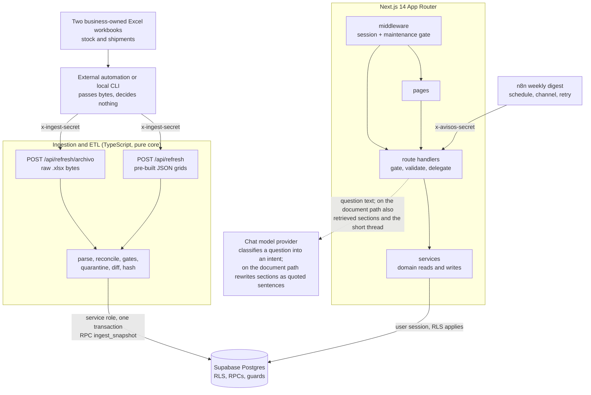

# Logistics SLA Analytics

A web portal that gives key-account managers (KAMs) one current view of stock per warehouse, inbound shipments and customs status, reservations, quotation projects and change notices. It is fed by the two Excel workbooks the business already maintains.

> **Portfolio sample.** The interface is in Spanish (es-MX) because that is the real product; the documentation is in English, and the [glossary](#glossary) maps the Spanish terms you will meet in the UI and the code. The code is a sanitized copy of a production system and every piece of data in it is synthetic: see [Provenance](#provenance). The visible product name lives in one constant in the app, `src/config/producto.ts`; the sample n8n workflow (`n8n/boletin-semanal.json`) cannot import code, repeats the name in its sender and is edited separately.

## What problem it solves

In the operation this system comes from, stock per warehouse lived in one Excel workbook and inbound shipments and customs status in another. Both keep changing as the business edits them, and KAMs need per-SKU answers from them: how many pieces are really available, how many are reserved for which customer, and when more arrives. The portal does not replace the workbooks. It ingests them as immutable, hashed snapshots, derives what changed between two loads, and serves the result to a role-aware web app.

It covers:

- **Inventory**: stock per warehouse, `available = total - reserved`, and over-reserved SKUs (available below zero) flagged.
- **Shipments and customs**: an eleven-stage status pipeline per SKU and a ledger with history.
- **Reservations**: per KAM, customer, date and reason, de-pivoted from the Excel matrix into rows that SQL can aggregate.
- **Projects and documents**: per-user quotation projects with line items, exported as PDF or XLSX.
- **Notices**: a bell in the UI and a weekly email digest, delivered by an n8n workflow.
- **Assistant**: a chat that routes each question to a closed catalogue of intents and answers with data read under the user's own session; an optional document corpus can back it.

## Architecture

Three decoupled layers. The ingestion trigger is a replaceable detail: end users never read the spreadsheets, they read the database through the API.



Evidence: ingestion doors in `src/app/api/refresh/archivo/route.ts` and `src/app/api/refresh/route.ts`; engine in `src/services/etl/runEtl.ts`; atomic write in `src/services/etl/persist.ts` (RPC `ingest_snapshot`, `supabase/migrations/0036_cat_b1_tecnologia_y_producto.sql`); middleware in `src/middleware.ts`; digest endpoint in `src/app/api/avisos/envios/route.ts`; assistant in `src/app/api/chat/route.ts`.

- **Ingestion and ETL**: pure TypeScript parsers behind two HTTP doors; one atomic RPC writes the snapshot.
- **Domain and data**: Supabase Postgres with row-level security on every table. The schema exists only as numbered migrations in `supabase/migrations/` (42 files, `0001` to `0044`; `0016` and `0021` are intentionally absent): no ORM, no generated schema file.
- **Frontend and API**: Next.js 14 App Router. Route handlers are thin (gate, validate, delegate, map errors); domain reads and writes live in `src/services/*.service.ts`, and components do not import services.

More: [docs/architecture.md](docs/architecture.md) (layers, source layout, design principles, deployment model) and [docs/data-model.md](docs/data-model.md) (tables, RPCs, invariants).

## Stack

Versions are the ones declared in `package.json`.

| Concern | Choice |
|---|---|
| Framework | Next.js `14.2.35` (App Router), React `^18`, TypeScript `^5` in strict mode |
| UI | Tailwind CSS `^3.4.1`; shadcn/ui (`components.json`) on Radix UI primitives; `lucide-react` `^1.20.0`; `sonner` `^2.0.7`; `next-themes` `^0.4.6`; IBM Plex through `next/font/google` |
| Data | Supabase: Postgres 15 (per the header of `supabase/migrations/0001_schema.sql`), Auth and Storage; `@supabase/supabase-js` `^2.108.2` and `@supabase/ssr` `^0.12.0`; `pgvector` for one optional column |
| Validation | `zod` `^4.4.3` for API bodies, the ingestion contract and the server environment |
| Spreadsheets | `xlsx` `0.18.5`, which reads the workbooks and writes the XLSX documents (see ING-1 under [Known limitations](#known-limitations)) |
| Documents | `pdfkit` `^0.19.1` for PDF output, `pdfjs-dist` `^6.3.289` for the in-browser PDF preview |
| Tests | Vitest `^4.1.9` on jsdom `^29.1.1`, Testing Library (`@testing-library/react` `^16.3.2`), Playwright `^1.62.1` for one layout instrument |
| Lint | ESLint `^8` with `eslint-config-next` `14.2.35` |
| Automation | An example n8n workflow, `n8n/boletin-semanal.json` |
| Assistant | A provider-agnostic chat client, OpenAI or DeepSeek chosen by environment (`src/lib/chat/proveedor.ts`) |
| Runtime and CI | Node 24 (`.nvmrc`); GitHub Actions (`.github/workflows/ci.yml`) |

## Features

Fifteen `page.tsx` files live under `src/app`:

| Route | Screen | What it does |
|---|---|---|
| `/` | Dashboard | KPIs, a brand-by-warehouse heat map, a per-brand radar, rankings, a summarized customs pipeline, trend and alert links |
| `/catalogo`, `/catalogo/[sku]` | Catálogo, ficha | Browse and filter the catalogue; the SKU sheet shows stock per warehouse, reservations, the shipment timeline, the image and the editable family, description and technology layers |
| `/embarques` | Embarques | The active shipment pipeline by stage, with inventory next to it for the same SKU |
| `/embarques/historico` | Histórico de embarques | A ledger of every shipment in the current customs snapshot, active and historical |
| `/snapshots`, `/snapshots/[id]` | Snapshots | The log of every ingestion and the change feed each one produced |
| `/proyectos`, `/proyectos/[id]` | Proyectos | Per-user quotation projects with line items (partidas); PDF preview and export as PDF or XLSX |
| `/carga` | Carga de imágenes | Admin upload of product images by SKU |
| `/config` | Configuración | Preferences and help for everyone; admins also get users and roles, families, brands and the pending-data inbox |
| `/login`, `/mantenimiento` | Login, maintenance | Outside the app shell. Maintenance mode is switched on with `MANTENIMIENTO=1`; admins are exempt |
| `/control-estados`, `/control-layout` | Instrument pages | Used only by the layout check; they answer 404 unless `LAYOUT_CHECK=1` |

Behind the screens there are 39 `route.ts` files under `src/app/api/`. Most reply through one error shape and one code-to-status map (`src/lib/api/errors.ts`); the JSON ingestion door answers most of its errors with its own short shapes (`src/app/api/refresh/route.ts`).

**Notices and the weekly digest.** Notices are derived from the change feed (status, reserved, availability and arrival signals) instead of from a second diff, so the bell and the email share one derivation (`src/lib/avisos.ts`). The email endpoint (`/api/avisos/envios`, header `x-avisos-secret`) is consumed by `n8n/boletin-semanal.json`. n8n owns the calendar, the channel, the retry and the delivery receipt, and decides nothing (`n8n/README.md`). The workflow is imported inactive, and `n8n/workflows.test.ts` rejects any export that carries a secret-shaped value.

**Documents.** Project documents are generated on the server: `pdfkit` for PDF, with the standard PDF fonts so that no font binary is stored in the repository, and SheetJS for XLSX (`src/services/documento/pdf.ts`, `src/services/documento/xlsx.ts`, route `src/app/api/proyectos/[id]/documento/route.ts`).

**Assistant and corpus (optional).** The chat bubble (`src/components/chat/burbuja-chat.tsx`) posts to `/api/chat`. The model never writes SQL and never touches the database. On the routed path it only classifies the question into a closed catalogue of intents (`src/lib/chat/intenciones.ts`); anything outside it gets an explicit "I don't know" that lists what the assistant can do, and the factual answer comes from the same services the screens use, under the user's session, so RLS applies. For a question about the documentation corpus the model instead rewrites the retrieved sections into short quoted sentences, and a guard rejects the whole answer if any datum is not inside its own quotation (`src/lib/chat/redactor.ts`, `src/lib/chat/verificar-redaccion.ts`). A usage cap is charged before the model is called. Configuration: `CHAT_PROVEEDOR` (`openai` or `deepseek`), then `OPENAI_API_KEY` with `OPENAI_MODELO`, or `DEEPSEEK_API_KEY` with `DEEPSEEK_MODELO`. Left unset, only the chat answers `config_error` (`.env.example`).

The document corpus is optional and this repository ships none. `scripts/corpus-sync.mjs` indexes the Markdown files of a local folder (`--raiz=<folder>`, default `./corpus-ejemplo`, git-ignored; only the subfolders listed in `EN_ALCANCE` inside the script are read) through the `FuenteCorpus` interface (`src/lib/corpus/fuente.ts`): manifest, diff, a secret detector that stops the whole batch, chunking, embedding, write. `--simular` is a dry run that embeds and writes nothing; `--sin-embeddings` skips embedding. It needs `NEXT_PUBLIC_SUPABASE_URL` and `SUPABASE_SERVICE_ROLE_KEY` in every mode, plus `OPENAI_API_KEY` when it embeds (`OPENAI_MODELO_EMBEDDING`, 1536 dimensions, per `.env.example`). Search is lexical (Postgres full text) and does not use the embedding column (`docs/architecture.md`).

## Screenshots

There are no screenshots: screenshots need a database with data; this repository ships diagrams instead. They are Mermaid blocks, rendered by GitHub, in [docs/architecture.md](docs/architecture.md), [docs/data-model.md](docs/data-model.md), [docs/ingestion.md](docs/ingestion.md) and [docs/testing.md](docs/testing.md).

## Run it locally

You need Node 24 (the version in `.nvmrc`) and npm, and you should clone with git: `npm ci` runs `postinstall` (copies the PDF worker into `public/`) and `prepare` (points `core.hooksPath` at `.githooks`, whose pre-commit hook runs `tsc --noEmit`).

### Route A: no database

```bash
npm ci
cp .env.example .env.local      # Windows cmd: copy .env.example .env.local
npm run build
npm start
```

Open `http://localhost:3000`. With no database behind it, every app page redirects to the login screen, which renders. That is as far as this route goes: signing in and every screen after it need Supabase (route B). `.env.example` holds placeholders with no key shape. `npm run build` needs internet access, because the fonts are downloaded at build time by `next/font/google` (`src/app/layout.tsx`).

### Route B: the full stack, local

This route needs Docker and the Supabase CLI. It is assembled from the repository's own script headers and from `supabase/README.md`; it has not been recorded from an end-to-end run. Run `npm ci` first if you have not.

1. Start a local Supabase stack and apply the migrations:

   ```bash
   supabase init          # once: creates the CLI's local project config (not versioned in this repository)
   supabase start
   supabase db reset      # applies supabase/migrations/ in numeric order, 0001 to 0044
   supabase status        # prints the API URL and the keys
   ```

2. Copy `.env.example` to `.env.local` if you have not. Set `NEXT_PUBLIC_SUPABASE_URL`, `NEXT_PUBLIC_SUPABASE_ANON_KEY` and `SUPABASE_SERVICE_ROLE_KEY` from what the CLI printed, and `INGEST_SECRET` to any string of 16 or more characters.

3. Create the first administrator:

   ```bash
   node scripts/bootstrap-admin.mjs
   ```

   The script reads `NEXT_PUBLIC_SUPABASE_URL` and `SUPABASE_SERVICE_ROLE_KEY` from the process environment or, failing that, from `.env.local`. It creates the founder account (its address is the `EMAIL_ADMIN_FUNDADOR` constant at the top of the script, an `example.com` address in this copy), sets its role to `admin`, and prints the email and a temporary password once. It writes to whatever database those variables point at, so use it on the local stack only.

4. Generate the sample data, synthetic and from a fixed seed, into the git-ignored `muestra/` folder:

   ```bash
   npm run datos:muestra
   ```

   It also regenerates the versioned JSON fixtures under `src/`; because the seed is fixed they come out identical. `node scripts/generar-datos-muestra.mjs --solo-libros` writes only the workbooks and `--verificar` only compares.

5. Start the app:

   ```bash
   npm run dev
   ```

6. From a second terminal, load the sample workbooks. The stock workbook is `muestra/inventario-unificado.xlsx` and the shipments workbook is `muestra/seguimiento-embarques.xlsx`:

   ```bash
   # preview: the real parsers, no network, no database
   node scripts/ingesta-mensual.mjs --dry --stock muestra/inventario-unificado.xlsx --aduana muestra/seguimiento-embarques.xlsx

   # post: stock first, then shipments
   node scripts/ingesta-mensual.mjs --aplicar --stock muestra/inventario-unificado.xlsx --aduana muestra/seguimiento-embarques.xlsx
   ```

   `--aplicar` posts to `http://localhost:3000/api/refresh` (change it with `--base-url`), reads `INGEST_SECRET` from the environment or `.env.local`, and needs Node 23.6 or newer. If the stock post fails it does not post shipments. The other way in is door A, raw bytes over HTTP; send stock first, then repeat the call with `source=aduana` and the shipments workbook:

   ```bash
   curl -X POST "http://localhost:3000/api/refresh/archivo?source=stock" \
     -H "x-ingest-secret: <your INGEST_SECRET>" \
     --data-binary @muestra/inventario-unificado.xlsx
   ```

   There is no screen for loading workbooks: `/carga` uploads product images. Re-sending identical content is a no-op.

7. Open `http://localhost:3000/login` and sign in with the account from step 3. Use `localhost` and not `127.0.0.1`: the same-origin check on writes only knows `localhost` unless you set `NEXT_PUBLIC_SITE_URL` (`src/lib/api/origin.ts`).

The assistant, the digest and the corpus indexer are optional and need their own variables (see [Features](#features) and `.env.example`). The live RLS batteries (`scripts/rls-negativas.mjs`, `scripts/rls-negativas-proyectos.mjs`, `scripts/seguimientos-negativas.mjs`, `scripts/chat-negativas.mjs`, `scripts/correo-negativas.mjs`) attack that local stack with throwaway accounts and are outside `npm test`: run them one at a time, and never against a hosted project ([docs/testing.md](docs/testing.md)). The offline sections of `scripts/rls-negativas.test.ts` do run under `npm test` and in CI; its live block ("batería EN VIVO") runs only when the Supabase variables are in `.env.local` **and** `RLS_EN_VIVO=1` is set.

## Testing

```bash
npm test                 # vitest run: the whole automated suite on jsdom, no database needed
npx tsc --noEmit         # type check
npm run lint             # next lint
npm run build            # production build (needs .env.local, see route A)
npm run verificar        # tsc --noEmit, then vitest run, then next build
```

`.github/workflows/ci.yml` runs type check, lint, test and build on every push to `main` and every pull request, on the Node version in `.nvmrc`, with `.env.example` copied to `.env.local`: no real credential exists in CI. `npm test` needs no `.env.local` (`vitest.config.ts` injects fake credentials) and generates the sample workbooks into `muestra/` before collecting tests (`scripts/datos-muestra/global-setup.mjs`). `tsc` is a separate instrument on purpose: Vitest transpiles with esbuild and does not type-check.

Layers: pure unit tests, service tests with doubled Supabase clients, route-handler and middleware tests, contract tests, component tests, fixture-driven ETL tests, ratchets (tests that read the source and fail when a class of defect becomes writable again), tests of the migration tooling, document goldens, and an offline evaluation of the assistant. Outside `npm test`: the live RLS batteries above, the SQL negatives (`supabase/tests/rls_negative_tests.sql`) and the live block of `scripts/rls-negativas.test.ts`, which needs `RLS_EN_VIVO=1` as well as the Supabase variables. Optional: `npm run verificar:migraciones` (static check of the SQL migrations; the full sweep is red by design, with two accepted findings in already-applied migrations) and `npm run layout-check` (a headless-browser layout check that builds the app, needs a Playwright Chromium, a running Supabase stack with ingested data and an existing admin account in `PARCHE_ADMIN_EMAIL` and `PARCHE_ADMIN_PASSWORD`). Details: [docs/testing.md](docs/testing.md).

## Security model

The design position is that the database is the last line of defence; the application checks permissions for good errors and early rejection. Full model: [docs/security.md](docs/security.md).

- **RLS on every table**, column-level grants and hardened `SECURITY DEFINER` functions; the admin RPCs re-check `is_admin()` inside their bodies (`supabase/migrations/0002_rls.sql`, `supabase/migrations/0012_b7b_hardening.sql`).
- **Four roles on two independent axes.** Shared data (catalogue, classification, families, brands, users): only `admin` writes. Own data (projects, follows, notification preferences): the rule is ownership, not role, and the one role exception is `visitante`, which cannot create projects (RLS) and cannot edit them through the API (route gate in `src/lib/api/auth.ts`). `soporte` is a twin of `kam` on both axes (`src/lib/roles.ts`).
- **Fail closed.** A mutating request without an allowlisted `Origin` is a 403 (`src/lib/api/origin.ts`), write permissions are whitelists rather than blacklists (`supabase/migrations/0042_rolsoporte_lista_blanca_de_escritura.sql`), and the middleware treats an unreadable role as "not admin" (`src/middleware.ts`).
- **The service role is confined.** One server-only factory, used by a small enumerated set of route handlers: ingestion, mailing, user administration and one ledger read (`docs/security.md`, section 6, lists them). Everything else, the assistant included, runs under the user's session (`src/lib/supabase/server.ts`, `src/lib/supabase/session.ts`).
- **Machine routes have their own secrets.** `x-ingest-secret` and `x-avisos-secret`, at least 16 characters, compared as SHA-256 digests in constant time (`src/lib/api/ingest-auth.ts`). The mailing endpoint reads everyone's notices, so it accepts the header only and never a session.
- **Negative tests that bypass the app.** SQL negatives plus live harnesses with real sessions that assert by effect (the row is unchanged), because under RLS a denied `SELECT`, `UPDATE` or `DELETE` answers `200 []` (`scripts/rls-negativas.mjs`, header).

## Data flow

Two doors, one engine: door A takes the raw `.xlsx` (`POST /api/refresh/archivo?source=stock` or `source=aduana`), door B takes JSON grids that the local CLI `scripts/ingesta-mensual.mjs` builds (`POST /api/refresh`). Both send the `x-ingest-secret` header and share everything after "workbook to grids".

1. The route rejects early: invalid server configuration, a wrong secret, a body over 15 MB, bytes that are not a ZIP-based workbook, a workbook that declares more than 2,000,000 cells, or a `source` that is not `stock` or `aduana`.
2. Sheets are mapped to datasets by configuration, not by code (`src/config/ingesta-mapeo.ts`). A renamed required sheet fails loudly instead of producing an empty snapshot.
3. The core of the ETL is pure (`computeSnapshot` in `src/services/etl/runEtl.ts`; `runEtl` wraps it with the catalogue and previous-state reads and the atomic write): it finds each header row by content, reconciles the second warehouse with the inventory, normalizes brands, families, warehouses, KAMs and statuses through alias tables, applies the gates (mismatched sums are kept and reported; rows whose SKU is unknown go to quarantine), diffs against the previous state and hashes the canonical row set with SHA-256.
4. The same hash as the previous snapshot writes nothing and answers `sinCambios`. If the incoming row universe falls below half of the previous one, the run is refused with 409 `universo_reducido` unless it is forced with three headers that record a reason and an identity.
5. Otherwise one transaction, the RPC `ingest_snapshot` (executable by `service_role` only), writes the snapshot, stock, reservations, shipments and the change feed. Any failure rolls everything back.
6. The change feed then drives the dashboard, the bell and the weekly digest. Stock must be posted before shipments, because shipments are checked against the products already in the database.

More: [docs/ingestion.md](docs/ingestion.md).

## Decisions

Nine architecture decision records, each with context, decision, consequences and evidence, indexed in [docs/decisions/](docs/decisions/README.md). If you read two, read the first two.

| # | Decision |
|---|---|
| [0001](docs/decisions/0001-rls-roles-and-column-allowlists.md) | RLS, fail-closed roles, column allowlists |
| [0002](docs/decisions/0002-immutable-snapshots-idempotent-by-hash.md) | Immutable snapshots, idempotent by hash |
| [0003](docs/decisions/0003-empty-and-degraded-input-guards.md) | Empty and degraded input guards |
| [0004](docs/decisions/0004-http-upload-door-and-external-scheduler.md) | HTTP upload door and external scheduler |
| [0005](docs/decisions/0005-migration-guards-and-replay.md) | Migration guards and replay |
| [0006](docs/decisions/0006-civil-timezone-period-derivation.md) | Civil-time-zone period derivation |
| [0007](docs/decisions/0007-privilege-guards-inside-functions.md) | Privilege guards inside functions |
| [0008](docs/decisions/0008-derive-family-taxonomy-at-read.md) | Taxonomy derived at read |
| [0009](docs/decisions/0009-grounded-assistant-persona-contract.md) | Grounded assistant |

## Known limitations

An honest list lives in [docs/known-limitations.md](docs/known-limitations.md), with a status and a file for every entry. The ones that matter most:

- **Spreadsheet parser with known advisories (ING-1, accepted).** `package.json` pins `xlsx` `0.18.5`, and the fixed releases are not published on the public registry. Barriers: the shared secret, the size cap, the ZIP-signature check and the cell budget. The risk is accepted because only the holder of `INGEST_SECRET` can reach the parser, and that holder can already overwrite the catalogue. This repository makes no claim of a clean `npm audit`.
- **No Content-Security-Policy (B7B-1, open)**, and the session cookie is not `httpOnly` because `@supabase/ssr` must expose it to the browser (B7B-6, accepted).
- **Snapshots record results, not attempts (B10-3, open).** "Nothing changed" and "the automation never ran" leave the same trace, so the silent-source alarm is ambiguous.
- **User-originated data has no backup (B8-10, open).** Projects, follows and preferences cannot be rebuilt by re-ingesting the workbooks.
- **Reads are derived in memory over the current snapshot (B3-4 and B7A-1, accepted and bounded)**: deliberate for a small audience, with a stated trigger for moving filtering and paging into SQL.

## Glossary

The interface and part of the code are in Spanish. Table and column names are Spanish because the product is.

| Spanish | English | Where you will see it |
|---|---|---|
| inventario | inventory, stock | the `inventario` dataset and sheet; `src/services/inventory.service.ts` |
| almacén (also bodega) | warehouse | table `almacenes`; keys `NORTH`, `SOUTH`, `EAST`, `TRAN`, `BO`, `WEST` (`src/types/enums.ts`) |
| embarque, estatus | inbound shipment, and its status (an eleven-stage pipeline) | `/embarques`, tables `embarques`, `estatus_catalogo` and `estatus_alias` (`supabase/migrations/0004_estatus.sql`; `src/lib/estatus.ts` is the separate availability taxonomy of the catalogue); "cruce" is the code name of the `/embarques` screen (`src/lib/nav-nombres.ts`) |
| aduana | customs; also the name of the shipments source | snapshot source `aduana` |
| reserva, reservado, disponible | reservation, reserved, available (total minus reserved) | table `reservas`, `src/services/derivaciones.ts`; "sobre-reservado" is over-reserved (available below zero) |
| ficha | SKU detail sheet | `/catalogo/[sku]`, `src/components/ficha/` |
| familia | product family: a multi-valued field, `/` as separator | table `familias`, `src/lib/familias.ts` |
| tecnología | technology, a product attribute | table `tecnologias` |
| marca | brand | tables `marcas`, `marca_alias` |
| proyecto, partida | quotation project, line item | `/proyectos`, table `proyecto_partidas` |
| pendientes, bandeja | pending items, and the inbox that holds them | "Pendientes" tab of `/config`, table `pendientes_datos`, `src/components/pendientes/bandeja-view.tsx` |
| campana, aviso, boletín | notification bell, notice (alert), weekly digest | `src/components/campana/`, `src/lib/avisos.ts`, `n8n/boletin-semanal.json` |
| seguimiento | follow: a SKU a user watches, with the alerts they want | table `seguimientos` |
| snapshot, corte | snapshot; "cut": the current snapshot a figure was measured on | table `snapshots`; "corte vigente" in `src/lib/chat/tarjeta.ts` |
| cambios (ALTA, BAJA, MODIFICACION) | the change feed (add, remove, modify) | table `cambios` |
| cuarentena | quarantine: rows read but not accepted, returned with a reason | the ETL result |
| ingesta, carga | ingestion (loading the workbooks); upload | `src/services/ingesta/`; in the UI `/carga` uploads product images |
| KAM | key-account manager | table `kams` |

## More documentation

[docs/engineering/failure-patterns.md](docs/engineering/failure-patterns.md) catalogues the failure classes cited in code comments as `P1`, `P2` and so on. [n8n/README.md](n8n/README.md) explains the workflow example and [supabase/README.md](supabase/README.md) the migrations.

## Provenance

This is a sanitized copy of a production system I built. The git history is new and all data in the repository is synthetic: the sample workbooks and test fixtures come from a seeded generator (`scripts/generar-datos-muestra.mjs`) and the seed migrations load example catalogues. It was built with AI coding assistants under a documented process, described in [docs/ai-assisted-workflow.md](docs/ai-assisted-workflow.md).

## License

Portfolio sample — all rights reserved.
