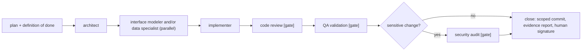

# AI-assisted workflow

This system was built with AI coding assistants working under a deliberate process. This page describes that process in general terms: the roles, the gates between steps, how a block of work iterates, how results are verified, and how several streams of work share one source tree without breaking each other. It describes a method, not a product, and it makes no claim about speed or productivity.

The reason to write it down is that the assistant is fast and agreeable, and the failure modes of fast, agreeable work are specific: a green test that watches nothing, a confident number nobody measured, a fix that moves a problem. Most of what follows exists to make those failures expensive to commit and cheap to notice. The failure classes are catalogued in [`engineering/failure-patterns.md`](engineering/failure-patterns.md); the test harness that embodies the detectors is in [`testing.md`](testing.md).

## 1. The idea

Work was done in **blocks**. A block has a stated definition of done, is driven by one coordinating agent that **plans, delegates, audits at gates and closes, but does not implement**, and ends with one human signature. The coordinating agent delegates to **role agents**: prompts with a restricted toolset and a model tier chosen per role (a heavier model for design, data and review; a lighter one for implementation and routine QA). The roles were plain prompts; nothing about them is shipped or required to build or run the system.

A human owner decides what is built and gives one sign-off per block. Anything that touches visibility outside the working copy (publishing, deploying, pushing) needs explicit confirmation each time; none of it is implied by a previous yes.

## 2. Roles

| Role | Responsibility | What it must not do |
|---|---|---|
| Architect | Designs the module structure before any code; defines contracts (types, schemas, API shapes, props) and the order of files (infrastructure, domain, interface); classifies risk and guards invariants | Write production code; approve without reading the files |
| Interface modeler | Fidelity to the approved design and design system (tokens, component kit, loading, empty, error and no-permission states, responsive layout, accessibility) | Write business logic; ship a component with missing states |
| Data specialist | Schema, migrations, row-level security and the ETL (tolerant parsing, alias normalization, reconciliation between sources, idempotent snapshots); integrity gates (sums must match, orphans go to quarantine, never deleted) | Resolve a data question by guessing; trust a displayed value over the source sheet |
| Implementer | Writes the code one concept at a time with a green build after every step; strict types, validation at boundaries, no secrets in code, domain logic in services | Redesign or change a contract (the doubt goes back to the architect); keep going after repeated failed attempts |
| Code reviewer | Audits quality and architecture with the stance "assume there are problems, find them"; returns precise file and line instructions with severities | Fix what it finds |
| QA validator | Verifies real behaviour, because green tests are not a working runtime: clean build, tests, runtime where applicable, regression, data integrity | Approve with warnings; skip running the build itself |
| Security auditor | Mandatory when a block touches schema or row-level security, login and roles, or ingestion and edit endpoints; verifies with **negative** tests and literal output | Approve without literal evidence; accept a privileged key reachable from the client |

The invariants the architect guards are the domain's own, for example: a SKU is immutable; total stock equals the sum over warehouses; available equals total minus reserved; edits are traceable (see [`data-model.md`](data-model.md) and [ADR 0002](decisions/0002-immutable-snapshots-idempotent-by-hash.md)).

## 3. The loop and its gates

The gates are non-negotiable:

- **Evidence or no advance.** Each step delivers evidence: a green build, test output, a diff, a literal command output. A claim without the output that produced it does not pass.
- **Stop and ask** on structural decisions: a schema or contract change, a new dependency, moving logic from one layer to another, anything irreversible. The pause is cheap; the measured experience of the project is that the stops found real problems (an irreversible name, a silently deleted navigation item, two errors in a specification) rather than being ceremony.
- **Tests first when a change touches a contract** (schema, API, ETL).
- **Short reports** from role agents (a few lines) to protect the coordinator's context.
- **Three strikes.** A point that fails three times stops and reports a diagnosis instead of trying a fourth variation.
- **One signature per block;** no push and no deployment without explicit confirmation.

## 4. Iteration and verification

What the failure catalogue added to the loop:

1. **Name the patterns before designing.** Each block reads the catalogue, lists which failure classes apply and which detector will be installed for each, and on closing adds its own case (or opens a new class with its detector). A pattern is never deleted: the value is in the disguise, not in the bug.
2. **Verify by the reason, not by the value.** A check can give the right result for the wrong reason. When a sabotage turns a test red, check which assertion fell.
3. **Every guard gets a vacuity proof.** A guard is not believed until it has been seen failing: a deliberately built state that turns it red, versioned next to it, and where possible a mutation of the code that must break it. Pair every "this must not happen" with a "this must still work" ([ADR 0005](decisions/0005-migration-guards-and-replay.md)).
4. **The author does not verify.** Whoever builds a change does not sign its verification. Run the checks and read the exit code **before** committing, never after.
5. **Naming a defect is not closing it.** A finding written in a document is a confession, not a fix; it is closed by a change plus a detector that would catch its return. The project's own example: a red test run lost its identity because re-running was the only way to see it again, so the runner was changed to write one result file per run (`vitest.config.ts`, `scripts/ultimo-rojo.mjs`).
6. **Cheap check per commit, full check per block.** The pre-commit hook runs only the fast type check (`.githooks/pre-commit`); the full triple of type check, tests and build runs at block close (`npm run verificar` in `package.json`). A hook that takes minutes is a hook somebody disables.
7. **Adversarial audit rounds at the end of a block,** by independent lenses (security, correctness, "what does this do on an empty input"). One round per gate; another only if the first found something.
8. **Evidence beats assertion.** "Measured" requires the query or command that produced the number. A figure that was not measured is removed, and the finding stands without it.
9. **Limit what an automated harness may destroy.** A QA harness once deleted far more accounts than intended because it asked the server which ones were disposable through a filter the server ignored. The rule that came out of it: delete only by the identity you created, count before and after, cap the blast radius, report exact identifiers on failure. The main RLS harness encodes all of it (header and code of `scripts/rls-negativas.mjs`); the other live-database harnesses only delete the exact ids they created (see [`testing.md`](testing.md#negative-rls-tests)).

## 5. Parallel fronts and shared tree

Several fronts (streams of work) sometimes ran at once against one source tree. What is safe, and what destroys, was learned in layers, each discovered after solving the previous one.

| Shared resource | Failure | Countermeasure |
|---|---|---|
| Build output folder (`.next/`) | `tsc` and the test runner can run in parallel, but `next build` cannot: two simultaneous builds do not slow down, they corrupt each other, and a build under a live server breaks its pages | One build directory per front: `distDir: process.env.NEXT_DIST_DIR ?? '.next'` in `next.config.mjs` (production unchanged), `/.next-*/` ignored in `.gitignore`. Child processes inherit the variable, so scripts that spawn `next build` need no change. It isolates output, not input, and does not stop a front rebuilding its own folder under its own running server |
| `tsconfig.json` | `next build` rewrites its `include` when a build directory is not declared, turning the file into the next contested resource | Pre-declare every build directory's type folder in `include` before its first build (`tsconfig.json`) |
| The source tree | A half-written file in another front's territory fails **your** verification | A red outside your own territory is reported, not fixed; you never conclude anything about your own work from someone else's red. The real fix is one `git worktree` per front, triggered by the second time a front is blocked by a foreign red (never force-remove a worktree that contains junctions or symlinks; unlink them first) |
| The database | It cannot be partitioned: live harnesses count auth users before and after, so two at once corrupt each other | Agreement only: do not run live harnesses concurrently |
| The machine | Memory cannot be partitioned or serialized; it shows first as slowness, not as red | Measure free memory before a build or a fan-out of agents. A "background task died" notice measures the wrapper, not the process: check the result instead |
| Shared documents | One front's lines inside another's file | Commit shared documents immediately; one named writer per turn |
| Migration numbers | Two terminals creating the same number do not collide in git, they collide in the database later | The number asserts an application order: reserve it with the coordinator before writing the file ([ADR 0005](decisions/0005-migration-guards-and-replay.md)) |
| Ownership | An unassigned file is not neutral territory, it is territory everybody touches | Each front owns directory globs; any shared directory (libraries, types, UI kit, layout, global CSS, config, migrations, package manifest, hooks, docs) is nobody's, and touching it is a stop-and-ask named in the report header |

Git rules that cost real incidents:

- Stage by file, never with `-A`; the commit takes the **index**, so check it. A pathspec does not protect a *new* file and does not isolate a *shared* file.
- Serialize commits: the hook runs the type check, and two at once fight for the index lock.
- Use a commit prefix per front; never push and never skip hooks.
- **Never raise a hook or test timeout to make something pass.** The cap is information about the environment, and a margin spent on the network is a margin the code no longer has. Wait and retry; do not commit on red, even if the red is measured and not yours.

What parallelism does not change: it multiplies fronts, it does not speed up any one of them. Pause per test and per document; put a positive control on every gate; run verification and read the exit code before committing.

## 6. What this page does not claim

- It does not claim the process is optimal, only that each rule above exists because skipping it once cost something, and that the rule has a mechanism wherever one was possible. A rule that exists only on paper (a hook that was documented for many blocks before it was written) is itself a failure class.
- It does not ship the role prompts. They were instructions to an assistant, not part of the product.
- The numbers it deliberately omits (counts of tests, rows, durations) were measured on a production system and are not reproduced here; the method stands without them.
