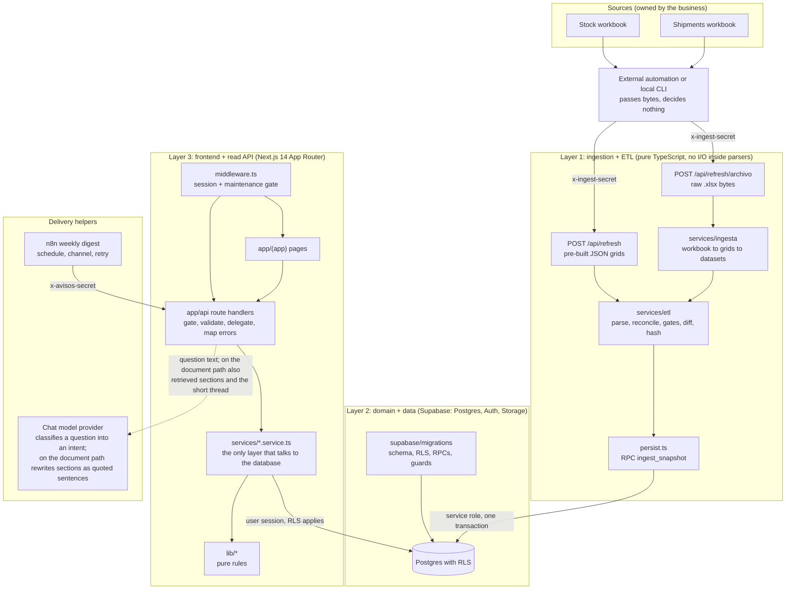

# Architecture

This document explains how Logistics SLA Analytics is put together: the layers, the stack, the rules that keep the layers apart, and the design principles that shaped the code. It is written for a reader who has not seen the system. Every technical statement points at the file that backs it.

The system is an internal web portal. It gives key-account managers (KAMs) near-real-time visibility of stock per warehouse and customs/shipment status per SKU. It is fed by two Excel workbooks that the business keeps editing. The portal never replaces the workbooks. It ingests them.

Related documents: [data-model.md](data-model.md), [security.md](security.md), [ingestion.md](ingestion.md), [testing.md](testing.md), [known-limitations.md](known-limitations.md) and the decision records under [decisions/README.md](decisions/README.md).

## 1. Shape of the system

Three decoupled layers. The ingestion trigger is a replaceable detail: end users never read the spreadsheets directly, they read the database through the API.

Evidence: layer 1 entry points in `src/app/api/refresh/archivo/route.ts` and `src/app/api/refresh/route.ts`; engine in `src/services/ingesta/motor.ts`; ETL orchestrator in `src/services/etl/runEtl.ts`; atomic write in `src/services/etl/persist.ts` (RPC `ingest_snapshot`, SQL in `supabase/migrations/0036_cat_b1_tecnologia_y_producto.sql`); middleware in `src/middleware.ts`; the digest consumer in `src/app/api/avisos/envios/route.ts` and `n8n/README.md`.

The decision to keep the ingestion adapter pluggable is recorded in [decisions/0004-http-upload-door-and-external-scheduler.md](decisions/0004-http-upload-door-and-external-scheduler.md).

## 2. Stack

| Concern | Choice | Evidence |
|---|---|---|
| Web framework | Next.js 14.2 App Router, React 18, TypeScript | `package.json` |
| UI | Tailwind 3, shadcn/ui on Radix primitives, lucide-react, sonner toasts, next-themes | `package.json`, `components.json`, `tailwind.config.ts` |
| Data | Supabase: Postgres 15, Auth, Storage, PostgREST; `pgvector` for one optional column | `supabase/migrations/0001_schema.sql` (header says PG 15), `supabase/migrations/0030_b11_corpus.sql` |
| Validation | zod 4: API bodies, ingestion contract, server environment | `package.json`, `src/schemas/`, `src/lib/env.ts` |
| Excel read | SheetJS `xlsx` 0.18.5, used only in a server route or CLI | `package.json`, `src/services/ingesta/io.ts` |
| Documents out | `pdfkit` for PDF, SheetJS for XLSX, `pdfjs-dist` for the in-browser PDF preview of project documents | `package.json`, `src/services/documento/pdf.ts`, `src/services/documento/xlsx.ts`, `src/components/proyectos/proyecto-documento-previa.tsx` |
| Tests | Vitest 4 on jsdom, Testing Library, Playwright for one layout instrument | `package.json`, `vitest.config.ts`, `scripts/layout-check.mjs` |
| Mail automation | n8n workflow that calls a secret-gated endpoint | `n8n/README.md`, `n8n/boletin-semanal.json`, `src/app/api/avisos/envios/route.ts` |
| Assistant | Provider-agnostic chat client chosen by environment | `src/lib/chat/proveedor.ts`, `src/lib/env.ts` |
| Hosting | Serverless route handlers on a managed host, one managed Postgres project | `src/app/api/refresh/route.ts` (`maxDuration` 60 s), `next.config.mjs` |
| CI | Type check, lint, test and build on every push and pull request | `.github/workflows/ci.yml` |

## 3. Source layout and the layer rule

| Path | Role | Rule |
|---|---|---|
| `src/lib/**` | Pure rules and helpers, plus the HTTP, auth and client-construction plumbing the other layers share | The domain files at the top level hold no I/O: `src/lib/avisos.ts` (what to notify to whom), `src/lib/correo.ts` (who gets an email), `src/lib/estatus.ts` (status taxonomy and precedence), `src/lib/familias.ts` (multi-value family parsing), `src/lib/fechas.ts` (civil-date derivations), `src/lib/roles.ts` (role capability maps). Some sub-folders do touch I/O, as listed below this table |
| `src/services/**` | Domain reads and writes | The only layer that talks to the database. Pure derivations live next to it in `src/services/derivaciones.ts` |
| `src/app/api/**/route.ts` | Thin HTTP handlers | Gate (auth or origin), validate (zod), delegate to a service, map errors through `src/lib/api/errors.ts` |
| `src/components/**` | UI | Components do not import services. `src/lib/estatus.ts` records `app -> services` as the only allowed edge |
| `src/config/ingesta-mapeo.ts` | Data-driven sheet and header mapping | The operational contract to edit when the workbook owners rename a sheet or a column. The engine and the parsers stay untouched |
| `src/config/producto.ts` | The visible product name | One constant, the only place the name lives in the app; the sample n8n workflow (`n8n/boletin-semanal.json`) cannot import code, so it repeats the name in its sender and is edited separately |
| `supabase/migrations/*.sql` | The schema, only by migrations | 42 files numbered `0001` to `0044`, gaps at `0016` and `0021`; no ORM, no generated schema file |
| `supabase/tests/rls_negative_tests.sql` | SQL negative RLS tests N1 to N8 | Run on a local Postgres/Supabase |
| `scripts/*.mjs` | Operational CLIs and gates | Several touch live services and are not meant to be run against anything you do not own |

What `src/lib/**` really contains, by part:

- **`src/lib/supabase/` builds the database clients; it does not hold domain queries.** `browser.ts` (anonymous key, for the browser), `server.ts` (service role, `server-only`, bypasses RLS) and `session.ts` (the signed-in user's cookies, so RLS applies) each construct a client. `reintento.ts` wraps the `fetch` of the last two with a bounded retry of transient auth failures. `embed.ts`, `fetch-all.ts`, `ilike.ts` and `pg-errors.ts` are pure helpers over PostgREST results and error codes: pagination is driven by a callback that the caller supplies, so these files do not issue queries themselves.
- **`src/lib/api/` is the HTTP plumbing of the route handlers.** It imports `next/server` (`errors.ts`, `origin.ts`, `auth.ts`). `auth.ts` checks the session through `db.auth.getUser()`, and `perfil-rol.ts` holds the one query in `src/lib/` (`db.from('perfiles').select('rol')`) that both `auth.ts` and `src/middleware.ts` call, with the client passed in by the caller.
- **Outbound network calls exist in three files**, all to the optional model provider: `src/lib/chat/modelo-openai.ts`, `src/lib/chat/proveedor.ts` and `src/lib/corpus/embebedor-openai.ts`.
- **`src/lib/hooks/use-api.ts` is the one React file** (`"use client"`), a data-fetching hook for components. `src/lib/auth/actions.ts` is a Server Action (logout) that uses the session client. Configuration is read from `process.env` in `src/lib/env.ts` (validated with zod) and, for the allowed-origin list, in `src/lib/api/origin.ts`.
- The rest (`src/lib/chat/` routing and redaction, `src/lib/corpus/` chunking and manifest, `src/lib/marcas/`, `src/lib/layout-check/`, `src/lib/guardas/` and the files named in the table) is pure. Where a `src/lib` file mentions `src/services/`, it is a type or a domain error class, not a database call (for example `src/lib/clasificacion.ts`, `src/lib/api/avisos-error.ts`).

The rule "services are the only layer that talks to the database" therefore holds for domain reads and writes, with these named exceptions: the role lookup in `src/lib/api/perfil-rol.ts`, the profile read in `src/app/(app)/layout.tsx`, and the three `rpc` calls that record assistant usage in `src/app/api/chat/route.ts`.

There are 39 `route.ts` files under `src/app/api/`. Almost all reply through one error shape and one code-to-status map (`src/lib/api/errors.ts`, functions `apiError` and `internalError`). The exception is the JSON ingestion door, `src/app/api/refresh/route.ts`, which builds most of its error bodies by hand with its own short shapes (`contract_error` and `etl_failed` do not exist in the common code list); its sibling `src/app/api/refresh/archivo/route.ts` uses the common helpers, and so does the JSON door for the universe-collapse rejection. [ingestion.md](ingestion.md), section 6, tabulates both. `src/app/api/version/route.ts` has no error path. A contract test checks the list envelopes (`src/lib/hooks/contrato-de-lista.test.ts`).

## 4. What the product does

Pages (`src/app/(app)/`):

| Page | Purpose |
|---|---|
| `page.tsx` (dashboard) | KPIs, brand-by-warehouse heatmap, per-brand radar, rankings, summarized customs pipeline, trend and alert links (header of `src/services/dashboard.service.ts`) |
| `catalogo/` and `catalogo/[sku]/` | Catalog browsing; SKU detail with per-warehouse stock, reservations, shipment timeline, image and editable family, description and technology layers |
| `embarques/` and `embarques/historico/` | Shipments ledger, active and history |
| `snapshots/` and `snapshots/[id]/` | Ingestion log and the change feed of each snapshot |
| `proyectos/` and `proyectos/[id]/` | Per-user quotation projects with line items and PDF/XLSX export |
| `carga/` | Admin product-image upload |
| `config/` | Admin: users, catalogs, pending-data inbox, alias and merge tools |
| `control-estados/`, `control-layout/` | Instrument pages for the layout check, not product screens: served only when `LAYOUT_CHECK=1`, otherwise a 404 (headers of `src/app/(app)/control-estados/page.tsx` and `src/app/(app)/control-layout/page.tsx`) |

Outside the shell: `src/app/login/page.tsx` and `src/app/mantenimiento/page.tsx`.

API groups, all under `src/app/api/`: reads (`inventory`, `sku/[sku]`, `cruce`, `dashboard`, `embarques`, `snapshots`, `snapshots/[id]/cambios`, `campana`), admin edits (`override`, `color`, `imagenes`, `clasificacion`, `familias`, `familias/fusionar`, `marcas`, `tecnologias`, `pendientes`, `usuarios`), per-user data (`proyectos`, `seguimientos`, `preferencias`), the assistant (`chat`, `corpus/frescura`), ingestion (`refresh`, `refresh/archivo`), mailing (`avisos/envios`, `avisos/envios/confirmar`) and operations (`health`, `version`).

## 5. Cross-cutting design principles

1. **The SKU is the universe of interpretation.** `productos.sku` is the primary key that joins stock, shipments, reservations, overrides, metadata, projects and follows. A trigger makes it immutable. Evidence: `supabase/migrations/0001_schema.sql` (`productos_pkey`, trigger `before_update_sku` calling `protect_sku_immutable`).
2. **Every ingestion is an immutable, hashed snapshot, and the change feed is derived from it.** A unique hash makes re-ingesting identical content a no-op. Evidence: `supabase/migrations/0001_schema.sql` (`snapshots_hash_unique`), `src/services/etl/differ.ts`, `src/services/etl/hash.ts`. See [decisions/0002-immutable-snapshots-idempotent-by-hash.md](decisions/0002-immutable-snapshots-idempotent-by-hash.md).
3. **The source file is master for source-owned fields; the app layers edits on top and never over.** Overrides are versioned rows in `productos_override`. The effective value is the latest active override, otherwise the source value (`src/services/derivaciones.ts`). A technology can be edited only where the workbook left it empty (`supabase/migrations/0044_fixb1_tecnologia_editable_excel_gana.sql`).
4. **Pure domain core, impure edges.** Parsers, differ, gates, derivations, notification rules, email rules, status taxonomy and corpus chunking take values and return values, and are unit-tested without a database (`src/services/etl/*.ts`, `src/lib/*.ts`, `src/lib/corpus/*.ts`).
5. **One truth per business rule.** Each rule has one home: `src/lib/estatus.ts`, `src/lib/fechas.ts` (with the guard test `src/lib/una-sola-verdad-temporal.test.ts`), `tecnologias_seleccionables()` in SQL (`supabase/migrations/0044_fixb1_tecnologia_editable_excel_gana.sql`), and one secret-comparison primitive (`src/lib/api/ingest-auth.ts`).
6. **Errors are loud and distinguishable.** "Nothing arrived", "arrived and nothing changed" and "failed" must not look alike. Attempts are recorded when they start (`corpus_sync_intentos` in `supabase/migrations/0030_b11_corpus.sql`), ingestion has explicit status codes (`src/lib/api/errors.ts`), and the assistant has an explicit negative path (`src/services/corpus-consulta.service.ts`).
7. **Fail closed.** A mutating call without an allowlisted `Origin` is a 403 (`src/lib/api/origin.ts`). A role not named in a write whitelist has no permission (`supabase/migrations/0042_rolsoporte_lista_blanca_de_escritura.sql`). A failed role read is treated as "not admin" (`src/middleware.ts`, function `esAdmin`).
8. **Degraded input must not look like input.** An empty sheet, a header-only grid, a failed catalog read and a collapsed row universe each stop the ingestion instead of producing a plausible snapshot (`src/schemas/refresh.schema.ts`, `src/services/etl/persist.ts`, `src/services/etl/runEtl.ts`). See [decisions/0003-empty-and-degraded-input-guards.md](decisions/0003-empty-and-degraded-input-guards.md) and [ingestion.md](ingestion.md).
9. **Behavior in data, not in code.** Sheet names, header aliases, brand, family and status aliases are tables or config. Renaming a column in the workbook is a config edit (`src/config/ingesta-mapeo.ts`, tables `marca_alias`, `familia_alias`, `estatus_alias`).
10. **The scheduler delivers, it does not decide.** n8n owns the calendar, the channel, the retry and the delivery record. The portal decides who gets which alert (`src/lib/avisos.ts`, `src/lib/correo.ts`). Evidence: the first paragraph of `n8n/README.md`.

## 6. Subsystems worth knowing

### Alerts and the weekly digest

Alerts are derived from the change feed (`cambios`), not from a second diff. Four signals: status change, reserved change, availability change and "arrival" (available went from zero or below to positive). The reserved figure is always the product's own reserved value, never the sum of the reservations table, because that table is rewritten whenever a KAM is resolved on a row (`src/lib/avisos.ts` header). The bell in the UI and the weekly email consume the same derivation. The email endpoint is described in [security.md](security.md).

### Pending-data inbox

Ingestion is a producer of the inbox by state, not by event: every SKU that currently lacks an effective technology is queued, and an item closed by the ingestion itself reopens when the condition returns, whereas an item closed by a person is reopened only by a person. A newly arrived family is queued instead of entering silently. Evidence: `supabase/migrations/0013_mvp_cierre_bandeja_ingesta.sql`, `supabase/migrations/0019_mvp2_familia_nueva.sql`, `supabase/migrations/0038_cat_b1_reapertura_por_condicion.sql`.

### Grounded assistant

The model never writes SQL and never touches the database. On the routed path it only classifies a question into a closed catalog of intents; anything outside the catalog becomes `no_soportado`. The factual answer comes from already-tested services running under the user's own session, so row-level security applies. For a question about the documentation corpus the model instead rewrites the retrieved sections into short quoted sentences, and a guard rejects the whole answer if any datum is not inside its own quotation. A usage cap is charged before the model is called. Evidence: `src/lib/chat/enrutador.ts`, `src/lib/chat/intenciones.ts`, `src/lib/chat/redactor.ts`, `src/lib/chat/verificar-redaccion.ts`, `src/services/chat.service.ts`, `src/app/api/chat/route.ts`; the contract is recorded in [decisions/0009-grounded-assistant-persona-contract.md](decisions/0009-grounded-assistant-persona-contract.md).

An optional document corpus can back the assistant. Search is lexical (Postgres full text, an exact Spanish query united with a prefix query on the `simple` dictionary); the embedding column exists and is not used by search. Evidence: `supabase/migrations/0033_b11_busqueda_corpus.sql`, `supabase/migrations/0034_b11_busqueda_prefijo.sql`, `src/services/corpus-consulta.service.ts`. The indexer reads its source through an interface (`src/lib/corpus/fuente.ts`), stops the whole batch if any file looks like a secret (`src/lib/corpus/secretos.ts`) and records every attempt (`scripts/corpus-sync.mjs`, table `corpus_sync_intentos`). This repository ships no corpus.

### Time

Dates are civil dates in one fixed time zone. The snapshot period (`YYYY-MM`) is derived from the capture instant in that zone, not in UTC, so a capture just after local midnight at month end lands in the right month. The derivation has one home, `src/lib/fechas.ts` (`periodoDeCaptura`), guarded by `src/lib/una-sola-verdad-temporal.test.ts`; the matching SQL backfill is `supabase/migrations/0023_reproducibilidad_backfill_periodo_civil.sql`. See [decisions/0006-civil-timezone-period-derivation.md](decisions/0006-civil-timezone-period-derivation.md).

## 7. Deployment model

- One Next.js deployment (serverless on a managed host) plus one managed Postgres/Auth/Storage project. Environment variables are the only configuration; the variables the code reads are listed, with their scope and where each is read, in [security.md](security.md), section "Secrets and environment variables". A build on Vercel (`VERCEL_ENV=production`) prints an error when no production origin variable is set (`next.config.mjs`); a local or CI build prints nothing.
- Migrations are forward-only and self-verifying. A static verifier (`scripts/verificar-migracion.mjs`, tests in `scripts/verificar-migracion.test.ts`) and an all-or-nothing applier (`scripts/aplicar-migracion.mjs`, tests in `scripts/aplicar-migracion.test.ts`) support them. Rolling the application back never rolls the database back. See [decisions/0005-migration-guards-and-replay.md](decisions/0005-migration-guards-and-replay.md).
- Security headers: `X-Frame-Options: DENY`, `X-Content-Type-Options: nosniff` and a strict referrer policy; `poweredByHeader` is off. A Content-Security-Policy is a declared gap (`next.config.mjs`, [known-limitations.md](known-limitations.md)).
- Maintenance mode: when `MANTENIMIENTO=1`, everything is rewritten to a maintenance page except for admins and the two exempt routes `/api/refresh` and `/api/version` (`src/middleware.ts`, function `esRutaExentaDeMantenimiento`).
- Health and version probes: `src/app/api/health/route.ts` reports `ok` only when both sources (stock and customs) have a current snapshot, otherwise `degradado` (`src/services/health.service.ts`).

## 8. Where to go next

| If you want to know | Read |
|---|---|
| Tables, relations, RPCs | [data-model.md](data-model.md) |
| Who can do what and why | [security.md](security.md) |
| What happens to an uploaded workbook | [ingestion.md](ingestion.md) |
| How the system is verified | [testing.md](testing.md) |
| Why it is built this way | [decisions/README.md](decisions/README.md) |
| What is not solved | [known-limitations.md](known-limitations.md) |
