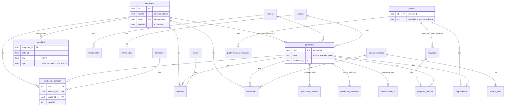

# Data model

The database is Postgres 15 on Supabase. Everything lives in schema `public` unless stated. The model is built only by migrations (no ORM, no generated schema file), so the answer to "what is the current shape?" is the last migration that touches an object. Where a function was redefined several times, this document names the migration that holds its current body.

There are no views and no materialized views in `public`. Column-level privileges (see [security.md](security.md)) would not cover a view, so a guard in `supabase/migrations/0012_b7b_hardening.sql` (part P3) counts views and warns if one ever appears. Derived values are computed in pure TypeScript (`src/services/derivaciones.ts`) or inside RPCs.

Naming: table and column names are Spanish because the product is Spanish. The glossary in the README maps the main terms. The ones used below: `snapshot` is a versioned capture of one ingestion; `cambios` is the append-only change feed; `embarques` are inbound shipments; `reservas` are reservations per KAM and customer; `pendientes_datos` is the data-question inbox; an `override` is an admin edit layered over source data.

## 1. Three classes of data

This is the organizing idea. The class of a table decides who may write it and which rule authorizes the write.

| Class | Tables | Who writes | Rule |
|---|---|---|---|
| Ingested (born in the workbooks; the app does not own it) | `snapshots`, `productos`, `stock_por_almacen`, `reservas`, `embarques`, `cambios` | Only the `ingest_snapshot` RPC, called with the service role | Rows are inserted per snapshot; `productos` is latest-wins per SKU; the app never deletes any of it |
| Curated by an admin (shared catalog and interpretation) | `marcas`, `familias`, `tecnologias`, `almacenes`, `kams`, `estatus_catalogo`, `marca_alias`, `estatus_alias`, `familia_alias`, `productos_override`, `productos_metadata`, `clasificacion_v2`, `pendientes_datos` | Admins, mostly through SECURITY DEFINER RPCs | `is_admin()` is the whole authorization; soft delete only (`activo = false`) |
| Own data (belongs to one user) | `proyectos`, `proyecto_partidas`, `seguimientos`, `preferencias_notificacion` | The owner | "Is it yours?" (ownership RLS), not the role |

Three further groups do not fit the three: the identity table `perfiles` (its row is created only by the `handle_new_user` trigger on `auth.users`, it is readable by its owner or an admin, only an admin may update it, and it has no `DELETE` policy); the ledgers with RLS on, zero policies and privileges revoked (`envios_aviso`, written only by the service-role client of the two mail routes; `consumo_chat`, written only through `SECURITY DEFINER` functions); and the optional assistant corpus (`corpus_*`).

Evidence for the taxonomy: the header of `supabase/migrations/0024_b8_proyectos.sql` (the third lane of ownership), `supabase/migrations/0026_b9_seguimientos.sql`, and the comment on `perfiles.rol` in `supabase/migrations/0043_rolsoporte_cuarto_rol_de_solo_lectura.sql` (the "two axes" wording).

## 2. Entity-relationship overview

A simplified view. Columns are limited to keys and the ones that carry meaning. Not every table is drawn (aliases, ledgers and corpus tables are in the lists below).

Two relationships are deliberately absent. `cambios.sku` has no foreign key, so a removal (BAJA) of a SKU that no longer exists in `productos` stays traceable (`supabase/migrations/0001_schema.sql`, `supabase/README.md`, section "Security notes on the model"). `clasificacion_v2` and the other interpretive layers hang off the SKU, never off a snapshot, so the ingestion cannot touch them (`supabase/migrations/0008_bparche_clasificacion_v2.sql`).

## 3. Tables and the migration that creates each

### 3.1 The core set, all created in `0001_schema.sql` (15 tables)

| Table | Key columns and relations | Notes |
|---|---|---|
| `snapshots` | `id` PK; `fuente`; `hash` UNIQUE (`snapshots_hash_unique`); `periodo` `YYYY-MM`; `archivo`; `filas`; `created_at`; `created_by` | One row per ingestion, never updated. `forzado_por` and `forzado_motivo` added by `0022_repro_registro_de_forzado.sql` |
| `productos` | `sku` PK; FKs `marca_id` to `marcas`, `familia_id` to `familias`, `snapshot_id` to `snapshots`; `class`, `descr_origen`, `cliente`; `resv >= 0` | Latest-wins per SKU. `tecnologia` and `producto` added by `0036_cat_b1_tecnologia_y_producto.sql`. SKU immutable via trigger `before_update_sku` |
| `stock_por_almacen` | PK `(sku, almacen_id, snapshot_id)`; `cantidad >= 0` | Normalized warehouse stock: a new warehouse needs no schema change |
| `almacenes` | `clave` UNIQUE with a CHECK on the six allowed keys (`NORTH`, `SOUTH`, `EAST`, `TRAN`, `BO`, `WEST`); `nombre`; `activo` | The CHECK is `almacenes_clave_check`; widening the set means a migration |
| `reservas` | FKs `sku` to `productos`, `kam_id` to `kams` (nullable), `snapshot_id`; `cliente`; `cantidad > 0`; `motivo`; `fecha` | The Excel reservation matrix de-pivoted into rows. `kam_raw` (the unresolved text) added by `0009_b6_pendientes.sql` |
| `kams` | `id`; `nombre` UNIQUE | Key-account managers |
| `embarques` | FK `sku`; `oc_po`, `proveedor`, `referencia`, `factura`, `pais_origen`, `piezas`, `fw`, `tipo_importacion`; five date columns (`fecha_recoleccion`, `etd`, `eta`, `fecha_llegada`, `fecha_disponibilidad`); `estatus_id` FK to `estatus_catalogo.orden`; `proyecto`; `observaciones`; `is_historial`; `snapshot_id` | Active rows and history rows in one table, told apart by `is_historial` |
| `estatus_catalogo` | `orden` PK; `nombre` UNIQUE | Nine stages in `0001`; widened to eleven by `0004_estatus.sql` (CHECK `orden BETWEEN 1 AND 11`) |
| `marcas` | `id`; `nombre` UNIQUE; `activo` | Exclusion columns (`excluida_del_catalogo`, `excluida_motivo`, `excluida_por`, `excluida_en`, `creada_en`) added by `0039_vert_b2_exclusion_por_marca.sql` under CHECK `marcas_exclusion_con_autoria` |
| `familias` | `id`; `nombre` UNIQUE | A unique index on `lower(nombre)` in `0006_b5_dominio.sql`; `creado_en` and `creado_por` added by `0020_repro_truncate_guarda_pendientes_creado_en.sql` |
| `marca_alias` | `alias` PK, `marca_id` FK | Normalizes brand spellings in the ETL |
| `productos_override` | `sku` FK; `campo`; `valor_editado`; `editado_por`; `activo`; `editado_en` | Versioned admin edits; reverting means `activo = false`. The CHECK on `campo` admits `familia` and `descripcion` in `0001`; `0044` adds `tecnologia` |
| `productos_metadata` | `sku` PK and FK; `imagen_url`; `updated_by`; `updated_at` | `color` added by `0006_b5_dominio.sql`, restricted to eight color slugs by CHECK `productos_metadata_color_check` |
| `cambios` | `snapshot_id` FK; `entidad` (`producto`, `stock`, `reserva`, `embarque`); `clave`; `sku`; `campo`; `valor_anterior`; `valor_nuevo`; `tipo` (`ALTA`, `BAJA`, `MODIFICACION`); `detectado_en` | Append-only change feed |
| `perfiles` | `id` (equals `auth.uid()`); `email` UNIQUE; `rol` CHECK | `0001` allowed `kam` and `admin`; `0010_b7a_rol_visitante.sql` adds `visitante` and the foreign key to `auth.users` with `ON DELETE CASCADE`; `0043_rolsoporte_cuarto_rol_de_solo_lectura.sql` adds `soporte` |

Indexes for the main foreign keys and for the hot reads (active shipments, change lookups by SKU and date) are in the same file.

### 3.2 Later tables

| Table | Created in | Purpose and relations |
|---|---|---|
| `estatus_alias` | `0004_estatus.sql` | Raw status text to `orden` (data-driven normalization, the sibling of `marca_alias`) |
| `tecnologias` | `0008_bparche_clasificacion_v2.sql` | Technology catalog: `nombre` UNIQUE (also unique on `lower(nombre)`), `activo` |
| `clasificacion_v2` | `0008_bparche_clasificacion_v2.sql` | One row per SKU with the interpretive overlay (`tecnologia`, `marca_v2`, `familia_v2`, `clase_v2`, `descr_v2`, `fuente_version`); the ETL never writes it |
| `pendientes_datos` | `0009_b6_pendientes.sql` | The data-question inbox: `tipo`, `clave_natural`, `estado` (`abierto`, `resuelto`, `descartado`), `payload` jsonb, `detectado_por`, `resolucion`, `resuelto_por`, `resuelto_en`; UNIQUE `(tipo, clave_natural)`. `tipo` has eight values after `0019_mvp2_familia_nueva.sql`: `kam_desconocido`, `marca_west`, `colision_familia`, `cuarentena_etl`, `marca_ambigua`, `familia_atomo_dudoso`, `sku_sin_tecnologia`, `familia_nueva` |
| `familia_alias` | `0018_mvp2_familia_alias.sql` | Alias to `familia_id`, so a family merge survives the next ingestion (unique on `lower(alias)`) |
| `proyectos` | `0024_b8_proyectos.sql` | Per-user project: generated `folio` (`PRJ-` plus a zero-padded sequence), `titulo`, `descripcion`, `notas`, `fecha`, `tipo`, `intencion`; `propietario` FK to `perfiles` with `ON DELETE SET NULL` |
| `proyecto_partidas` | `0024_b8_proyectos.sql` | Line items: `proyecto_id` FK with cascade, `sku` FK, `cantidad > 0`, UNIQUE `(proyecto_id, sku)` |
| `seguimientos` | `0026_b9_seguimientos.sql` | PK `(perfil_id, sku)`: the SKUs a user follows and which alerts they want (`av_estatus`, `av_disponible`, `av_reservado`, `av_llegada`; CHECK that at least one is on). `av_correo` added by `0027_b91_correo.sql` |
| `preferencias_notificacion` | `0026_b9_seguimientos.sql` | Per-user defaults and `visto_hasta`; `boletin_correo` added by `0027_b91_correo.sql` |
| `envios_aviso` | `0027_b91_correo.sql` | Mail delivery ledger: UNIQUE `(perfil_id, clave_intento)`, state `preparado` or `enviado`. RLS on with zero policies |
| `consumo_chat` | `0028_b10_chat.sql` | Assistant usage ledger and basis of the rate cap. It stores no question text. Redaction columns added by `0040_chatb1_consumo_redaccion.sql` |
| `corpus_documentos`, `corpus_trozos`, `corpus_sync_intentos` | `0030_b11_corpus.sql` | Optional assistant corpus: documents (`hash`, `commit_sha`), chunks (`texto`, `ruta_seccion`, `tiene_tabla`, `excede`, `embedding vector(1536)`), sync attempts (`resultado` is `corriendo`, `ok`, `detenido` or `error`). A `busqueda tsvector` column with a GIN index is added by `0033_b11_busqueda_corpus.sql` |
| `corpus_familia_ficha` | `0031_b11_puente_familia_ficha.sql` | Bridge from a family to a corpus document (`origen` is `exacta-normalizada` or `humano`, with reviewer) |

Totals: 15 tables from `0001`, 15 more across later migrations, 30 in `public`. The `producto-imagenes` storage bucket is created in `0007_b5_storage.sql`: public read, admin-only write, a 2 MiB size limit (`2097152` bytes) and three MIME types (png, jpeg, webp).

Extensions: `pgcrypto` in `0001_schema.sql`; `vector`, in schema `extensions`, in `0030_b11_corpus.sql`.

## 4. How a snapshot lives in the tables

- Each ingestion inserts one `snapshots` row, then inserts that snapshot's rows into `stock_por_almacen`, `reservas`, `embarques` and `cambios`, all stamped with the new `snapshot_id`. Earlier rows stay.
- `productos` is different: it is an upsert by SKU (`ON CONFLICT (sku) DO UPDATE`), so it always holds the latest values, and `productos.snapshot_id` records which ingestion last wrote the row. Evidence: `supabase/migrations/0036_cat_b1_tecnologia_y_producto.sql`, body of `ingest_snapshot`.
- "Current" is defined per source as the `snapshots` row with that `fuente` that maximizes `(created_at, id)`. The second key makes ties deterministic. Evidence: header of `src/services/vigente.service.ts`.
- There are two sources, `stock` (inventory, the second-warehouse sheet and reservations) and `aduana` (shipments). Evidence: `src/services/etl/runEtl.ts` (`fuenteOf`), `src/services/vigente.service.ts` (`FuenteSnapshot`).

Why stock is rows per warehouse rather than columns, and why reservations are de-pivoted: a new warehouse then needs data, not DDL, and the Excel matrix of KAM by customer by date by reason becomes something SQL can aggregate. The design record is [decisions/0002-immutable-snapshots-idempotent-by-hash.md](decisions/0002-immutable-snapshots-idempotent-by-hash.md); the parsers that do the de-pivoting are in `src/services/etl/parse.reserva.ts` and `src/services/etl/parse.inventario.ts`.

## 5. Key RPCs and triggers

Each row names the migration that holds the current body.

| Object | Current body in | What it does |
|---|---|---|
| `ingest_snapshot(payload jsonb)` returns uuid | `0036_cat_b1_tecnologia_y_producto.sql` (earlier bodies in `0005`, `0009`, `0013`, `0019`, `0022`) | One atomic transaction: insert the snapshot, create new brands and families, upsert products, insert stock, reservations, shipments and the change feed, queue pending questions. SECURITY DEFINER, `search_path` pinned, EXECUTE for `service_role` only |
| `aplicar_override(sku, campo, valor)` | `0044_fixb1_tecnologia_editable_excel_gana.sql` (origin `0006_b5_dominio.sql`) | Atomic admin override. A NULL value is a true revert: it deactivates the override so the effective value falls back to the source. `tecnologia` is accepted only for SKUs where the workbook left it empty and only from `tecnologias_seleccionables()`; the failures raise `tecnologia_no_seleccionable` and `excel_manda` |
| `tecnologias_seleccionables()` | `0044_fixb1_tecnologia_editable_excel_gana.sql` | The single source of the technology choice list |
| trigger `productos_override_tecnologia_excel_gana` | `0044_fixb1_tecnologia_editable_excel_gana.sql` | Enforces the same two rules at table level, so a direct write cannot bypass the RPC |
| `aplicar_clasificacion_v2(payload jsonb)` | `0008_bparche_clasificacion_v2.sql` | Atomic upsert of the interpretive layer. An incoming NULL never clears a stored value, and `is_admin()` is checked inside the function |
| `aplicar_metadata(sku, campo, valor)` | `0017_mvp2_metadata_por_rpc.sql` | Image and color writes go through an RPC because column-level privileges made direct upserts fail (see [security.md](security.md)) |
| `resolver_pendiente(id, ...)` | `0014_mvp_cierre_tecnologia_canonica.sql` (history `0009`, `0011`, `0013`) | Resolves one inbox item and writes the decision into the right layer |
| `contar_pendientes()` | `0020_repro_truncate_guarda_pendientes_creado_en.sql` (origin `0009`) | Inbox count for the dashboard badge; checks `is_admin()` inside |
| `sincronizar_pendientes_tecnologia(snapshot)` | `0038_cat_b1_reapertura_por_condicion.sql` (history `0013`, `0015`, `0037`) | Ingestion as a producer of the inbox; closes and reopens by condition |
| `sincronizar_pendientes_familia`, `resolver_familia_nueva` | `0019_mvp2_familia_nueva.sql` | A newly arrived family is queued instead of entering silently |
| `fusionar_familia`, `desfusionar_familia` | `0041_cohb1_fusionar_familia_declara_actor.sql` (`desfusionar_familia` and the origin of the merge are in `0018_mvp2_familia_alias.sql`) | Merge and unmerge families through an alias rule |
| `chat_registrar_pregunta`, `chat_anotar_uso`, `chat_anotar_redaccion` | `0029_b10_anotar_uso.sql`, `0040_chatb1_consumo_redaccion.sql` (origin `0028_b10_chat.sql`) | The rate cap is counted and inserted under one lock; token usage is noted afterwards, idempotently |
| `buscar_corpus(consulta, tope)` | `0034_b11_busqueda_prefijo.sql` (origin `0033_b11_busqueda_corpus.sql`) | Lexical search over corpus chunks |
| `is_admin()` | body in `0002_rls.sql`; EXECUTE grants in `0006_b5_dominio.sql` | SECURITY DEFINER, `search_path` pinned; used by every admin policy |
| `handle_new_user()` and trigger `on_auth_user_created` | `0002_rls.sql` | Creates the profile with role `kam` when an auth user is created |
| `protect_sku_immutable()` and trigger `before_update_sku` | `0001_schema.sql` | The SKU cannot change, for any role |
| trigger `before_update_proyecto` | `0024_b8_proyectos.sql` | Keeps `actualizado_en` current |

## 6. Domain invariants and derivations

These live in pure code and are tested without a database.

- `total(sku)` is the sum of `stock_por_almacen.cantidad` over all warehouses, the second-warehouse sheet included. `reservado(sku)` is the source value `productos.resv`, not the sum of the reservations table; that sum is cross-checked, not trusted. `disponible = total - reservado`. Over-reserved means `disponible < 0`. A reservation mismatch means `resv != sum(reservas)`. Evidence: header of `src/services/derivaciones.ts`.
- The effective family or description is the latest active override, otherwise the source value, read defensively as latest-active-wins (`src/services/derivaciones.ts`).
- `familia` is a multi-valued field stored as text with `/` as separator. Families are for finding and filtering, never for summing: summing exploded families would count the same stock several times. Rule and guard: header of `src/lib/familias.ts`, and the heatmap test in `src/services/dashboard.service.test.ts`.
- The snapshot hash is the hash of the canonical row set. Identical re-ingestion creates nothing. A re-send of an older file hits `snapshots_hash_unique` and is reported as a repeat instead of failing (`src/services/etl/runEtl.ts`, `src/services/etl/errors.ts`). Details in [ingestion.md](ingestion.md).
- Dates are civil dates in one fixed time zone, and `snapshots.periodo` is derived in that zone (`src/lib/fechas.ts`, `supabase/migrations/0023_reproducibilidad_backfill_periodo_civil.sql`).
- The status pipeline has eleven stages (`supabase/migrations/0004_estatus.sql`). A shipment whose status text maps to no stage does not enter the table: it goes to quarantine in the ETL result (`src/services/etl/runEtl.ts`, reason `embarque_estatus_no_resuelto`).

## 7. Seeds

The seed migrations load example data for a demo: the six warehouse keys, the status stages, example KAM first names and example brands (`supabase/migrations/0003_seeds.sql`, `supabase/migrations/0004_estatus.sql`). The repository is a portfolio sample with synthetic data; the seeds do not describe a real operation. Seed values are data: replace them to model another business, and keep the CHECK on `almacenes.clave` in step if you change the warehouse keys (`supabase/migrations/0001_schema.sql`).

## 8. Reading the migration set

- 42 files, numbered `0001` to `0044`. The numbers `0016` and `0021` are intentionally absent; numbering is an order claim, not a count ([decisions/0005-migration-guards-and-replay.md](decisions/0005-migration-guards-and-replay.md)).
- Most migrations end with a `DO $$` block that reads the catalog (`pg_policy`, `pg_proc`, `has_*_privilege`) and raises if the intended state was not reached. Example: the column-privilege guard in part P3 of `supabase/migrations/0012_b7b_hardening.sql`.
- The static verifier `scripts/verificar-migracion.mjs` checks SQL and PL/pgSQL files before they are applied; its adversarial fixtures are in `scripts/fixtures-verificador/`.
