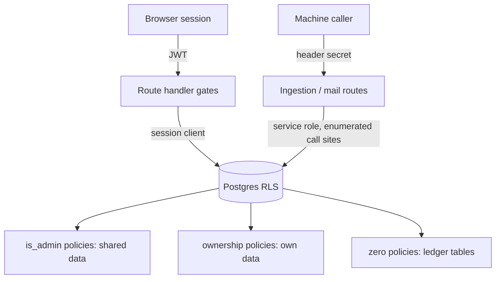

# ADR 0001: The database is the last line of defence (RLS, fail-closed roles, column allowlists)

**Status:** Accepted

## Context

Application checks can be refactored away, and a green application test cannot tell "the policy blocked it" from "the route blocked it". The portal also has an unusual permission shape: most data is shared and curated by administrators, but some data belongs to a person (projects, follows, notification preferences), and the roles that may write it do not coincide with the roles that may curate. Two further facts shaped the design:

- A fourth role was added after a permission had been written as `rol <> 'visitante'`, a blacklist that would have granted the new role access by omission.
- Audit columns (who edited a row) must not be readable by ordinary users, but PostgREST builds every write with `RETURNING *`, which expands to a table-level privilege check.

## Decision

1. **RLS on every table.** `supabase/migrations/0002_rls.sql` enables it on the 15 original tables and every later table follows. Ingested tables (`snapshots`, `productos`, `stock_por_almacen`, `reservas`, `embarques`, `cambios`) have `SELECT` for `authenticated` and **no write policy**, so only the service role writes them. Catalogs, aliases and overrides allow `INSERT`/`UPDATE` only `WITH CHECK (public.is_admin())` and have no `DELETE` policy (soft delete). Two tables, `envios_aviso` and `consumo_chat`, have RLS on and **zero policies** with privileges revoked, so no session can reach them directly. `consumo_chat` is written only through `SECURITY DEFINER` functions (`chat_registrar_pregunta`, `chat_anotar_uso`, `chat_anotar_redaccion`); `envios_aviso` is written only by the service-role client of the two mail routes (no function, no session policy).
2. **Two permission axes, not a role ladder.** Axis 1 is *shared data* (catalog, classification, users, images, pending items): the rule is `is_admin()`. Axis 2 is *own data* (projects, line items, follows, preferences): the rule is "is it yours", not the role. Roles are `admin`, `kam`, `soporte` and `visitante`; `soporte` is a twin of `kam` on both axes, and `visitante` reads what `kam` reads (no `SELECT` policy looks at the role) but writes no shared data and no projects or line items, with one precision: RLS only blocks the `INSERT` of projects (the whitelist of `0042`). The `UPDATE`/`DELETE` policies on projects and the line-item policies check ownership only, so an account demoted to `visitante` keeps write access to what it already owns and only the route gate stops that path (B8-11 in [`../known-limitations.md`](../known-limitations.md)). It does write its own follows and notification preferences, because those policies check ownership (`perfil_id = auth.uid()`), not the role, and their routes use `requireSession`: a deliberate product decision. The explanation lives in the header of `supabase/migrations/0043_rolsoporte_cuarto_rol_de_solo_lectura.sql` and in `src/lib/roles.ts`.
3. **Whitelists, never blacklists, for writes.** The predicate changed from `rol <> 'visitante'` to `rol IN ('kam','admin','soporte')` in `0042_rolsoporte_lista_blanca_de_escritura.sql`, which ships **before** the migration that creates the new role (`0043`), so no window exists in which the new role inherits a permission. The migration's own guard proves the allowed set is identical, row by row. In TypeScript the same decision is a `Record<Rol, boolean>` (`PUEDE_ESCRIBIR_PROYECTOS`, `MUESTRA_CLASIFICACION_V2` in `src/lib/roles.ts`): a new role does not compile until someone answers for it.
4. **Authorship columns are hidden by column-level grants.** `supabase/migrations/0012_b7b_hardening.sql` (part P3) revokes table-level `SELECT` from `authenticated` on three tables and grants it column by column except the audit column (revoking one column alone does nothing in PostgreSQL). The guard aborts if the revoke did not take effect or if it left other columns unreadable. Such tables are **allowlists**: a new column is invisible until someone grants it.
5. **Writes the allowlist breaks move into RPCs.** Direct upserts on those tables failed with `42501` because of `RETURNING *`; image and colour writes became a `SECURITY DEFINER` function (`aplicar_metadata`, `0017_mvp2_metadata_por_rpc.sql`), and `scripts/guarda-lista-blanca.mjs` fails if any user-session code writes directly to a table on the list.
6. **The service role is confined.** It is built in one `server-only` factory (`src/lib/supabase/server.ts`) and used by a short, enumerable set of handlers: both ingestion routes, both mail routes, the campaign route (reads the sent ledger) and the two user-administration routes (built only after the admin gate passes). Every other feature, the assistant included, runs under the user's session so RLS applies and a feature can never see more than the user could in the UI.
7. **Immutable and append-only data.** `snapshots` and `cambios` have no `UPDATE`/`DELETE` policy; a trigger (`protect_sku_immutable`, `0001_schema.sql`) blocks any change of a SKU even for the service role.

## Consequences

- (+) A refactor of a route cannot silently open data; the negative tests hit the database directly, bypassing the app.
- (+) Adding a role fails closed in both layers, and the SQL and TypeScript guards are twins.
- (-) Column allowlists make the three affected tables write-only through RPCs; a column added later is invisible by default (a known limitation recorded as debt in [`../known-limitations.md`](../known-limitations.md)).
- (-) Several admin RPCs are executable by `authenticated` and rely on an internal `is_admin()` check; see [ADR 0007](0007-privilege-guards-inside-functions.md).
- (-) The policy name `proyectos_insert_own_no_visitante` no longer describes its predicate; names were kept to avoid churn (`0042`).
- (-) Without `FORCE ROW LEVEL SECURITY`, the table owner and the service role bypass RLS by design; the risk returns if a later migration grants table privileges to another role.

## Evidence

- Policies and helper: `supabase/migrations/0002_rls.sql` (`is_admin()`, `handle_new_user()`, per-table policies); `supabase/migrations/0006_b5_dominio.sql` (EXECUTE grants of `is_admin`).
- Roles: `supabase/migrations/0010_b7a_rol_visitante.sql`, `0042_rolsoporte_lista_blanca_de_escritura.sql`, `0043_rolsoporte_cuarto_rol_de_solo_lectura.sql`; `src/lib/roles.ts`; `src/lib/api/auth.ts` (`requireSession`, `requireSessionNoVisitante`, `requireAdminSession`).
- Column allowlists and the RPC fallout: `supabase/migrations/0012_b7b_hardening.sql`, `0017_mvp2_metadata_por_rpc.sql`; `scripts/guarda-lista-blanca.mjs`.
- Zero-policy tables: `supabase/migrations/0027_b91_correo.sql`, `0028_b10_chat.sql`.
- Service-role confinement: `src/lib/supabase/server.ts` and its call sites under `src/app/api/` (`refresh/`, `refresh/archivo/`, `avisos/envios/`, `avisos/envios/confirmar/`, `campana/`, `usuarios/`).
- Tests: `supabase/tests/rls_negative_tests.sql` (N1 to N8), `scripts/rls-negativas.mjs`, `scripts/rls-negativas-proyectos.mjs`, `scripts/seguimientos-negativas.mjs`, `scripts/rls-negativas.test.ts`; see [`../testing.md`](../testing.md).
- Wider context: [`../security.md`](../security.md), [`../data-model.md`](../data-model.md).
