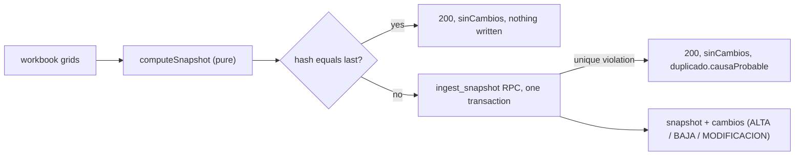

# ADR 0002: Immutable snapshots, idempotent by content hash, with a derived change feed

**Status:** Accepted

## Context

The data is born in two spreadsheets that the business keeps editing; the portal never replaces them. Stakeholders need to see *what changed* between loads, attributably and reproducibly, and re-sending the same file must be harmless: an external automation may retry, run twice, or send an older file after a newer one. The source also has a shape that is awkward to query: one column per warehouse, and reservations as a pivot (KAM by customer by date by reason). Warehouses and customers change over time.

## Decision

1. **One ingestion is one snapshot with a unique content hash.** `snapshots.hash` carries the constraint `snapshots_hash_unique` (`supabase/migrations/0001_schema.sql`). The hash is computed over the *canonical* row set: each row is serialized with sorted keys, hashed, the hashes are sorted and hashed again, so input order does not matter (`src/services/etl/hash.ts`). Capture time and file name are not part of the hash, only content.
2. **Equal hash means no write.** `computeSnapshot` (pure, `src/services/etl/runEtl.ts`) compares the new hash with the last one for the same source and returns `sinCambios: true` with the previous snapshot id. Every field that matters must enter the hash, otherwise a change in only that field produces the same hash, nothing is written and nothing is reported; the hash set in `runEtl.ts` documents this at the point where a field was once missing.
3. **A repeated *older* hash is reported, not retried.** If the unique constraint fires (a file re-sent after a newer one), `runEtl` catches `SnapshotDuplicadoError` (`src/services/etl/errors.ts`) and answers as a legitimate "nothing new": 200, `sinCambios: true`, the previous snapshot id and a `duplicado` block (`hash`, `constraint`, `causaProbable`, `mensaje`). The same symptom has two causes: the content was already stored (an older file re-sent) or the stored row was hashed with a different recipe than the running build uses. `causaProbable` is meant to name which one (`archivo_repetido` or `receta_del_hash`), but today it cannot: the branch is reached only after the "same hash as the previous snapshot" check has failed, so `prev.hash === payload.hash` is always false and the field is always `receta_del_hash`, a re-sent older file (A, B, A) included. `archivo_repetido` is declared but unreachable, and no test pins the field (`src/services/etl/runEtl.ts`, `src/services/etl/types.ts`).
4. **The change feed is derived.** A pure differ (`src/services/etl/differ.ts`) compares previous and new state per entity and emits one `ALTA` per new key, one `BAJA` per missing key and one `MODIFICACION` per changed field into the append-only `cambios` table. `cambios.sku` has no foreign key on purpose, so removals stay traceable after the product is gone. Stock is keyed by `(sku, warehouse)`, reservations by `(sku, kam, customer, date, reason)`, shipments by `(oc_po, sku)` collapsing duplicates to the most advanced status.
5. **Persistence is one transaction.** `persistSnapshot` calls the RPC `ingest_snapshot(payload jsonb)` (`supabase/migrations/0005_ingest_fn.sql`, current body in `0036_cat_b1_tecnologia_y_producto.sql`): snapshot row, new catalog entries, product upsert, stock, reservations, shipments, change feed and the pending-question producers commit together or not at all. `EXECUTE` is restricted to `service_role`.
6. **Shape of the data.** Stock is normalized into `stock_por_almacen(sku, almacen, snapshot)` so a new warehouse needs no schema change; reservations are de-pivoted into `reservas` rows. The reserved quantity the UI uses is the *source* value, cross-checked against the sum of the rows. A mismatch becomes a diagnostic item (`SUMA_STOCK`, `SUMA_RESERVAS` in `src/services/etl/gates.ts`), never a rejection.
7. **Quarantine instead of deletion.** A reservation or shipment whose SKU has no product, and a shipment whose status text maps to no stage, go to a quarantine list with a reason and are returned to the caller; nothing is dropped silently. `productos` is latest-wins per SKU and `stock_por_almacen` is keyed by snapshot.

## Consequences

- (+) Loads are idempotent and history is reproducible; one feed serves the dashboard, the alerts and the weekly mail.
- (+) A new warehouse or a new customer is data, not a migration.
- (-) "Ran and found nothing new" and "did not run" leave the same evidence on the snapshot log: results are recorded, attempts are not (attempts are recorded only for the document-index sync, `corpus_sync_intentos` in `0030_b11_corpus.sql`). The staleness alarm is therefore blind to a stopped scheduler; this is a recorded limitation.
- (-) The hash recipe is load-bearing: changing which fields enter it changes what counts as "the same".
- (-) A second truth (sum of rows versus source total) has to be reconciled and surfaced, hence the diagnostics and the mismatch badge.

## Evidence

- Schema: `supabase/migrations/0001_schema.sql` (`snapshots`, `snapshots_hash_unique`, `stock_por_almacen`, `reservas`, `cambios`); `supabase/migrations/0005_ingest_fn.sql`; `supabase/migrations/0036_cat_b1_tecnologia_y_producto.sql`.
- ETL: `src/services/etl/hash.ts`, `differ.ts`, `gates.ts`, `reconcile.ts`, `runEtl.ts`, `persist.ts`, `errors.ts`, `parse.reserva.ts`.
- Tests: `src/services/etl/__tests__/hash.test.ts`, `differ.test.ts`, `gates.test.ts`, `computeSnapshot.test.ts`, `persist.duplicado.test.ts`.
- Derived quantities (total, reserved, available): `src/services/derivaciones.ts`.
- Related: [ADR 0003](0003-empty-and-degraded-input-guards.md) for what is refused before a snapshot is computed; [`../ingestion.md`](../ingestion.md) and [`../data-model.md`](../data-model.md).
