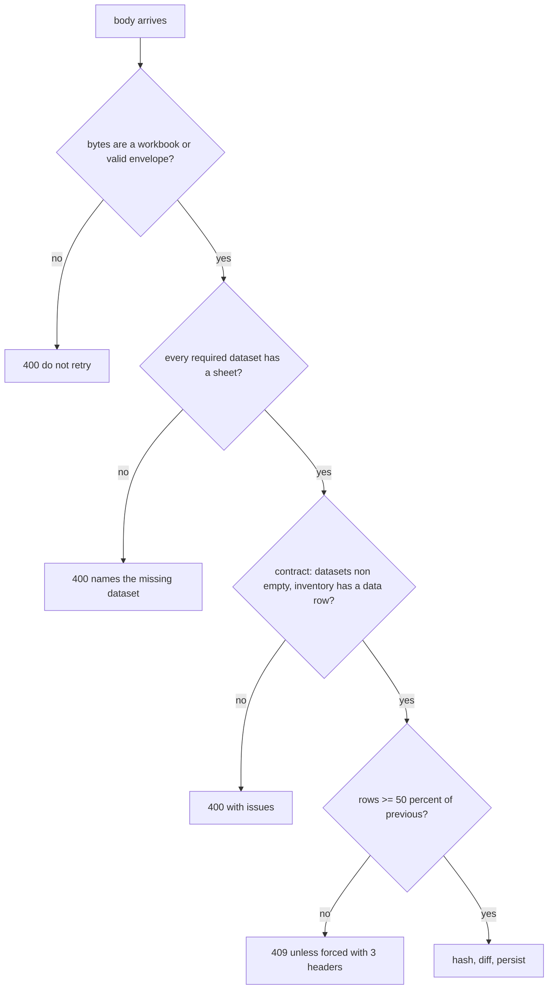

# ADR 0003: Empty and degraded input is a failure, never a success

**Status:** Accepted

## Context

A workbook can be perfectly valid `.xlsx` and still describe a catastrophe. A sheet that was renamed is simply not recognized; a sheet that was read with zero rows is an empty grid; a sheet with only its header row is a well-formed table with no products. Each of these looks like "a quiet month" to the code that follows, and each can erase data: with zero products in the incoming snapshot, a differ would emit a removal for every product in the current catalog, and a maintenance routine that decides "close what is not in the current set" would close every pending item. The absence arrived with the right shape.

Two ingestion doors feed the same pipeline (see [ADR 0004](0004-http-upload-door-and-external-scheduler.md)). A protection that lived in one mechanism of one door was not inherited by the other.

## Decision

Defend in **layers, each of which would catch the failure alone**, and never treat a missing dataset as a legitimate empty one.

1. **Classify by sheet name, not by row count.** `construirDatasets` (`src/services/ingesta/motor.ts`) classifies every sheet against the mapping config (`src/config/ingesta-mapeo.ts`). If any *required* stock dataset has no assigned sheet it throws `DatasetsStockFaltantesError`, and neither stock nor shipments body is produced. A recognized sheet with zero rows must not trigger it; that is a different gate. The only way to ingest shipments without stock is an explicit declaration by the caller (`stockOmitido`), never an inference from the data.
2. **Validate content, not only shape.** The request contract (`src/schemas/refresh.schema.ts`, zod) requires every stock dataset to be non-empty, and requires the inventory grid to hold at least a header **plus one data row**. A real sheet always has its header row, so an empty array can only mean "the origin did not read the sheet". Only inventory gets the stricter minimum: a month with no reservations is a business fact, a month with zero products is the catalog vanishing.
3. **Both doors run the whole contract.** The file-upload route builds its body from the workbook and then validates it with the same `RefreshBody.safeParse` before any ETL work (`src/app/api/refresh/archivo/route.ts`); inheriting only the sheet-name gate had let a workbook with correctly named but empty sheets through. An unreadable body or an envelope without content answers 400, never 500, so a retrying caller does not loop on a file that can never work (`src/services/ingesta/desde-archivo.ts`).
4. **A universe-collapse guard on the computed snapshot.** If the incoming row universe (products + stock + reservations + shipments, the same expression that fills `snapshots.filas`) is below **50 %** of the previous one for the same source, the run is rejected with `UniversoReducidoError` (HTTP 409). The cut is strictly `<`, so exactly 50 % passes. The constant is `UMBRAL_UNIVERSO_MINIMO` in `src/services/etl/runEtl.ts`. The guard does **not** apply when there is no previous snapshot or its universe is empty: an empty universe is never evidence that the work was already done.
5. **A forced run is explicit, complete and recorded.** It needs three request headers together (a flag, a reason of 12 to 300 characters, an identity of 3 to 120), read only from the request, never from an environment variable or a default (`src/lib/api/forzar-universo.ts`). The reason and identity are stored on the snapshot (`supabase/migrations/0022_repro_registro_de_forzado.sql`); the identity is self-declared, not authenticated, and the column comment says so.
6. **Everything else is diagnosed, not dropped.** Sum mismatches become diagnostics, orphan references and unresolved statuses go to quarantine ([ADR 0002](0002-immutable-snapshots-idempotent-by-hash.md)).
7. **Maintenance by absence is guarded in the database too.** The routine that closes pending items for SKUs missing from a snapshot returns without touching anything when the evaluated snapshot has no products, and an item closed by the ingestion itself is reopened when its condition returns (a person's closure is reopened only by a person). `supabase/migrations/0015_mvp_cierre_autocierre_seguro.sql`, `0038_cat_b1_reapertura_por_condicion.sql`.

## Consequences

- (+) The worst realistic failure, a mostly empty file, cannot wipe data; every layer has a test that would fail if the others were removed.
- (+) The operator gets a status code that says whether to retry: 400 means fix the file, 409 means verify and then force, 500 means retry.
- (-) A legitimate large contraction needs a deliberate forced run, and the recorded identity is not authenticated.
- (-) **The guard catches emptying, not degrading.** A file with every row and one renamed column gives 100 % of the universe and passes; a missing optional column is only reported as a quarantine item (`columna_ausente_*` in `src/services/etl/parse.inventario.ts`). A test covers the renamed-column case (`src/services/etl/__tests__/ingesta-degradada.familia-renombrada.test.ts`). A green universe guard is not coverage of the degraded case.
- (-) The 50 % threshold rests on the history of the source it was calibrated on; a source that has never shrunk gives little evidence about its floor.

## Evidence

- `src/services/ingesta/motor.ts` (`DatasetsStockFaltantesError`, `construirDatasets`), `src/services/ingesta/preflight.ts` (`evaluarGateStock`, the same classification without building a body), `src/config/ingesta-mapeo.ts`.
- `src/schemas/refresh.schema.ts`, `src/app/api/refresh/archivo/route.ts`, `src/app/api/refresh/route.ts`, `src/services/ingesta/desde-archivo.ts`.
- `src/services/etl/runEtl.ts` (`UMBRAL_UNIVERSO_MINIMO`, universe guard), `src/services/etl/errors.ts` (`UniversoReducidoError`), `src/lib/api/forzar-universo.ts`.
- Migrations: `supabase/migrations/0015_mvp_cierre_autocierre_seguro.sql`, `0022_repro_registro_de_forzado.sql`, `0038_cat_b1_reapertura_por_condicion.sql`.
- Tests: `src/schemas/refresh.schema.test.ts`, `src/services/etl/__tests__/guarda-universo-reducido.test.ts`, `src/services/ingesta/__tests__/ingesta-vacia.test.ts`, `src/services/ingesta/__tests__/esquina-f.cero-hojas.test.ts`, `src/services/ingesta/__tests__/desde-archivo.stockOmitido.test.ts`, `src/lib/api/forzar-universo.test.ts`.
- Failure classes: P10, P13, P14, P17 in [`../engineering/failure-patterns.md`](../engineering/failure-patterns.md). Ingestion flow: [`../ingestion.md`](../ingestion.md).
