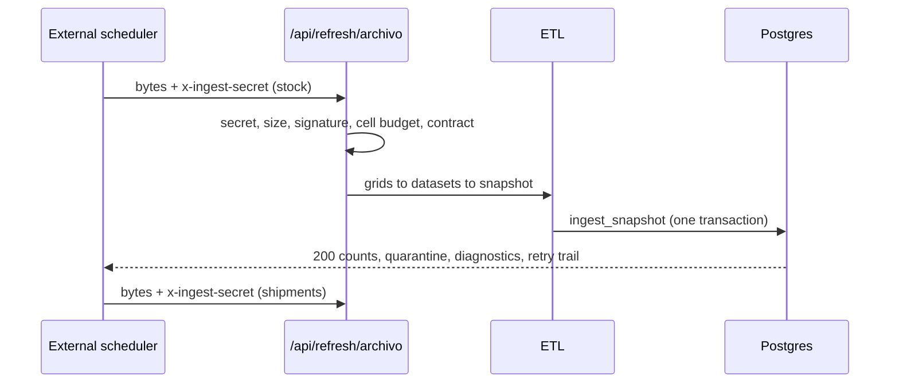

# ADR 0004: A second ingestion door that takes the file, and schedulers that only deliver

**Status:** Accepted

## Context

The source workbooks live in a corporate file-sharing service that requires interactive login and blocks cross-origin reads, so the browser can never read them directly. Something outside the portal has to fetch them. At design time the licensing and tenant policy of the automation tool that would do that were unknown, so the portal could not depend on any one tool.

The first ingestion door took pre-built JSON grids, which meant the automation had to interpret the workbook (find the range, name the sheet, build the grid), and a mistake there produced an empty dataset that looked like a quiet month. The machine callers (the ingestion automation and a weekly mail scheduler) also have no browser session, so none of the application's cookie-based defences apply to them.

## Decision

1. **Three decoupled layers; the trigger is a replaceable detail.** Ingestion, domain data and frontend are separate; the frontend reads only the API and the database. Any trigger (a workflow tool, a local CLI, a scheduled job) calls the same endpoints and shares the same ETL.
2. **Two doors, one engine.** `POST /api/refresh/archivo?source=stock|aduana` (`src/app/api/refresh/archivo/route.ts`) receives the file itself, either as raw `.xlsx`/`.xlsm` bytes or as a JSON envelope with a base64 `$content`; `POST /api/refresh` (`src/app/api/refresh/route.ts`) keeps taking pre-built grids and is the path used by the local CLI `scripts/ingesta-mensual.mjs`. From "workbook to grids" onward both run the same code (`src/services/ingesta/io.ts`, `motor.ts`, `desde-archivo.ts` and then the ETL), and both run the whole request contract ([ADR 0003](0003-empty-and-degraded-input-guards.md)). The automation stays deliberately dumb: it forwards bytes, and all interpretation lives in the repository where it is versioned and tested.
3. **Recognize the file by its bytes, never by its label.** The body is accepted if it starts with the ZIP signature (`PK\x03\x04`) or is a JSON envelope whose `$content` decodes to one; the declared `Content-Type` is not trusted, and a body that is neither is a 400 (`extraerBytesDelCuerpo` in `src/services/ingesta/desde-archivo.ts`). The `source` is declared by the caller in the query and is never guessed from content, so the wrong workbook is a 400, not a 200.
4. **Cheap cuts before the expensive parser.** The body is capped at 15 MB (`MAX_ARCHIVO_BYTES = 15_000_000`), first on the declared `Content-Length` and again on the real bytes, because the header is client-declared and may be missing or chunked. After the workbook is opened, a budget on the **declared** cell count (`MAX_CELDAS_LIBRO = 2_000_000` in `src/services/ingesta/io.ts`) is checked before the sheet is expanded, because a tiny valid file can declare a huge range and exhaust memory; neither the body cap, the signature check nor the 60-second function limit (`maxDuration`) bounds memory.
5. **Machine callers authenticate with their own secrets, not with the service key.** The ingestion header `x-ingest-secret` and the mail header `x-avisos-secret` are compared by hashing both values with SHA-256 and using `timingSafeEqual`, so the secret's length is not observable and a missing header never matches (`src/lib/api/ingest-auth.ts`). The mail endpoint returns every user's alerts, so it accepts the header **only**, with no session fallback (`src/app/api/avisos/envios/route.ts`).
6. **The ingestion prefix is exempt from browser defences by one explicit rule.** `/api/refresh` and its sub-paths are outside the session middleware matcher, exempt from maintenance mode and from the same-origin check, anchored by path segment so `/api/refresh-token` would not match (`src/middleware.ts`, `src/lib/api/origin.ts`). Hanging the new door under that prefix inherits all three exemptions by construction instead of asking someone to edit three lists in three files. Every other mutating route handler starts with the same-origin check, which fails closed. The only ones without it are the two mail routes (`/api/avisos/envios` and `/api/avisos/envios/confirmar`): their caller is the external scheduler, on another host, so `requireSameOrigin` would always reject it, and they are protected by `x-avisos-secret` alone, with no session fallback (`src/app/api/avisos/envios/route.ts`).
7. **Status codes tell the operator whether to retry.** 401 wrong secret; 400 unreadable file, missing required sheet or invalid body (do not retry, fix the file); 409 universe collapse; 413 over the cap; 500 server error (retry). Stock is posted before shipments, because shipment referential checks depend on the products the stock load inserts; that ordering lives in the automation and in the CLI, not in the server.
8. **Schedulers deliver, they do not decide.** The weekly mail workflow owns the calendar, the channel, the retry and the delivery record; the portal decides who gets what and renders the subject and HTML (`src/lib/avisos.ts`, `src/lib/correo.ts`, `src/lib/correo-plantilla.ts`). The example export `n8n/boletin-semanal.json` carries only placeholders, and a test fails if an export carries a literal key or credential id (`n8n/workflows.test.ts`).
9. **Transient failures leave a trace in the result.** A single wrapper around `fetch` retries a short whitelist of transient database errors under a per-request budget and returns the retry trail in the response (`src/lib/supabase/reintento.ts`), so a self-healing run is not mistaken for a healthy one.

## Consequences

- (+) Any trigger can be swapped without touching the domain or the UI; the ETL is fully testable without the automation.
- (+) A leaked end-user session cannot overwrite catalogs or read every user's alerts.
- (-) The ordering and retry rules of the automation (stock before shipments) live outside the server and must be documented ([`../ingestion.md`](../ingestion.md)).
- (-) The secrets are high privilege (the ingestion secret can overwrite the whole catalog and feeds bytes to the spreadsheet parser) and need rotation discipline.
- (-) **Accepted risk:** the spreadsheet library `xlsx` 0.18.5 (`package.json`) has known advisories. Mitigation is a set of barriers (shared secret, two-layer size cap, signature check, declared-cell budget, per-request isolation), none of which patches the advisories; the exposure is bounded to whoever holds the ingestion secret. See [`../known-limitations.md`](../known-limitations.md).
- (-) The recorded identity of a forced run is self-declared, because the doors authenticate with a shared secret and there is no user session to derive it from.

## Evidence

- Doors and guards: `src/app/api/refresh/archivo/route.ts`, `src/app/api/refresh/route.ts`, `src/services/ingesta/desde-archivo.ts`, `src/services/ingesta/io.ts`, `src/services/ingesta/motor.ts`, `src/lib/api/ingest-auth.ts`, `src/lib/api/origin.ts`, `src/middleware.ts`.
- CLI: `scripts/ingesta-mensual.mjs` (`--dry` is the default; `--aplicar` posts), with `scripts/ts-loader.mjs` so it runs the real `src/` code instead of a copy.
- Scheduler example: `n8n/boletin-semanal.json`, `n8n/README.md`, `n8n/workflows.test.ts`, `src/app/api/avisos/envios/route.ts`, `scripts/correo-negativas.mjs`.
- Tests: `src/app/api/refresh/archivo/route.test.ts`, `src/services/ingesta/__tests__/desde-archivo.test.ts`, `src/services/ingesta/__tests__/io.buffer.test.ts`, `src/lib/api/origin.test.ts`, `src/lib/supabase/reintento.test.ts`.
- Related: [ADR 0001](0001-rls-roles-and-column-allowlists.md) (service role confined to enumerated handlers), [`../security.md`](../security.md), [`../architecture.md`](../architecture.md).
