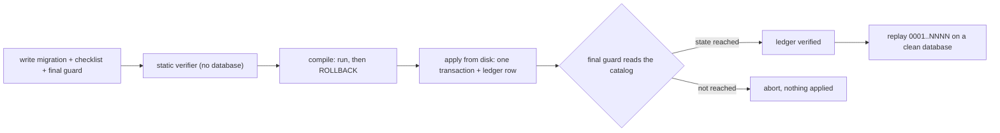

# ADR 0005: Migrations are forward-only, self-verifying and replayable; guards must be seen failing

**Status:** Accepted

## Context

The schema is built **only** by SQL migrations (no ORM, no generated schema file). The repository has 42 migration files numbered `0001` to `0044`, with gaps at `0016` and `0021` (explained below). Four things went wrong in its history, and each shaped a rule:

- A migration was verified figure by figure against the live database and still aborted at apply time, because a `RAISE` had a `%` marker with no argument and PostgreSQL compiles a plpgsql body when the function is created.
- A guard asserted *absence of harm* ("no privileges for these roles") and passed, while the table it protected had become unreadable for the one role that needed it.
- A migration that was written to run late was numbered like one that runs early, so the ledger and the disk disagreed.
- The application can be rolled back, but the database cannot.

## Decision

1. **Forward-only files with an irreversibility checklist.** Every migration from `0020` onward carries one in its header (24 of the 42 files; `0001` to `0019` predate the rule). The questions are those of the checklist in the header of `scripts/aplicar-migracion.mjs`: does the migration delete, close or mark as resolved anything that cannot be rebuilt, is there a blast-radius cap, and does it decide what to close or delete from the *absence* of data (failure class P17). Some files also answer whether the change can be undone and what happens if it is applied twice, and the wording varies from file to file. Rolling the application back never rolls the schema back; a data error is fixed by a new migration. Example: `supabase/migrations/0020_repro_truncate_guarda_pendientes_creado_en.sql`.
2. **Every migration from `0010` onward carries a guard, and nearly all end with it.** 33 of the 42 files carry a `DO $$` guard (`0001` to `0009` predate the rule and have none). In 30 of the 33 the guard is the last statement before `COMMIT`; in `0010`, `0039` and `0044` something follows it (a further `ALTER TABLE`, a notice-only block, a `NOTIFY`). Typically the guard reads the catalog: it inspects `pg_policy`, `pg_proc` and the privilege functions and raises if the intended state was not reached, so a migration cannot "succeed" while leaving the wrong state. Where a guard's green result proves nothing (the state was already correct, the table is empty) it prints an explicit anti-vacuity notice instead of a silent pass (`0020`).
3. **A negative control needs a positive control.** The guard of `supabase/migrations/0032_b11_corpus_lectura.sql` does not count privileges; it *becomes* the `authenticated` role and reads. Pairing every "this cannot" with a "this can" is the antidote to a guard that proves harmlessness but not function.
4. **A static verifier runs before anything is applied.** `scripts/verificar-migracion.mjs` checks the shape of SQL and plpgsql without a database: `RAISE` marker/argument balance (replicating PostgreSQL's own check), transaction structure, and catalog predicates (rule 4: do not compare a literal against the rendered text of `pg_get_function_identity_arguments()`; resolve by identity). It is tested against positive and adversarial SQL fixtures (`scripts/verificar-migracion.test.ts`, `scripts/fixtures-verificador/`). It says what it cannot catch: green means "the `RAISE` balance is not broken", not "the migration compiles".
5. **A compile step closes that gap without applying.** `scripts/compilar-migracion.mjs` swaps the last top-level `COMMIT` for `ROLLBACK` and sends the file to a real PostgreSQL, so unknown names, undeclared variables and bad grammar surface, and nothing remains afterwards.
6. **The applier sends the file from disk, all or nothing.** `scripts/aplicar-migracion.mjs` reads the file (so the applied bytes equal the committed bytes), sends it as one simple-query message (one implicit transaction), registers the migration in the platform ledger **inside the same transaction**, and re-reads the ledger to verify the effect. It runs the static verifier as a subprocess without database credentials, refuses a real application unless `--irreversibilidad="..."` answers the checklist (and echoes the answer into the log), derives the ledger name from the file's basename and never from an argument (`NNNN_slug.sql` only), cross-checks ledger against disk before applying, and never prints the connection string. Skipping the verifier needs an explicit, noisy flag per invocation, never a global replay mode. It is a tool for an operator: tests cover argument parsing, the ledger splice and `--dry` (`scripts/aplicar-migracion.test.ts`, `scripts/fixtures-aplicador/`), and it is not run as part of testing.
7. **The number is a claim about application order, not a label.** A file planned for out-of-order application is renumbered *before* it is applied. `0023_reproducibilidad_backfill_periodo_civil.sql` was born as `0021` and renumbered when the ledger reached `0022` first; a file that had been written and never applied (`0016`) was absorbed into `0020` and removed from disk, so a replay cannot apply both. These are the two gaps in the numbering. The alternative of an exemption list inside the guard was rejected: an exemption written to hide what the guard just found is how detectors die.
8. **The whole chain must replay on a clean database.** A migration whose guard requires history (for example "exactly N rows must match", or a ceiling derived from the size of a production catalog) degrades **the guard, not the file** when the universe is empty: it announces the empty universe with a notice and exits that branch, while the original assertion stays intact, word for word, inside the non-empty branch. `0023` and `0011_taxo.sql` carry such amendments; a one-shot backfill is deliberately not idempotent and aborts loudly if applied twice.
9. **The same principle outside SQL: ratchets and vacuity proofs.** For each defect class that once passed a fully green suite, a test reads the source and fails when the class can be written again, and each guard is proven able to fail (a seeded fixture or a mutant) before it is believed. These are listed, with their limits, in [`../testing.md`](../testing.md#4-ratchets-tests-that-watch-the-code).

## Consequences

- (+) A migration cannot succeed while leaving the wrong state, and what was applied is byte for byte what is in version control.
- (+) The replay promise ("`0001` onwards on a fresh database") is testable rather than asserted.
- (-) Very long headers and guards are a deliberate teaching cost.
- (-) Gaps in the numbering have to be explained to readers (item 7).
- (-) The static verifier produces at least one known false positive (a comparison against the empty string for a function with no arguments); the two affected, already-applied migrations are applied with an explicit skip and frozen byte for byte rather than edited (header of `scripts/aplicar-migracion.mjs`).
- (-) A guard can still be right for the wrong reason; vacuity proofs reduce but do not remove that risk (patterns P19, P21, P25 in [`../engineering/failure-patterns.md`](../engineering/failure-patterns.md)).

## Evidence

- Tooling: `scripts/verificar-migracion.mjs`, `scripts/compilar-migracion.mjs`, `scripts/aplicar-migracion.mjs`; tests and fixtures in `scripts/verificar-migracion.test.ts`, `scripts/aplicar-migracion.test.ts`, `scripts/fixtures-verificador/`, `scripts/fixtures-aplicador/`; `npm run verificar:migraciones` in `package.json`.
- Checklist and anti-vacuity: `supabase/migrations/0020_repro_truncate_guarda_pendientes_creado_en.sql`, `0022_repro_registro_de_forzado.sql`, `0042_rolsoporte_lista_blanca_de_escritura.sql`.
- Positive control: `supabase/migrations/0032_b11_corpus_lectura.sql`.
- Renumbering and replay amendments: `supabase/migrations/0023_reproducibilidad_backfill_periodo_civil.sql`, `0011_taxo.sql`, `0020_repro_truncate_guarda_pendientes_creado_en.sql` (absorption note for `0016`).
- Related: [ADR 0007](0007-privilege-guards-inside-functions.md), [ADR 0006](0006-civil-timezone-period-derivation.md) (the backfill that needed renumbering), [`../testing.md`](../testing.md).
