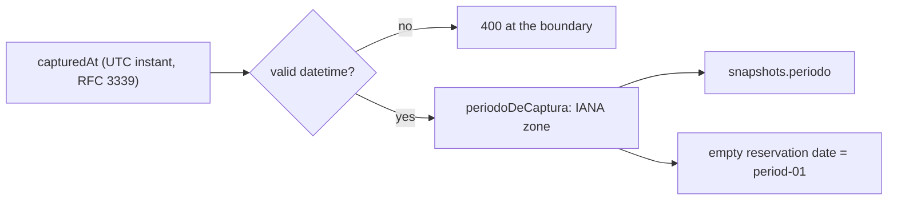

# ADR 0006: A period is derived in the civil time zone of the operation

**Status:** Accepted

## Context

Every snapshot carries a `periodo` (`'YYYY-MM'`) that drives the dashboard's trend and "current versus previous" comparison. It was originally derived by slicing the first seven characters of the capture instant, an ISO string in UTC. Slicing an ISO string slices UTC. In a zone behind UTC, an ingestion that happens in the evening of the last day of a month is already on the next UTC day, and possibly in the next UTC *month*, so it was stamped with a period that, for the people operating the system, had not started yet. Real ingestions were mislabelled that way.

Two traps made the obvious fixes wrong:

- **A fixed offset is not a time zone.** "The zone is six hours behind UTC" is true today and false for part of the year in earlier years; a subtraction of a fixed number of hours would be right by coincidence. What makes a helper correct is that it names an IANA zone, which knows every historical rule change, and that SQL's `AT TIME ZONE` and JavaScript's `Intl` consult the same zone database and therefore agree.
- **A value that merely *parses* is not a valid instant.** Some inputs that JavaScript accepts as dates (a bare `'2026'`) would fabricate a believable period and nobody would notice, because it has the right shape.

## Decision

1. **One zone, declared once, always explicit.** The operation's zone is a single constant (`ZONA_MEXICO` in `src/lib/formato.ts`). `src/lib/fechas.ts` imports it instead of repeating the literal, so there is one constant and two homes that use it. A date is never formatted with the zone of the machine that happens to run the process.
2. **A pure derivation.** `periodoDeCaptura(capturedAt)` (`src/lib/fechas.ts`) returns the month that it actually was in that zone at the given instant. It never reads the clock, only its argument, so it is deterministic. Its three branches are documented and tested: empty input gives an empty string; text that cannot be parsed falls back to the raw seven-character slice (and never throws); text that parses but is not ISO is the dangerous branch and is *latent* only because the single production entry point validates the instant first.
3. **Validation lives at the boundary.** `capturedAt` is `z.string().datetime()` in the request contract (`src/schemas/refresh.schema.ts`), which requires RFC 3339 and rejects the non-ISO forms before they reach the derivation. The derivation is called from `computeSnapshot` (`src/services/etl/runEtl.ts`), which stays pure with respect to the clock.
4. **Second-order effects are part of the decision.** A reservation row with an empty date in the workbook is filled with the **first day of the period** (never "now"), so the snapshot hash does not rotate every run. That fill depends on `periodo`, so correcting the period corrects the fill with it (`src/services/etl/__tests__/periodo.derivacion-civil.test.ts`).
5. **One truth for date formatting.** A ratchet fails the suite if any file outside the two sanctioned homes (`src/lib/formato.ts` for text a person reads, `src/lib/fechas.ts` for business values) constructs its own date formatter (`src/lib/una-sola-verdad-temporal.test.ts`), because two formatters, one pinned and one not, once made the same datum render as two dates.
6. **The historical repair is a predicate with two conditions, plus a guard by identity.** `supabase/migrations/0023_reproducibilidad_backfill_periodo_civil.sql` moves mislabelled rows with `periodo = UTC month` (A: "the machine with the bug stamped this row", which protects rows whose period was corrected by hand) **and** `periodo <> civil month` (B: "and it really changes", without which the update rewrites unaffected rows with their own value and the expected-count assertion stops meaning anything). The expected rows are also listed by id in a second guard, because (A) cannot tell a machine stamp from a human correction that happens to coincide. The predicate stays a predicate, rather than an id list, so it can explain itself and be re-verified against a rebuilt database.
7. **Order is part of the decision.** The code fix is deployed first and the backfill applied afterwards. Reversed, the history would be corrected while live code kept mislabelling new ingestions, leaving two conventions in force, which is worse than one wrong convention. The count assertion also *expires* if applied late: each mislabelled ingestion in the window adds a row and the migration then aborts, correctly, and must be re-measured and re-ratified rather than loosened.

## Consequences

- (+) The period is what the operators see on their calendar, on any machine and in SQL as in JavaScript.
- (+) A single constant makes the zone parametrizable; the behavior depends on it, so changing it is a deliberate decision, not a find-and-replace.
- (-) The backfill moves **only the label**. Rows it touched keep reservation dates filled with the old period's first day, and their stored hash is no longer re-derivable from its inputs: re-ingesting the same file under the corrected code would produce a different hash. This is inert for reads (every consumer filters by snapshot id) but it is a state the corrected ingestion cannot generate, and the migration header says so.
- (-) The correction can only move a period *backwards* for a zone behind UTC; that property is what makes condition (A) sound, and it would not hold for a zone ahead of UTC.
- (-) A new caller that bypasses the request schema would reopen the non-ISO branch; that branch is the first to close if one is added.

## Evidence

- `src/lib/fechas.ts` (`periodoDeCaptura`, `hoyMexico`), `src/lib/formato.ts` (`ZONA_MEXICO`), `src/services/etl/runEtl.ts`, `src/schemas/refresh.schema.ts`.
- `supabase/migrations/0023_reproducibilidad_backfill_periodo_civil.sql` (predicate, guards, renumbering note, residual effect).
- Tests: `src/lib/fechas.test.ts`, `src/services/etl/__tests__/periodo.derivacion-civil.test.ts`, `src/lib/una-sola-verdad-temporal.test.ts`, `src/services/etl/__tests__/dates.test.ts`.
- Test environment pins the zone: `vitest.config.ts`. Related: [ADR 0005](0005-migration-guards-and-replay.md), [`../ingestion.md`](../ingestion.md).
