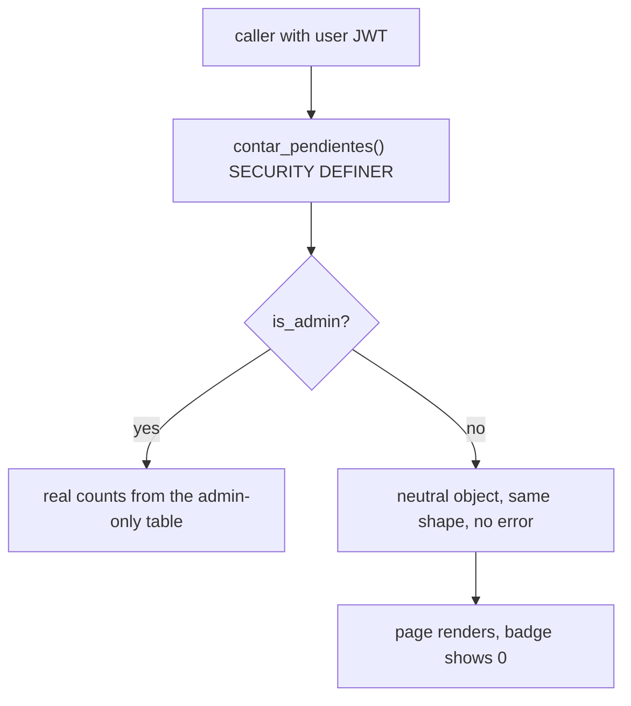

# ADR 0007: Restrict a function by a role check inside it, not by revoking EXECUTE

**Status:** Accepted

## Context

Several functions are `SECURITY DEFINER`: they run as their owner and therefore bypass RLS. That is intentional (it lets admin-only tables be summarised or written through a controlled door) and it makes the function itself the authorization boundary.

One such function, `contar_pendientes()`, returns the count of open items in the pending-data inbox, a table whose RLS policy is admin-only. It was executable by every authenticated role, so a non-admin could read an aggregate of an admin-only table. The textbook fix is `REVOKE EXECUTE ... FROM authenticated`. It was rejected for a reason that is not visible in SQL:

- The function is called by the dashboard route, which requires a session but **not** an admin session. The dashboard service tolerates only the error codes that mean "this object does not exist yet because its migration was not applied" (`42P01`, `42883`, `PGRST202`, `PGRST205`, set in `src/lib/supabase/pg-errors.ts`). `42501` (insufficient privilege) is not in that set.
- So after a `REVOKE`, a KAM or a visitor would have received `42501`, the service would have thrown, and the **entire landing page** would have returned 500 for them, not just one badge missing. A tolerated-error list written for yesterday's failures does not contemplate the error you are about to cause (failure class P18).

Separately, the platform's default privileges grant `EXECUTE` on every new function in the `public` schema to `anon` **by name**, and `REVOKE ... FROM PUBLIC` does not remove a named grant. Every new function is therefore born callable by `anon` until someone says otherwise.

## Decision

1. **Put the restriction inside the function and keep the return shape.** `contar_pendientes()` (`supabase/migrations/0020_repro_truncate_guarda_pendientes_creado_en.sql`) starts with `IF NOT public.is_admin() THEN RETURN` a neutral object of the same shape (`abiertos` zero, empty `por_tipo`). The UI already has copy for that role ("managed by the administrator"), so a zero renders coherently. `EXECUTE` stays granted to `authenticated` and `service_role`, and the ACL is re-emitted after `CREATE OR REPLACE` so the guard does not depend on the replace preserving it. The function was converted from SQL to plpgsql only so the guard could be written literally in its ratified form.
2. **Where the caller maps the error, raise it.** Admin *write* functions such as `aplicar_override` (`supabase/migrations/0006_b5_dominio.sql`) raise `42501` when `is_admin()` is false, because their callers translate it: `esForbidden` in `src/lib/supabase/pg-errors.ts` becomes a typed `forbidden` result and an HTTP 403 (`src/services/override.service.ts`). The two shapes (neutral answer, raised error) follow what each caller can tolerate.
3. **Every `SECURITY DEFINER` function is hardened the same way.** `SET search_path` is pinned, `REVOKE ALL` is applied from `PUBLIC` **and** `anon` explicitly, and `EXECUTE` is granted explicitly. `ingest_snapshot` and the inbox-sync functions are executable by `service_role` only; admin RPCs are executable by `authenticated` and re-check `is_admin()` inside, because the application calls them with the user's session. `supabase/migrations/0006_b5_dominio.sql`, `0028_b10_chat.sql`.
4. **Defaults are closed for the future, not only for today.** `TRUNCATE` is revoked from `anon` and `authenticated` on existing tables and, through `ALTER DEFAULT PRIVILEGES`, for tables created later, so the leak does not reappear with the next table. The guard aborts if `service_role` lost `TRUNCATE` or `authenticated` lost `SELECT` on core tables, i.e. if the revoke reached someone who was not its target (`0020`).
5. **Verify the effect, not the mechanism.** The guard in `0020` does not trust that the function body contains the check: it calls the function as a real non-admin session and requires the neutral shape, and, as an admin, requires a non-neutral answer when open items exist, so a guard that switched the inbox off for the admin cannot pass. When the state was already correct beforehand, or no items are open, it prints an explicit anti-vacuity notice, because a green result then proves nothing. The default-grant behavior is measured by effect in `scripts/chat-negativas.mjs`.
6. **The failure mode of this design is written down.** The guard discriminates by *person* (`auth.uid()`), so both callers must use the session client. If a caller were ever moved to the service role, `auth.uid()` would be null and the function would return the neutral answer to the admin. The migration records this because it is silent.

## Consequences

- (+) A non-admin gets no information and no outage: the landing page keeps working for every role.
- (+) New functions and new tables do not inherit leaks from default privileges.
- (-) Several RPCs stay executable by `authenticated` and rely on their internal check; the platform's security advisor reports them as warnings (`is_admin`, `contar_pendientes`, `aplicar_override`, `aplicar_clasificacion_v2`, `resolver_pendiente`), accepted and documented in `supabase/migrations/0012_b7b_hardening.sql`.
- (-) The neutral answer cannot be told apart, from the caller's side, from "an admin with nothing open"; the UI copy for that role makes the ambiguity harmless, but it is a conscious trade.
- (-) The restriction is only as good as the callers' use of the session client (item 6).
- (-) A tolerance list must be re-audited whenever privileges change on an object that is already consumed.

## Evidence

- `supabase/migrations/0020_repro_truncate_guarda_pendientes_creado_en.sql` (guard inside the function, ACL re-emit, `ALTER DEFAULT PRIVILEGES`, effect-level guard, anti-vacuity notices).
- `supabase/migrations/0006_b5_dominio.sql` (`aplicar_override`, grants of `is_admin`), `0012_b7b_hardening.sql` (advisor warnings), `0028_b10_chat.sql` (revoking from `anon` by name, with an effect-level guard).
- `src/lib/supabase/pg-errors.ts` (`esNoDisponiblePorMigracion`, `esForbidden`), `src/services/dashboard.service.ts` (tolerance of the inbox count), `src/services/override.service.ts`, `src/services/pendientes.service.ts`.
- `scripts/chat-negativas.mjs`, `scripts/rls-negativas.mjs` (live effect checks; see [`../testing.md`](../testing.md)).
- Related: [ADR 0001](0001-rls-roles-and-column-allowlists.md), [ADR 0005](0005-migration-guards-and-replay.md); class P18 in [`../engineering/failure-patterns.md`](../engineering/failure-patterns.md).
