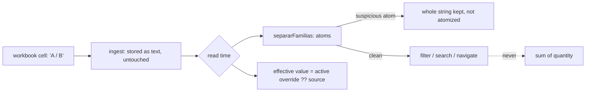

# ADR 0008: Interpretation lives in data and is derived at read; it is never materialized over the source

**Status:** Accepted

## Context

The spreadsheet is the master for the fields it owns, but it is a human-edited artifact, and the portal has to make sense of it without ever overwriting it. Four pressures met on the product catalog:

- `familia` is a **multi-valued field modelled as text**: several families live in one cell separated by `/`. Treated as one atomic value it makes filters wrong (filtering on one family finds only the rows whose cell equals it exactly, while more rows contain it) and makes a search for a family that only appears inside a longer cell return nothing. The symptom shows up three layers away from the cause.
- An administrator needs to fix a family or a description, and to add interpretation (technology, a cleaned brand), but the next ingestion would overwrite any edit made in place.
- A merge of two spellings of a family done by re-pointing foreign keys is undone by the next load, because the bad name is still in the workbook and the family is resolved by exact name on every run.
- Operators rename sheets, add supplier sheets and spell brands and statuses inconsistently; each such change would otherwise need a deploy.

## Decision

1. **Derive family atoms at read, do not materialize them.** `src/lib/familias.ts` (pure) splits the raw cell into atoms when a page or a filter needs them. The migration that introduced the rule explicitly does **not** rewrite `familias`, does not create a table of atomic families and does not auto-merge collisions (`supabase/migrations/0011_taxo.sql`, "what it does NOT do"). Rules of `separarFamilias`: split on `/` only (never on `&` or `-`, which occur inside proper names); tolerate spaces around the separator; trim and collapse inner spaces but **never change case** (display fidelity, comparisons are case-insensitive); drop empty atoms; de-duplicate case-insensitively keeping order; null, empty or blank means no families.
2. **A phantom-atom gate that fails safe.** If any atom looks like a model-suffix rather than a family (two characters or fewer, or purely numeric), the cell is **not** atomized: the whole normalized string is kept as the single value, so a SKU never loses its family (`esAtomoSospechoso` in `src/lib/familias.ts`). The cases that existed when the rule was introduced were queued once, by the migration itself, in the pending-data inbox as `familia_atomo_dudoso` (`0011_taxo.sql`, part P5), and a person decides them. No ingestion step produces that type afterwards: a suspicious cell that first appears in a later load is kept whole, but nothing queues it.
3. **Membership is token-exact, never substring.** `perteneceAFamilia` and `contieneFamilia` compare whole atoms, so one family is never captured by another that shares a prefix. Free-text search is a different layer (`src/services/inventory.service.ts`) and never lives here.
4. **Families are for finding, never for summing.** Any aggregation of quantity uses single-valued dimensions (brand, warehouse); exploding families inside a sum would count the stock of a multi-family SKU several times. A gate test on the dashboard's brand-by-warehouse heatmap enforces it (`src/services/dashboard.service.test.ts`, `heatmapPiezasUniverso` in `src/services/dashboard.service.ts`).
5. **The source stays master; edits are versioned overlays.** Raw source fields are untouched. An admin edit is a row in `productos_override` (authored, revertible by deactivating it); the effective value is the active override, latest wins, falling back to the source (`overrideActivo`, `efectivas` in `src/services/derivaciones.ts`). A separate interpretive table, `clasificacion_v2`, is never written by the ETL. Where the workbook *does* carry a value (technology), the workbook wins and the portal only fills gaps, enforced both in the RPC and by a table trigger so a direct write cannot bypass it (`supabase/migrations/0044_fixb1_tecnologia_editable_excel_gana.sql`); the choice list has a single SQL source, `tecnologias_seleccionables()`.
6. **A merge is a rule, not an action.** `familia_alias` maps a spelling to a family id and is consulted **before** discovery of new names (`resolveFamilia` in `src/services/etl/catalogs.ts`), so the bad name never reaches the "new families" list and the bad row is never created. An alias points at a family id, never at another alias: no chains, no cycles, one hop. A family that arrives for the first time is queued rather than entering silently (`supabase/migrations/0018_mvp2_familia_alias.sql`, `0019_mvp2_familia_nueva.sql`).
7. **Behavior in data, not in code.** Sheet names, excluded and pending sheets, header aliases and the shipments catch-all rule live in one config contract compared in normalized form (`src/config/ingesta-mapeo.ts`); brand, family and status aliases are database tables (`marca_alias`, `familia_alias`, `estatus_alias`); "this brand is not listed in the catalog" is a column with authorship (`supabase/migrations/0039_vert_b2_exclusion_por_marca.sql`), not an `if (brand === ...)`.
8. **Drift is read, not stored.** When the workbook's family assignments move, the change feed already records every reassignment with old and new value; `src/lib/drift-familias.ts` derives the drift from it without touching ingestion.

## Consequences

- (+) The source of truth is unambiguous, edits are traceable and reversible, and an operational change (a new sheet name, an alias) is a config line or a row, reversible without a deploy.
- (+) A change to the splitting rules needs no data migration.
- (-) Every reader must resolve the "effective" value through the single derivation; a second implementation would diverge.
- (-) The atomization is recomputed per read (acceptable for the catalog size and cached per item where an array is already computed).
- (-) The phantom-atom inbox was filled once, by `0011`: a suspicious cell that first appears in a later load is kept whole but nobody is asked about it.
- (-) The alias key is the **whole cell**, because the resolver looks up the full cell text; a merge rule does not cover a family that appears only as one atom of a longer cell (stated in the header of `0018`).
- (-) An unrecognized *required* sheet fails loudly by design while other sheets are dropped silently, so the failure is at the gate ([ADR 0003](0003-empty-and-degraded-input-guards.md)), not at parse time; historical header spellings must be kept in the config on purpose.
- (-) The classification layer is frozen between loads and can drift from the source; a drift flag makes it visible but does not reconcile it.

## Evidence

- `src/lib/familias.ts`, `src/lib/familias.test.ts`, `src/lib/drift-familias.ts`, `src/lib/drift-familias.test.ts`, `src/lib/clasificacion.ts`.
- `src/services/derivaciones.ts`, `src/services/etl/catalogs.ts`, `src/services/dashboard.service.ts`, `src/services/inventory.service.ts`.
- `supabase/migrations/0011_taxo.sql`, `0018_mvp2_familia_alias.sql`, `0019_mvp2_familia_nueva.sql`, `0039_vert_b2_exclusion_por_marca.sql`, `0044_fixb1_tecnologia_editable_excel_gana.sql`.
- `src/config/ingesta-mapeo.ts`, `src/config/ingesta-mapeo.test.ts`, `src/services/ingesta/motor.ts`.
- Related: [ADR 0002](0002-immutable-snapshots-idempotent-by-hash.md), [`../data-model.md`](../data-model.md); failure class P8 ("a list modelled as text") in [`../engineering/failure-patterns.md`](../engineering/failure-patterns.md).
