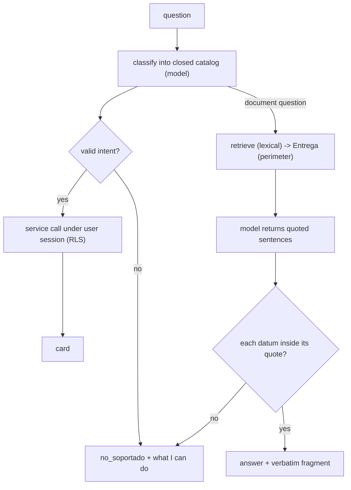

# ADR 0009: A grounded assistant: closed intents, answers only from what it was handed, a persona that is a contract

**Status:** Accepted

## Context

The classic failure of a data assistant is a plausible but wrong answer: a generated query that returns a believable number, or prose that quotes the right figure from the wrong section. Two further risks apply here. The assistant is the first route in the portal that **costs money** per call, so a loop is a billing problem, not only a CPU problem. And part of what it could read (the indexed documentation corpus) must not leave the perimeter for a third party.

A fixed personality brings its own risk: a character document that nothing enforces is a promise with nobody behind it.

## Decision

1. **The model never touches the database and never writes SQL.** It only classifies the question into a **closed catalog of intents**; the router validates the raw output strictly and anything outside the catalog, malformed JSON included, becomes `no_soportado` (`src/lib/chat/enrutador.ts`). Answers come from already-tested service functions executed **with the user's session**, so RLS applies and the assistant can never see more than the user could in the UI (`src/services/chat.service.ts`). Results are shaped as cards (`src/lib/chat/tarjeta.ts`).
2. **No self-declared confidence.** A model's own confidence is not calibrated, so a threshold on it would be a knob with the look of rigor. Instead "none of these" (`ninguna`) is a legitimate catalog value: the model does not estimate how much it knows, it picks from a closed list in which one option is to give up. How well it picks is measured by an evaluation set, where a number means something.
3. **Cost is charged before the model is called, atomically.** The cap is counted and the usage row inserted in one database function under one lock (`chat_registrar_pregunta`, `supabase/migrations/0028_b10_chat.sql`, completed by `0029_b10_anotar_uso.sql`), not "count in the app, write later". One question is one row, written in two phases (cap first, usage afterwards) so the effective cap is not halved. The ledger stores usage and never the text of a question (`src/app/api/chat/route.ts`, `src/lib/chat/topes.ts`). The limits are parameters of the function, not constants baked into it.
4. **The provider is data.** URL, model id and the environment variable that holds the key sit behind one HTTP client (`src/lib/chat/proveedor.ts`, `src/lib/chat/modelo.ts`, selection in `src/lib/env.ts`). Swapping provider is cheap, but a contract drift in a provider is real, so a probe script exists to ask the provider what models it actually offers (`scripts/chat-sonda-proveedor.mjs`); it is an operator tool and is not run in tests.
5. **Document answers come only from what the model was handed.** What may travel to the model is a branded type, `Entrega`, that nobody can build by hand: the only constructor, `armarEntrega`, is where the perimeter is checked, so sending an inventory figure to the model is not merely discouraged but does not compile (`src/lib/chat/entrega.ts`). The model returns **sentences with a copied quotation** as anchor, not prose, and every hard datum in a sentence (a number or a token containing a digit) must appear inside *its own* quotation; a correct number taken from another section does not pass (`src/lib/chat/verificar-redaccion.ts`, `src/lib/chat/redactor.ts`). The verbatim fragment is always shown next to the answer; that display is the counter-measure for paraphrase, which the guard declares it cannot check.
6. **Retrieval is lexical, inside Postgres, with three distinct negatives.** Search unions an exact Spanish-dictionary query with a prefix query on the `simple` dictionary, because the Spanish stemmer does not unify English product-name plurals (`supabase/migrations/0033_b11_busqueda_corpus.sql`, `0034_b11_busqueda_prefijo.sql`). The `embedding` column exists but retrieval does not use it, so the corpus does not have to leave the perimeter in order to be searched. The order of checks is the rule: index empty, then query failed, then no sheet for this item, and "no sheet" is never said without passing the first two (`src/services/corpus-consulta.service.ts`).
7. **The corpus is handled defensively.** Chunking never splits a table (an oversized table is flagged `excede`, not cut) and each chunk carries its provenance header (`src/lib/corpus/trocear.ts`). The sync records the attempt **at the start**, sends the whole manifest (absence means deletion), stops before touching anything on a mass deletion, and stops the **whole batch** if any file looks like a secret (`src/services/corpus.service.ts`, `src/lib/corpus/manifiesto.ts`, `src/lib/corpus/secretos.ts`). A `commit_sha` must come from version control; a source without one returns a value that cannot be mistaken for a sha (`src/lib/corpus/fuente.ts`).
8. **The persona is a contract with mechanical gates.** The assistant's fixed phrases live in one place (`src/lib/chat/voz.ts`) and a test proves no component bakes its own copy; on the routed path the model only classifies and the server renders, so the persona cannot produce a falsehood there: its sentences are written and its numbers come from the database. The persona document declares numbered gates, and a test **derives the gate ids from the document** and fails if any gate has no test that names it (`src/lib/chat/soul-gates.test.ts`).
9. **Evaluate rates, list the unstable.** Classification is not deterministic (the model used during development rejected temperature zero, see the header of `src/lib/chat/evaluacion.ts`), so each question is run several times, the bar is a rate, and the unstable questions are listed separately; the question set includes the shapes real users type (a bare SKU, a loose term), not only well-formed sentences (`src/lib/chat/evaluacion.ts`, `src/lib/chat/evaluacion-rag.ts`).

## Consequences

- (+) No generated SQL, no privilege escalation, bounded cost, and no "not documented" answer that is really an empty index or a failed query.
- (+) The corpus is searchable without a third-party service; the perimeter is a type, not a habit.
- (-) Only questions that map to known intents are answerable, and there are no synonyms in retrieval (a word the document does not use is not found).
- (-) Paraphrase is not verified: a number-free claim anchored to a fragment that exists but says something else passes the guard; the always-visible verbatim is the only counter-measure.
- (-) The conversation is not persisted by decision (it would become user-originated data with its own table, RLS and backup problem), and dispatch between "a named SKU" and "an unknown question about a SKU" is decided by text comparison, not understanding.
- (-) The rate cap bounds loops, it does not ration users; per-question cost is not comparable before and after the document path was added, so the two calls are recorded in separate columns (`0040_chatb1_consumo_redaccion.sql`).
- (-) A real corpus has to be supplied by the operator: the repository ships none (the corpus tests use short invented text inline, and the only Markdown fixture, `src/lib/chat/__fixtures__/contrato-de-voz.md`, is an invented voice contract for the persona gates, not a corpus). The corpus source is an interface (`FuenteCorpus` in `src/lib/corpus/fuente.ts`) and the only implementation that ships is the local-directory one (`fuenteLocal` in `scripts/corpus-sync.mjs`).

## Evidence

- Routing and cards: `src/lib/chat/enrutador.ts`, `src/lib/chat/intenciones.ts`, `src/lib/chat/tarjeta.ts`, `src/services/chat.service.ts`, `src/app/api/chat/route.ts`.
- Grounded answers: `src/lib/chat/entrega.ts`, `src/lib/chat/redactor.ts`, `src/lib/chat/verificar-redaccion.ts`, `src/lib/chat/redaccion.ts`, `src/services/corpus-consulta.service.ts`.
- Corpus: `src/lib/corpus/{trocear,manifiesto,secretos,fuente,frescura}.ts`, `src/services/corpus.service.ts`, `scripts/corpus-sync.mjs`, `supabase/migrations/0030_b11_corpus.sql`, `0032_b11_corpus_lectura.sql`, `0033_b11_busqueda_corpus.sql`, `0034_b11_busqueda_prefijo.sql`, `0035_b11_frescura_corpus.sql`.
- Cost: `supabase/migrations/0028_b10_chat.sql`, `0029_b10_anotar_uso.sql`, `0040_chatb1_consumo_redaccion.sql`, `src/lib/chat/topes.ts`, `scripts/chat-negativas.mjs`.
- Persona and evaluation: `src/lib/chat/voz.ts`, `src/lib/chat/voz.test.ts`, `src/lib/chat/soul-gates.test.ts`, `src/lib/chat/evaluacion.test.ts`, `src/lib/chat/evaluacion-rag.test.ts`, `src/lib/chat/verificar-redaccion.test.ts`.
- Related: [ADR 0001](0001-rls-roles-and-column-allowlists.md) (session client, service role confined); failure classes P20, P25 in [`../engineering/failure-patterns.md`](../engineering/failure-patterns.md).
