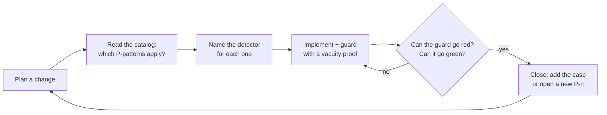

# Failure patterns

A catalog of **classes of failure**, not of bugs. A bug is fixed once; a class comes back in a new disguise. Each entry names the class, says how it showed up in this codebase, and points at the guard or detector that exists in the repository (or says plainly that there is none).

The IDs `P1` ... `P37` are stable. The source code and the tests cite them in comments and test titles (more than 700 bare mentions, found with `rg -w 'P([1-9]|[12][0-9]|3[0-7])' src scripts supabase`), so the numbering is never reused or compacted. If you meet a `P<n>` token in a file, this page is where it is defined.

How the catalog is used (the working rule of the project):

1. Before designing a change, read the list and write down which patterns apply and which detector will be installed for each.
2. Every guard that is added declares what it cannot check.
3. On closing, add the new case to the pattern it belongs to, or open a new pattern together with its detector.
4. A pattern is never deleted. The value is in the disguise, not in the bug.

The anti-vacuity question in the diamond is the thread that ties P16, P19, P21, P25 and P32 together.

## Families at a glance

| Family | Patterns | One-line idea |
|---|---|---|
| The environment and the measurement lie | P1, P2, P27, P28, P29, P31 | The number or the symptom is real but does not mean what it appears to mean. |
| State and timing | P3, P15, P33 | A value changes between two reads, a retry hides the damage, a copy is mistaken for the source. |
| Silent failure and tolerant readers | P4, P5, P12, P14, P18 | Nothing errors, and something wrong is accepted as right. |
| Ingestion and data shape | P8, P10, P11, P13, P17, P20, P22 | Empty, degraded or multi-valued input passes a gate written for the normal case. |
| Guards that do not guard | P6, P16, P19, P21, P23, P25, P26, P32, P34, P35, P36, P37 | The detector itself lies or looks at the wrong thing. |
| Interface completeness | P7, P24 | The screen promises something the product does not deliver, or delivers half. |
| Destructive operations | P9 | Deleting by search result instead of by identity. |

Where a pattern has an automated detector, the entry names the file. Where it has none, the entry says so (P7, P18, P28, P29 and P31 are review disciplines more than code).

## Catalog

### P1 · Lying environment

**Symptom.** The environment fails selectively and looks like an application bug: a stale dev server answers 500 with an HTML page without running the handler, or a credential inherited from the shell makes a live test report "invalid key".
**Cause.** A leftover process or an inherited variable nobody listed as an input.
**Guard.** Tests that spawn child processes strip the inherited variables before spawning (`envParaHijo()` in `scripts/rls-negativas.test.ts`); live runs use a single dev server and compare UI, API and database.

### P2 · Unverified truth

**Symptom.** A precise number that everyone repeats and nobody has a query for; the precision reads as verification.
**Cause.** A figure is copied from a document or a screen instead of being recomputed from the data.
**Guard.** One arithmetic per concept (`descuadresDe` in `src/services/derivaciones.ts`), per-SKU integrity gates that recompute the sums the sheets claim (`src/services/etl/gates.ts`), and ingestion tests that run the real parser on sample workbooks and assert exact derived values (`src/services/ingesta/__tests__/preflight.test.ts`, `src/services/ingesta/__tests__/libros-muestra.ts`).

### P3 · State that changes between two reads

**Symptom.** The value read is gone or different by the time it is used; invisible in tests because mocks resolve in one tick.
**Cause.** No latency, no intermediate render, no concurrent writer in the test double. The UI form is the remount: `loading && <Skeleton/>` replaces the whole view on every refetch and drops open menus, focus and scroll.
**Guard.** Anti-remount gates keep the view mounted and mark it busy; the test forces `loading = true` with data already in hand by mocking the hook (`src/components/dashboard/dashboard-view.antiremount.test.tsx`). Date helpers run under a pinned time zone (`TZ` in `vitest.config.ts`).

### P4 · Silence on failure / fail-open

**Symptom.** No error, just an empty or invented result, and the system walks on.
**Cause.** `data ?? []` without looking at `.error`; a denied `UPDATE` or `DELETE` that answers `200 []`.
**Guard.** Every read checks `.error` and fails fast with a specific message (`assertPrevOk` in `src/services/etl/persist.ts`, tests in `src/services/etl/__tests__/persist.loadPrevState.test.ts`). Negative RLS tests assert `before === after` on the data, never the HTTP status (`scripts/rls-negativas.mjs`, `supabase/tests/rls_negative_tests.sql`).

### P5 · Unwritten assumption

**Symptom.** The code rests on a belief about an external system that was never probed.
**Cause.** PostgREST error codes, auth-service behaviour or the monthly workbook layout were assumed, not observed.
**Guard.** Probe the real system before coding and write the evidence next to the code: the observed PostgREST codes are recorded in the header of `src/lib/supabase/pg-errors.ts`; the sheet and column mapping lives in one place (`src/config/ingesta-mapeo.ts`); the ingestion preflight evaluates a workbook before anything is persisted (`src/services/ingesta/preflight.ts`).

### P6 · Coverage that gives false confidence

**Symptom.** The suite is green and growing, and a severe bug is in production.
**Cause.** The detector itself lies: tests mock `fetch` and never run a route handler inside the framework; a truncated output or an isolated "N passed" is read as green.
**Guard.** Read `Test Files` and the exit code, never an isolated count. Regression locks are checked by hand with a mutant (revert the fix, the lock must go red); there is no mutation-testing tool in `package.json`. The cheapest instrument, `tsc --noEmit`, is enforced mechanically by `.githooks/pre-commit`, because a convention without a mechanism does not hold.

### P7 · Phantom interface

**Symptom.** Navigation promises destinations that are placeholders; the route answers 200 and has an auth test, so QA calls it healthy.
**Cause.** The existence of the route is tested; the substance of the page is not.
**Guard.** Inventory of navigation targets against pages (`src/lib/nav.ts`, `src/lib/nav-nombres.test.ts`). There is no automated substance test per item; this is a review discipline.

### P8 · List modeled as text

**Symptom.** A multi-value business field (several values separated by `/` in one cell) is typed, compared and aggregated as one atomic value; the symptom shows three layers later as wrong totals.
**Cause.** "Rows equal X" and "rows contain X" are different questions.
**Guard.** Splitting lives in one module with a suspicious-atom check that keeps the whole cell unsplit (`separarFamilias`, `contieneFamilia`, `esAtomoSospechoso` in `src/lib/familias.ts`); the cases that existed when the check was introduced were queued once for a human by `supabase/migrations/0011_taxo.sql`, and nothing queues later ones. The derived array is a required field so the compiler lists every call site (`src/types/api.ts`), and a conservation gate reuses the production aggregation (`src/services/dashboard.service.test.ts`). See `docs/decisions/0008-derive-family-taxonomy-at-read.md`.

### P9 · Deleting by enumeration instead of identity

**Symptom.** A cleanup script deleted every account of a project instead of only the disposable ones it was allowed to remove.
**Cause.** It asked the server "which accounts match this email?"; the endpoint silently ignored the filter and returned the full list, and the loop deleted the list.
**Guard.** Create keeping the returned id; delete only that exact id; count `auth.users` before and after and abort loudly on mismatch; cap the blast radius per run; report the exact UUIDs if cleanup fails. The six rules are in the header of `scripts/rls-negativas.mjs` and are tested in `scripts/rls-negativas.test.ts`. The same blast-radius idea exists in SQL (`supabase/migrations/0010_b7a_rol_visitante.sql`, `supabase/migrations/0012_b7b_hardening.sql`).

### P10 · Empty dataset from an unmapped sheet = false success

**Symptom.** A load answers 200 with a whole dataset missing.
**Cause.** Zero recognized sheets looks identical to zero legitimate rows.
**Guard.** A blocking gate on the classification of sheet names, not on row counts: a recognized sheet with zero rows must not trigger it (`DatasetsStockFaltantesError` in `src/services/ingesta/motor.ts`; `evaluarGateStock` in `src/services/ingesta/preflight.ts` measures the same thing without persisting). Rationale in `docs/decisions/0003-empty-and-degraded-input-guards.md`.

### P11 · Lost column masked by the resolution layer above

**Symptom.** A renamed header makes a field lose its source column while a higher layer (alias or override) keeps showing plausible values.
**Cause.** The override layer fills the hole, so nothing downstream looks empty.
**Guard.** A per-column "expected column absent" diagnostic at sheet level, never blocking (`CAMPOS_VISIBLES_OPCIONALES` in `src/services/etl/parse.inventario.ts`; tests in `src/services/etl/__tests__/parse.inventario.test.ts`).

### P12 · A tolerant reader turns garbage into valid data

**Symptom.** Bytes that are not a workbook come back as a well-shaped, wrong structure.
**Cause.** The spreadsheet library falls back to CSV on non-ZIP input, and the declared `Content-Type` is trusted.
**Guard.** Validate a structural property inside the primitive before parsing: the ZIP signature (`esZip`) and a cell budget over the *declared* range evaluated before allocation (`presupuestoDeCeldas`), both in `src/services/ingesta/io.ts` and tested in `src/services/ingesta/__tests__/io.buffer.test.ts`. See `docs/decisions/0004-http-upload-door-and-external-scheduler.md`.

### P13 · Protection lived in two places and only one was inherited

**Symptom.** A second door into a pipeline claims "same gates as the first", but one of the original protections is missing.
**Cause.** The original protection was two mechanisms in two layers, and only the visible one was copied.
**Guard.** Enumerate the original door's mechanisms one by one and reuse the whole contract validation instead of re-implementing half: the upload route re-validates the body it builds with `RefreshBody.safeParse` (`src/app/api/refresh/archivo/route.ts`, test in `src/app/api/refresh/archivo/route.test.ts`).

### P14 · The degraded request that passes as valid

**Symptom.** A well-formed request with empty content is accepted.
**Cause.** Validation checks shape ("is an array") and not content ("has at least one element"); a retry layer may also re-send a body that was already consumed.
**Guard.** `.min(1)` per dataset in `src/schemas/refresh.schema.ts` (an inventory dataset needs a header plus at least one row), and a whitelist of re-sendable bodies in the retry wrapper (`esCuerpoReenviable` in `src/lib/supabase/reintento.ts`).

### P15 · The retry that hides the failure

**Symptom.** A self-healing system reports health while degrading; the dashboard is green because it falls and rises.
**Cause.** Retries are logged but not returned, and logs expire.
**Guard.** The retry trail travels in the *result*, also on the happy path, with an explicit "budget exhausted" flag (`RastroResiliencia` in `src/lib/supabase/reintento.ts`, `EtlResult.resiliencia` in `src/services/etl/types.ts`, emitted from `src/services/etl/runEtl.ts`).

### P16 · The guard that verifies the mechanism and assumes the effect

**Symptom.** A guard passes, authorizes closing, and the user-visible effect is broken.
**Cause.** The guard checks rigorously what it can see from where it stands (for example `.select()` calls against column grants) and assumes the consequence.
**Guard.** Guards declare their border (a closing `RAISE NOTICE` in `supabase/migrations/0017_mvp2_metadata_por_rpc.sql` and `supabase/migrations/0018_mvp2_familia_alias.sql`); target lists are derived from the database, never typed by hand, and the guard watches the write side, where the count can rise above zero (`scripts/guarda-lista-blanca.mjs` derives the allowlist tables from `pg_class` and `pg_attribute`).

### P17 · The empty universe that passes as resolved

**Symptom.** A maintenance statement decides by absence ("not in the current set, so it no longer applies") and wipes everything when the set is empty.
**Cause.** Nobody asked what the statement does on an empty universe.
**Guard.** A count guard before the statement that returns early without touching anything (`IF v_snap IS NULL OR v_productos = 0 THEN RETURN jsonb_build_object(... 'omitido' ...)`), never a catch afterwards: `supabase/migrations/0015_mvp_cierre_autocierre_seguro.sql` (redefined with the same guard in `supabase/migrations/0038_cat_b1_reapertura_por_condicion.sql`). The question is step 3 of the irreversibility checklist in the header of `scripts/aplicar-migracion.mjs`. The ETL has the same "no previous snapshot" exception in `src/services/etl/runEtl.ts`.

### P18 · The tolerated-error list that does not contemplate the error you will cause

**Symptom.** A privilege change in a migration makes a service answer with an error that an old "tolerated errors" list silently swallows.
**Cause.** The list was written for yesterday's failures (object missing because a migration had not run) and now also absorbs "permission denied".
**Guard.** Grep the tolerance set before any `GRANT` or `REVOKE` on an object a service already consumes (`CODIGOS_NO_DISPONIBLE_POR_MIGRACION` in `src/lib/supabase/pg-errors.ts`); prefer a role check *inside* the function with the same return shape (`docs/decisions/0007-privilege-guards-inside-functions.md`). No automated sweep exists.

### P19 · The guard that cannot fail

**Symptom.** A guard passes against a state where "no" is impossible (empty set, universal quantifier over nothing) and authorizes closing.
**Cause.** Nobody built the state that should turn it red.
**Guard.** A mandatory vacuity proof: a deliberately built state that turns the guard red, versioned next to it. See the anti-vacuity notices in `supabase/migrations/0020_repro_truncate_guarda_pendientes_creado_en.sql` and `supabase/migrations/0023_reproducibilidad_backfill_periodo_civil.sql`, and the "red vacuity" tests of the migration applier in `scripts/aplicar-migracion.test.ts`.

### P20 · The metric whose worst case produces the weakest signal

**Symptom.** A correct, well-measured metric does not contain the signal: the case to catch sits mid-range, so no threshold separates it.
**Cause.** The target was assumed to be at the extreme of the metric.
**Guard.** Contrast a candidate threshold against the full history before proposing it, report the worst legitimate case per source, and name the universe in the code and in the rejection message. The incoming-universe guard in `src/services/etl/runEtl.ts` (`UMBRAL_UNIVERSO_MINIMO = 0.5`) catches emptying, not degradation, and says so in its header; the origin of the finding is in `src/services/etl/differ.ts`, where removals apply only to active shipments, so their fraction measures rotation rather than emptying.

### P21 · The guard that cannot pass (the B side of P19)

**Symptom.** A migration guard aborts, accusing another object.
**Cause.** A condition that never produced both outcomes was drafted, not verified; it compared text against the output of a `pg_get_*` function.
**Guard.** Replay the full migration chain on a clean real database for any migration that reads the catalog, and resolve by identity (`to_regprocedure`, `to_regclass`) instead of by text. The static verifier lists what it cannot catch in its "what it does not catch" section (`scripts/verificar-migracion.mjs`, tests in `scripts/verificar-migracion.test.ts`); `scripts/compilar-migracion.mjs` is the compile-inside-a-rollback step. See `docs/decisions/0005-migration-guards-and-replay.md`.

### P22 · The guard checks the FORM of an identifier, not its COLLISION

**Symptom.** A generated identifier passes a regex or prefix check and still collides.
**Cause.** What matters is uniqueness, and uniqueness was never asserted.
**Guard.** Assert `count(DISTINCT ...)` at the regime changes of the generator, not at representative values: the human-readable folio of the projects table is guarded this way in `supabase/migrations/0024_b8_proyectos.sql`. No file other than this page cites `P22` by its bare ID (the folio guard in that migration does not name it).

### P23 · The red guard that points to a real defect although its assertion is wrong

**Symptom.** A gate goes red, the instinct is to fix the assertion, and the finding is lost.
**Cause.** The assertion counted what is easy to count (the event) instead of what a human perceives (the SKU).
**Guard.** Ask first whether the product is wrong. The notification panel groups by SKU because one SKU with two signals is one piece of news (`agregarPorSku` in `src/lib/avisos.ts`; the same grain is documented in `src/lib/correo-plantilla.ts`).

### P24 · The half function that looks exactly like the complete one

**Symptom.** Every layer (migration, type, schema, service, tests) is green and the one place a human touches it does not exist. There is no symptom at all.
**Cause.** A capability was built bottom-up and the control was never added.
**Guard.** For every new user-changeable capability answer three questions: how is it switched on from the default state, how is it switched off, how can you see it is on without opening anything. `src/components/alcanzabilidad.test.tsx` mounts the real composition of the screen starting from a profile with no preferences row.

### P25 · The right result for the wrong reason

**Symptom.** A check yields the expected result for a reason other than the believed one, and nobody reviews the inference.
**Cause.** Measuring a source about the thing instead of the thing; an "acceptable" limitation never tested against the case that motivated the guard; a sabotage that goes red without checking which assertions fell.
**Guard.** Verify by the reason, not by the value. Evaluations report a rate and list the unstable questions separately (`src/lib/chat/evaluacion.ts`), and each case of the retrieval evaluation declares how it is scored so that a case outside the rate is reported apart, not folded in (`src/lib/chat/evaluacion-rag.ts`); a sabotage must fall through *its own* assertions.

### P26 · The fixture proves your understanding, not your code

**Symptom.** Two correctly designed pieces break each other through a shared character, separator or order that no fixture anticipates.
**Cause.** A fixture holds only what its author's mental model contains.
**Guard.** Sweep each external-data component against realistic data and declare whether the branch was exercised (the label is `SIN VEREDICTO`, "no verdict", never green); ask "which runs first, and why". In this repository the sweep runs against generated sample workbooks (`src/services/ingesta/__tests__/libros-muestra.ts`).

### P27 · Measuring the REPRESENTATION instead of the THING

**Symptom.** Coverage is reported by counting rows of a bridge table instead of paths someone can walk; both numbers are true about their own subject.
**Cause.** The structure that represents something was counted instead of the thing that can be reached.
**Guard.** Before reporting coverage ask "does this count what exists or what can be reached". The family-to-document bridge witness counts documents reachable by the one path a user walks (SKU, then family, then sheet), not bridge rows: `puentesSinCamino` in `src/lib/drift-familias.ts`.

### P28 · The plausible explanation nobody measured

**Symptom.** Two measurements of the same invariant differ; an explanation that fits a known pattern is written down as a finding.
**Cause.** Fitting a pattern feels like verifying.
**Guard.** Run the comparison before the explanation enters a document. Review discipline; a retraction of this kind is recorded in `src/lib/chat/tarjeta.ts`.

### P29 · The ornament figure

**Symptom.** A true finding is written with a number that sounds like a measurement and is an estimate (own converter, assumed advance width, from memory), and the figure travels with the finding.
**Cause.** P28 applied to the report instead of the system. Its reverse, P29-b: a re-worded claim is not the same claim.
**Guard.** Attack each finding with independent lenses, strip figures that were not measured, and let the finding stand without the number. Review discipline; the retractions are recorded in `src/components/dashboard/riel-contraste.test.ts` and `src/services/documento/pdf.ts`.

### P30 · (retired)

Not defined. The number was reserved for a parallel line of work and never written; it stays unused so the other IDs do not move. No file in this repository cites `P30`.

### P31 · The gap that was the truth

**Symptom.** A surface shows less than its space allows and reads as a layout defect.
**Cause.** Sometimes the gap is the honest drawing of absent data, and filling it makes the screen lie.
**Guard.** Decide which of three classes it is before touching anything; the detector is a database query, not a design review. Review discipline; no code detector.

### P32 · The guard of a step that is not taken

**Symptom.** A guard bites perfectly, at a subject that no longer exists: a flag skips the step but the guard still demands it. Its error message is true in the general case, so nobody disputes it.
**Cause.** The guard is evaluated before the branch that decides the step.
**Guard.** A guard that names the step it protects asks "can that step be skipped?"; skipping a step moves the risk, it rarely removes it. The two guards and their positive controls are in `scripts/layout-check.mjs`.

### P33 · An environment variable is not a source of truth, it is ANOTHER COPY

**Symptom.** A value in a versioned file is corrected from an environment variable, and shared staleness is propagated.
**Cause.** Comparing two copies detects divergence, never shared obsolescence.
**Guard.** Treat the live system as the source and add a "which copy is authoritative" step to recipes. `src/lib/admin-fundador.test.ts` compares the constant used by `scripts/bootstrap-admin.mjs` against the contacts directory (`src/lib/contactos.ts`); its header states that it detects the copies drifting apart, not both ageing together.

### P34 · The parser reads TEXT, and a comment is text

**Symptom.** Adding a comment to a file changed what a parser saw and turned an unrelated test red.
**Cause.** A file that somebody parses has an undeclared contract.
**Guard.** Before commenting a file, ask whether someone parses it; strip comments before parsing, with a positive control in both directions (a planted comment is ignored *and* a real declaration changed is still detected). `src/app/globals.css` declares in its header that it is parsed; the parser is in `src/services/documento/tokens.globals.test.ts`; the shared comment stripper is `sinComentarios` in `src/lib/guardas/codigo-fuente.ts`.

### P35 · The comment declares the invariant and the code below violates it

**Symptom.** A comment and the lines right below it, written by the same author minutes apart, say opposite things.
**Cause.** Nothing ties a stated invariant to the code that should honour it.
**Guard.** Review comments as claims and compare the stated invariant with the next lines mechanically where possible. Two instances were found and corrected; their comments record the retraction (`src/lib/chat/redaccion.ts`, `src/components/dashboard/dashboard-kpis.tsx`).

### P36 · The harness builds the input the system must DERIVE

**Symptom.** A test passes green and leaves untouched the step where the defect lives.
**Cause.** The harness fabricates its own input instead of feeding the raw input and letting the system derive it; a cousin of P26 (the harness is right about the shape and skips the stage that produces it).
**Guard.** Feed the raw row and let the system derive, with a control that fails when the derivation is removed: see the raw-row assertions in `src/services/sku.service.test.ts` and the fake that must not grant what the real server denies in `src/services/etl/__tests__/persist.loadPrevState.paginacion.test.ts`.

### P37 · The right guarantee on the wrong surface

**Symptom.** The system computes the right thing, stores it in the response object, a test checks it there, and it is not on the screen.
**Cause.** The object is not the page.
**Guard.** Assert at the surface the client reads (rendered text), and separate by class, not by text, so that a guarantee cannot hide inside a collapsible. The assistant card carries a distinct `aviso` field for "what changes the meaning of the answer" (`src/lib/chat/tarjeta.ts`); the DOM test is `src/components/chat/soul-dom.test.tsx`. See `docs/decisions/0009-grounded-assistant-persona-contract.md`.

## Three techniques that are not failure patterns

- **T1 · A prompt example is code, not prose.** Rewriting a prompt "saying the same but more general" is refactoring without tests; the examples carry the cases. Keep an evaluation set with the bar placed where it should be (`src/lib/chat/evaluacion.ts`).
- **T2 · Verifying that something was CALLED is not verifying WITH WHAT it was called.** The test double must record its arguments and the assertion must be on them.
- **T3 · A proportion as a diagnostic instrument.** When a catalog grows, look at which proportion moved and which did not: a count says "four were missing", a proportion says of which class.

## Detector index

| Pattern | Where the detector lives |
|---|---|
| P3 | `src/components/dashboard/dashboard-view.antiremount.test.tsx`, `vitest.config.ts` |
| P4 | `src/services/etl/persist.ts`, `scripts/rls-negativas.mjs`, `supabase/tests/rls_negative_tests.sql` |
| P5 | `src/lib/supabase/pg-errors.ts`, `src/config/ingesta-mapeo.ts` |
| P8 | `src/lib/familias.ts`, `src/services/dashboard.service.test.ts` |
| P9 | `scripts/rls-negativas.mjs`, `scripts/rls-negativas.test.ts` |
| P10 | `src/services/ingesta/motor.ts`, `src/services/ingesta/preflight.ts` |
| P11 | `src/services/etl/parse.inventario.ts` |
| P12 | `src/services/ingesta/io.ts` |
| P13, P14 | `src/app/api/refresh/archivo/route.ts`, `src/schemas/refresh.schema.ts`, `src/lib/supabase/reintento.ts` |
| P15 | `src/lib/supabase/reintento.ts`, `src/services/etl/runEtl.ts` |
| P16 | `scripts/guarda-lista-blanca.mjs` |
| P17 | `scripts/aplicar-migracion.mjs`, `supabase/migrations/0015_mvp_cierre_autocierre_seguro.sql` |
| P18 | `src/lib/supabase/pg-errors.ts` |
| P19 | `scripts/aplicar-migracion.test.ts`, migrations `0020` and `0023` |
| P21 | `scripts/verificar-migracion.mjs`, `scripts/compilar-migracion.mjs` |
| P24 | `src/components/alcanzabilidad.test.tsx` |
| P32 | `scripts/layout-check.mjs` |
| P34 | `src/services/documento/tokens.globals.test.ts`, `src/lib/guardas/codigo-fuente.ts` |
| P37 | `src/components/chat/soul-dom.test.tsx` |

The limitations that remain open are in `docs/known-limitations.md`; the way the catalog is used by the gated, multi-role workflow is in `docs/ai-assisted-workflow.md`.
