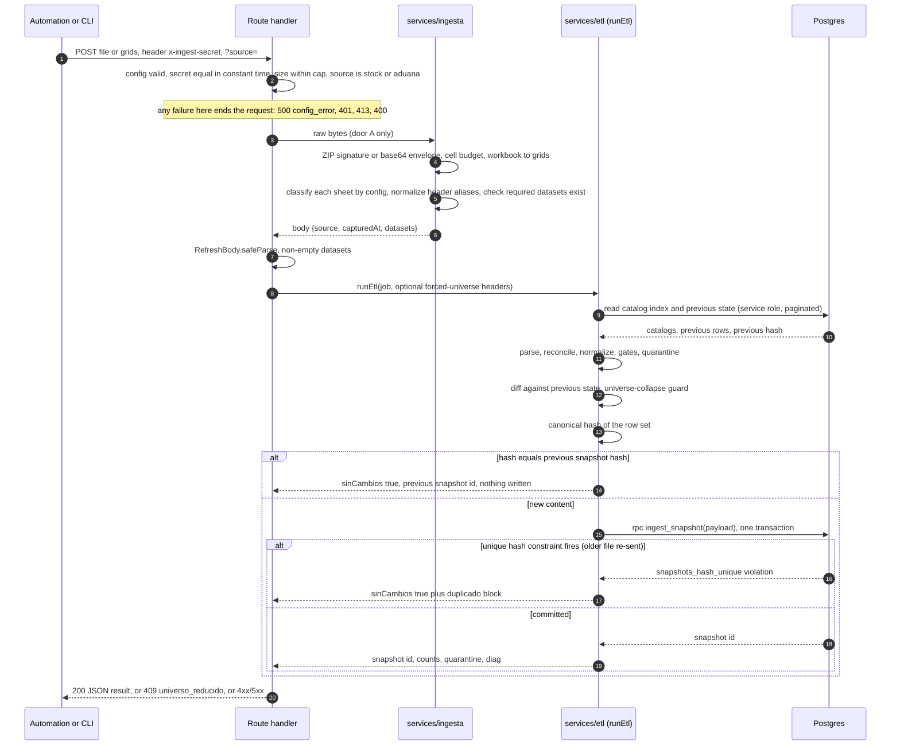

# Ingestion: from Excel to a snapshot

This document follows one workbook from the moment an automation sends it to the moment a snapshot exists in the database, and explains every guard on the way. The business keeps editing two workbooks and the portal never replaces them, so ingestion has to be tolerant of how people edit spreadsheets and strict about never turning a broken file into a plausible snapshot.

Related: [architecture.md](architecture.md), [data-model.md](data-model.md), [security.md](security.md). Design records: [decisions/0002-immutable-snapshots-idempotent-by-hash.md](decisions/0002-immutable-snapshots-idempotent-by-hash.md), [decisions/0003-empty-and-degraded-input-guards.md](decisions/0003-empty-and-degraded-input-guards.md), [decisions/0004-http-upload-door-and-external-scheduler.md](decisions/0004-http-upload-door-and-external-scheduler.md).

## 1. Vocabulary

| Term | Meaning |
|---|---|
| source (`fuente`) | `stock` (the inventory workbook: inventory sheet, second-warehouse sheet, reservations sheet) or `aduana` (the shipments workbook: one sheet per supplier, plus history sheets). Each source has its own chain of snapshots |
| grid | A sheet as a rectangular array of strings, numbers, booleans and nulls (`src/services/etl/types.ts`) |
| dataset | A grid assigned to a logical role: `inventario`, `west`, `reserva` (stock) or `embarques` (a list of named grids) |
| snapshot | One immutable ingestion result in the database |
| quarantine | Rows that were read but could not be accepted, returned with a reason; never silently dropped |
| diag | A numeric disagreement between two figures in the source; kept and reported, never discarded |

The second-warehouse dataset is keyed `west` throughout the code and the contract (`src/schemas/refresh.schema.ts`, `src/services/ingesta/motor.ts`).

## 2. Two doors, one engine

| Door | Caller | Body | Code |
|---|---|---|---|
| A. `POST /api/refresh/archivo?source=stock` or `aduana` | An external automation that fetches the workbook and forwards the file | Raw `.xlsx` or `.xlsm` bytes, or a JSON envelope `{"$content": "<base64>"}` | `src/app/api/refresh/archivo/route.ts`, `src/services/ingesta/desde-archivo.ts` |
| B. `POST /api/refresh` | A local CLI that reads the workbooks and builds the JSON | `{source: 'stock', capturedAt, datasets: {inventario, west, reserva}}` or `{source: 'aduana', capturedAt, datasets: {embarques: [{hoja, grid}]}}`, plus one legacy single-sheet shipments form | `src/app/api/refresh/route.ts`, `scripts/ingesta-mensual.mjs`, `src/schemas/refresh.schema.ts` |

Both doors share everything from "workbook to grids" onward: `workbookAGrids` in `src/services/ingesta/io.ts`, `construirDatasets` in `src/services/ingesta/motor.ts`, the same `RefreshBody` contract and the same ETL. Door B is the manual fallback and the way to dry-run a workbook before sending it. The equivalence of the two doors is asserted with `toEqual`, not "similar figures", in `src/services/ingesta/__tests__/desde-archivo.test.ts`; and it holds by construction, because disk and memory reads share the one function that converts a workbook to grids (comment above `workbookAGrids` in `src/services/ingesta/io.ts`).

The automation is intentionally dumb: it passes bytes. All interpretation lives in the repository, where it is versioned and tested. See [decisions/0004-http-upload-door-and-external-scheduler.md](decisions/0004-http-upload-door-and-external-scheduler.md).

## 3. The whole path

## 4. Step by step

### 4.1 Gate

Order in `src/app/api/refresh/archivo/route.ts`:

1. `getServerEnv()` must parse, otherwise 500 `config_error`.
2. `x-ingest-secret` is compared in constant time (`src/lib/api/ingest-auth.ts`), otherwise 401 `unauthorized`.
3. A declared `content-length` above 15 MB (`MAX_ARCHIVO_BYTES = 15_000_000`), and later the actual byte length, give 413 `payload_too_large`.
4. `source` must be exactly `stock` or `aduana`. It is never guessed from the content. A shipments workbook sent as `source=stock` yields 400, because the three stock datasets cannot be assigned (`DatasetsStockFaltantesError`, section 4.4). The reverse is not caught at this gate: the shipments side is a catch-all, so a stock workbook sent as `source=aduana` is read as sheets that hold no shipment rows. On the first load of a source there is no previous snapshot to compare against, so an empty shipments snapshot is accepted; once the shipments chain has a non-empty snapshot, the universe-shrink guard answers 409 `universo_reducido`.

The route runs with `maxDuration = 60` seconds. Door B has the same secret check and the same 15 MB cap on the declared length (`src/app/api/refresh/route.ts`). Both routes are exempt from the same-origin check and from the middleware, because an automation has no browser (see [security.md](security.md)).

### 4.2 Recognize the file by its bytes

The body is accepted if it starts with the ZIP signature (`PK\x03\x04`) or is a JSON envelope whose `$content` decodes from base64 to a ZIP. The declared `Content-Type` is not trusted. A macro-enabled workbook is also a ZIP and is read the same way. Anything else raises `ArchivoIlegibleError`, mapped to 400 `invalid_body` with a message that names the cause. Evidence: `extraerBytesDelCuerpo` in `src/services/ingesta/desde-archivo.ts`.

The same ZIP check exists a second time inside the reader (`leerWorkbookDesdeBuffer` in `src/services/ingesta/io.ts`). That is deliberate: without it the spreadsheet library auto-detects the format and would read arbitrary bytes as a plausible text sheet. For the shipments source this matters most, because every sheet that is not excluded is a shipments sheet, so a bogus `Sheet1` would have produced an empty snapshot reported as success.

A second guard in `io.ts` (`presupuestoDeCeldas`) refuses workbooks whose sheets declare more than 2,000,000 cells in total (`MAX_CELDAS_LIBRO`). The declared range is controlled by whoever sends the file, and a tiny valid workbook can declare an enormous grid. The limit is checked on the declared range before any grid is allocated. Tests: `src/services/ingesta/__tests__/io.buffer.test.ts`.

### 4.3 Workbook to grids

The reader turns each sheet into a rectangular grid (`header: 1, raw: true, defval: null` in `workbookAGrids`). It makes no business decisions.

### 4.4 Sheets to datasets, driven by config

`src/config/ingesta-mapeo.ts` is the operational contract. For the stock workbook it lists the accepted sheet names for `inventario`, `west` and `reserva`. Names are compared after normalization (trim, lower-case, collapsed spaces, accents removed, via `normalizeAliasKey` in `src/services/etl/normalize.ts`), and a renamed sheet is covered by listing every known name explicitly, not by a substring heuristic. For both workbooks it also lists:

- `excluidas`: sheets that exist but are never ingested, each with a reason that shows up in the report.
- `pendientes`: sheets that exist but need a business decision before they can be included. The engine never puts them in the body.
- `aliasesHeader`: per dataset, a map from the header text found in the file to the canonical header the parser already understands, plus the anchor tokens the real parser requires. The engine renames header cells in the grid before parsing; the parsers stay untouched. The anchor tokens are the same ones the parser uses, so an alias is never applied to a stray cell above the real header row (`aplicarAliasesHeader` in `src/services/ingesta/motor.ts`; test cases in `src/services/ingesta/__tests__/motor.test.ts`).

The shipments workbook has no list of names for `embarques`. It is a catch-all: any sheet not excluded or pending is a shipments sheet, so a new supplier sheet maps itself without a code or config change. Other sheets in the stock workbook are simply not ingested (the mapping report lists them as unrecognized), which is why a renamed required sheet must fail loudly: if any of `inventario`, `west`, `reserva` has no assigned sheet, `construirDatasets` throws `DatasetsStockFaltantesError` with a classification of every sheet received, and the route answers 400 `invalid_body` ("check that the Excel tabs kept their names"). An empty dataset caused by an unmapped sheet is never reported as success. The one deliberate exception is a shipments-only upload, which declares `stockOmitido` explicitly instead of letting the engine infer it from an empty workbook.

### 4.5 Contract check

`RefreshBody` (`src/schemas/refresh.schema.ts`) is a zod discriminated union on `source`:

- A stock body needs the three datasets, each non-empty. The inventory grid needs at least two rows: a header plus one data row. An empty grid can only mean the origin did not read the sheet, and a header-only grid would otherwise wipe the catalog.
- A shipments body needs at least one sheet.
- `capturedAt` must be a valid RFC 3339 datetime. The snapshot period is derived from it, so a malformed value must never reach the derivation (`src/lib/fechas.ts`, comment on `periodoDeCaptura`).

Door A builds its body with the engine and then validates it with the same schema, so a body that violates the contract is a 400 even though no client wrote it.

### 4.6 Compute the snapshot (pure)

`computeSnapshot(job, idx, prev, forzado)` in `src/services/etl/runEtl.ts` takes already-loaded catalogs and previous state and returns a payload and a result. It touches no database. Before it runs, `runEtl` loads `loadCatalogIndex` and `loadPrevState` (`src/services/etl/persist.ts`). Two properties of those reads matter:

- Failures abort. A failed catalog read raises `catalogos_no_disponibles`, and a failed previous-state read raises `prev_state_no_disponible`. Treating a failed read as "empty" would quarantine every shipment, or report a mass insertion, and produce a poisoned snapshot that looks valid.
- The previous-state reads are paginated (`fetchAllRows` in `src/lib/supabase/fetch-all.ts`, tests in `src/services/etl/__tests__/persist.loadPrevState.paginacion.test.ts`) so a platform row cap cannot silently truncate the previous state.

The steps inside `computeSnapshot`:

1. **Parse.** Each dataset is parsed by locating its header row by content, not by position, so banner rows and a left gutter column are tolerated (`detectHeaderRow` and `resolveColumns` in `src/services/etl/grid.ts`). Parsers: `src/services/etl/parse.inventario.ts` (anchor tokens `item`, `marca`, `total`, `resv`; one numeric column per warehouse; two spellings of the same header aliased to one logical field), `src/services/etl/parse.west.ts` (European decimal format, for example `13.472,00`), `src/services/etl/parse.reserva.ts` (de-pivots the matrix of KAM, date, reason and customer rows against SKU rows; the column holding the source total is ignored), `src/services/etl/parse.embarques.ts` (per-sheet header aliases; a sheet whose name contains the word for history sets `is_historial`; legend, blank and totals rows are skipped and are not counted as quarantine; a sheet with no header row holding both the `item` and `estatus` columns is skipped whole, without a diagnostic). Number and date helpers: `src/services/etl/numbers.ts`, `src/services/etl/dates.ts`.
   - A reservation with no date takes the first day of the period (`YYYY-MM-01`), never "now". If it took the capture instant, the key would change on every run and the hash would never repeat (`runEtl.ts`, comment above `reservasOk`).
   - An optional column that is missing from the file produces one sheet-level quarantine diagnostic per column (`columna_ausente_*`), never one per row, and never blocks the parse (`CAMPOS_VISIBLES_OPCIONALES` in `parse.inventario.ts`).
2. **Reconcile** the second-warehouse sheet with the inventory (`src/services/etl/reconcile.ts`). A SKU already in the inventory gets an extra stock row in that warehouse. A SKU that is new gets a product whose brand comes from the second sheet's own brand column, with stock only in that warehouse. That warehouse is never discarded. An empty brand, or a brand equal to the warehouse name, sends the row to quarantine (`west_nuevo_sin_prov`, `west_prov_es_almacen`).
3. **Normalize** brand, family, warehouse, KAM and status through data-driven alias tables loaded from the database (`marca_alias`, `familia_alias`, `estatus_alias`, `almacenes`, `kams`), in `src/services/etl/catalogs.ts` and `src/services/etl/normalize.ts`. An alias is consulted before the canonical name, so a merge done by an admin survives the next ingestion. Unknown brands and families become `marcasNuevas` and `familiasNuevas`. A warehouse name found in the brand column is replaced by a fallback brand rather than creating a brand named after a warehouse (`MARCA_FALLBACK_WEST` in `runEtl.ts`).
4. **Gates** (`src/services/etl/gates.ts`):
   - Integrity gates do not block. The per-SKU sum of warehouse stock is compared with the source total (the second-warehouse stock is excluded from that equality), and the per-SKU sum of reservations is compared with the source reserved value. A mismatch becomes a `diag` item (`SUMA_STOCK`, `SUMA_RESERVAS`) with expected, obtained and delta. The data is kept.
   - The referential gate does exclude data, but visibly: a reservation or shipment whose SKU has no product goes to quarantine (`reserva_sku_sin_producto`, `embarque_sku_sin_producto`); a shipment whose status text maps to no stage goes to quarantine (`embarque_estatus_no_resuelto`). Shipments are checked against every SKU already in the database, which is why stock must be posted first (section 5).
5. **Diff** against the previous state of the same source (`src/services/etl/differ.ts`, keys in `runEtl.ts`). A new key is an ALTA, a missing key is a BAJA, a changed field is one MODIFICACION per field with the old and new value. Stock is keyed by SKU and warehouse. Reservations are keyed by SKU, KAM, customer, date and reason. Shipments are keyed by purchase order and SKU, duplicates collapse to the most advanced status, and only the status field is diffed; history rows emit an ALTA on first appearance and never a MODIFICACION or BAJA (`diffEmbarques`).
6. **Universe-collapse guard.** The row universe is products plus stock plus reservations plus shipments (`filasDelUniverso` in `persist.ts`, the same expression stored in `snapshots.filas`). If the incoming universe is below 50 percent of the previous one (`UMBRAL_UNIVERSO_MINIMO = 0.5` in `runEtl.ts`) the run is rejected with `UniversoReducidoError`, HTTP 409 `universo_reducido`, unless forced. There is no previous universe on a first load, and then the guard does not apply. The error message names the source, both row counts, the percentage and the exact headers to force. Forcing needs all three headers (`x-forzar-universo-reducido: si`, `x-forzar-motivo`, `x-forzar-por`; `src/lib/api/forzar-universo.ts`); an incomplete attempt is reported in the 409 message. The forced reason and identity are stored on the snapshot (`forzado_por`, `forzado_motivo`; `supabase/migrations/0022_repro_registro_de_forzado.sql`). The identity is self-declared. Test: `src/services/etl/__tests__/guarda-universo-reducido.test.ts`.
7. **Hash.** The snapshot hash is the SHA-256 of the sorted row hashes of the canonical row set, and each row hash is the SHA-256 of canonical JSON with sorted keys (`src/services/etl/hash.ts`). It is stable under input order. If it equals the previous snapshot's hash for that source, the result is `sinCambios: true`, nothing is written, and the previous snapshot id is returned. Re-sending the same workbook is therefore a no-op, and an automation can run on a schedule without producing noise.

### 4.7 Persist atomically

`persistSnapshot` calls the RPC `ingest_snapshot(payload jsonb)` (`src/services/etl/persist.ts`; SQL in `supabase/migrations/0036_cat_b1_tecnologia_y_producto.sql`). In one transaction it inserts the snapshot row, creates new brands and families, upserts products by SKU, inserts stock, reservations, shipments and the change feed, and queues pending-data questions (for the stock source, `sincronizar_pendientes_tecnologia` and `sincronizar_pendientes_familia`). Any failure rolls everything back. Fixed catalogs (warehouses, KAMs, statuses) are resolved to ids in TypeScript before the call; dynamic catalogs (brands, families) travel by name and are inserted or resolved inside the function (header of `supabase/migrations/0005_ingest_fn.sql`). The function is SECURITY DEFINER and executable by `service_role` only.

### 4.8 Duplicate hash

If the unique constraint `snapshots_hash_unique` fires, for example an older file re-sent after a newer one (A, then B, then A again), `runEtl` returns `sinCambios: true` with a `duplicado` block instead of a 500 retry loop. `duplicado.causaProbable` compares the incoming hash with the latest snapshot's hash: `archivo_repetido` if they are equal, `receta_del_hash` if not. In practice the equal case never reaches this branch (the earlier no-change check answers it first), so the A, B, A case above reports `receta_del_hash` even though no recipe changed. Treat the field as a hint, not a diagnosis. Evidence: `src/services/etl/runEtl.ts` (catch of `SnapshotDuplicadoError`), `src/services/etl/errors.ts`, test `src/services/etl/__tests__/persist.duplicado.test.ts`.

### 4.9 Response

`{snapshotId, sinCambios, source, conteos, cuarentena: {total, items}, diag, universoForzado, resiliencia}` and, only in the duplicate case, `duplicado` (`EtlResult` in `src/services/etl/types.ts`). Quarantine and diag are returned to the caller, not only logged. `resiliencia` is the retry trace of the database client: `src/lib/supabase/reintento.ts` retries a short whitelist of transient errors with a per-request budget, chosen by response body and never by status.

## 5. Order and dependencies

Stock is posted before shipments. The shipment referential check runs against the products already in the database, so shipments posted after a failed stock run would be quarantined against a stale catalog. The server sees two independent requests, so the dependency lives in the caller: the CLI aborts the chain when the stock post fails and prints that shipments were not run because of the dependency (`modoAplicar` in `scripts/ingesta-mensual.mjs`), and any automation that calls door A must keep the same order.

## 6. Failure semantics

| Failure | Result | Operator action |
|---|---|---|
| Server configuration invalid | 500 `config_error` | Fix the environment |
| Wrong or missing secret | 401 `unauthorized` | Fix the header |
| File over 15 MB | 413 `payload_too_large` | Check the file |
| `source` missing or invalid; unreadable file; required sheet not recognized; body violates the contract | 400 `invalid_query` or `invalid_body`, with a message that names the cause | Do not retry. Fix the file, the sheet name (in `src/config/ingesta-mapeo.ts`) or the URL |
| Row universe collapsed below the threshold | 409 `universo_reducido` | Verify the file; force only with a reason and an identity |
| Server or database error | 500 `internal_error` | Retry |
| Nothing changed, or the same content already stored | 200, no new snapshot, `sinCambios: true` | None |

Door B answers with its own short error shapes for the same conditions (`contract_error`, `etl_failed`, `invalid_body`; `src/app/api/refresh/route.ts`); door A uses the common shape of `src/lib/api/errors.ts`.

Known gap: a stock workbook sent as `source=aduana` is not rejected at the gate (section 4.1); on the first load of that source it is stored as an empty shipments snapshot. Registered as ING-10 in [known-limitations.md](known-limitations.md).

Known gap: "nothing changed" cannot be told apart from "the automation never ran" by looking at the snapshot log alone, because `snapshots` records results, not attempts. The corpus sync does record attempts when they start (`corpus_sync_intentos`, `supabase/migrations/0030_b11_corpus.sql`, rationale in the header of `supabase/migrations/0035_b11_frescura_corpus.sql`); ingestion does not. See [known-limitations.md](known-limitations.md).

## 7. What happens after ingestion

- `cambios` of the latest snapshot feed the dashboard's recent updates, the "latest changes" on a SKU, the notification bell (`derivarAvisos` in `src/lib/avisos.ts`) and the weekly email (`src/lib/correo.ts`, `n8n/boletin-semanal.json`). Reserved is always read from the product's own reserved value, never from the reservations table.
- Ingestion is a producer of the pending-data inbox by state, not by event, and a new family is queued instead of entering silently ([architecture.md](architecture.md), section 6).

## 8. Running it locally

`scripts/ingesta-mensual.mjs` is the CLI:

- `--dry` (the default) reads the workbooks, applies the mapping and runs the pre-flight analysis (`src/services/ingesta/preflight.ts`: counts, gates, quarantine, structural deltas) with the real parsers, with no network and no database.
- `--aplicar` posts stock and then shipments to `/api/refresh` on `--base-url` (default `http://localhost:3000`) with `INGEST_SECRET` read from the environment or `.env.local`. It warns when the target host is not local, and it refuses to post if a required sheet has no mapping.
- `--solo stock` or `--solo aduana` limits a run to one side. `--stock <path>` and `--aduana <path>` take the workbooks; there are no default paths.

No workbook is bundled. Sample workbooks are written to a git-ignored `muestra/` folder by a seeded generator script, `scripts/generar-datos-muestra.mjs` (`npm run datos:muestra`; fixed seed, invented values, the structure of the production workbooks), and `npm test` also generates them before the suite is collected (`scripts/datos-muestra/global-setup.mjs`); the README explains how to run it, and the header of `src/services/ingesta/__tests__/libros-muestra.ts` describes which workbooks the ingestion tests look for. Structure that a sample workbook must reproduce, so that every path above is exercised:

- Stock: an inventory sheet with banner rows, a left gutter column and a header row, anchor columns (item, brand, total, reserved), one numeric column per warehouse; a reservation sheet in pivot form (KAM, date, reason and customer header rows, SKU in the first column) whose per-SKU sum matches the reserved value, or deliberately does not, to exercise the gate; a second-warehouse sheet with European number format, a few SKUs that already exist and a few new ones with a brand column.
- Shipments: several sheets with heterogeneous header spellings, at least one history sheet, a status column covering the aliases of the eleven stages, blank, legend and totals rows, one excluded sheet and one pending-decision sheet. Deliberate defects: a duplicate purchase-order and SKU pair at two statuses, a shipment for an unknown SKU, an empty brand on a new SKU, an unparsable date, a reservation quantity with no customer.

Synthetic edge grids that already cover several of these live in `src/services/etl/__tests__/fixtures/edge/` (`inventario.edge.json`, `reserva.edge.json`, `embarques.edge.json`). The test strategy is in [testing.md](testing.md).

## 9. Extending the mapping

| Situation | Change |
|---|---|
| A workbook owner renames a sheet | Add the new name to the matching `nombres` list in `src/config/ingesta-mapeo.ts` |
| A header is renamed | Add an alias in `aliasesHeader` for that dataset; do not edit the parser |
| A new supplier sheet appears in the shipments workbook | Nothing: the catch-all maps it |
| A sheet must be ignored | Add it to `excluidas` with a reason |
| A sheet needs a decision first | Add it to `pendientes` |
| A new status spelling appears | Insert a row in `estatus_alias` (an unknown status quarantines the shipment instead of failing the run) |
| A new brand or family appears | Nothing: it is created, and a new family is queued for review |
