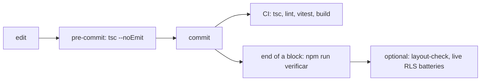

# Testing strategy

> A green test is evidence only about what it can see. Most of this repository's test harness exists because a verified-green state once hid a real defect. The strategy is therefore **layers of tests plus instruments that watch the instruments**.

This page tells you what runs, how to run it, what deliberately does **not** run under `npm test`, and the conventions that keep the suite honest. Failure-class identifiers such as `P19` or `P25` that appear in code comments are explained in [`engineering/failure-patterns.md`](engineering/failure-patterns.md). Decisions behind the harness are in [`decisions/`](decisions/README.md), mainly [ADR 0005](decisions/0005-migration-guards-and-replay.md) and [ADR 0001](decisions/0001-rls-roles-and-column-allowlists.md).

## 1. Running the checks

All commands run from the repository root (Node version in `.nvmrc`).

| Command | What it does | Needs a database? |
|---|---|---|
| `npm test` | `vitest run`: the whole automated suite (jsdom, Testing Library). Script in `package.json`, config in `vitest.config.ts` and `vitest.setup.ts` | No |
| `npx tsc --noEmit` | Type check of the whole tree (strict mode, `noUnusedLocals`, `noUnusedParameters`; see `tsconfig.json`) | No |
| `npm run lint` | `next lint` with `next/core-web-vitals` and `next/typescript` (`.eslintrc.json`) | No |
| `npm run build` | `next build`: production build | No |
| `npm run verificar` | Chains `tsc --noEmit`, `vitest run` and `next build` (`package.json`) | No |
| `npm run verificar:migraciones` | Static verifier over every SQL migration (`scripts/verificar-migracion.mjs`). The full sweep is red by design: it exits 1 with exactly two accepted findings, in frozen and already-applied migrations (`0017` line 183 and `0020` line 729, pinned in `scripts/verificar-migracion.test.ts`). It is not part of `npm run verificar`; run it on a single file for a verdict, and replaying `0017` or `0020` with the applier needs `--saltar-verificacion` | No |
| `npm run layout-check` | Optional headless-browser layout instrument (`scripts/layout-check.mjs`); see [Layout regression guards](#layout-regression-guards) | Yes: a running Supabase stack with ingested data and an existing admin account (`PARCHE_ADMIN_EMAIL` and `PARCHE_ADMIN_PASSWORD`, read from the process environment); it also builds the app and needs a Playwright Chromium |

Why `tsc` is a separate instrument: `vitest` transpiles with esbuild and **does not type-check**, so the suite can be green while `tsc` is red. That failed several times in the project's history, which is why `.githooks/pre-commit` runs only `tsc --noEmit` (fast enough that nobody disables it) and the full triple (`tsc`, tests, build) is the gate at the end of a block of work. The CI workflow `.github/workflows/ci.yml` runs type check, lint, tests and build on every push and pull request.

## 2. Layers

| Layer | What it covers | Where |
|---|---|---|
| Pure unit | ETL parsers, differ, gates, hash, reconcile, normalize, dates, numbers; derivations; notification and email rules; status taxonomy; family parsing; assistant router and redaction; corpus chunking, manifest, secret detector, freshness | `src/services/etl/__tests__/`, `src/lib/**/*.test.ts`, `src/services/derivaciones.test.ts` |
| Service tests with a doubled Supabase client | most `*.service.ts` files against hand-made fakes: pagination, embeds, retries, error mapping, plpgsql-error classification (gaps listed below the table) | `src/services/*.test.ts`, `src/lib/supabase/*.test.ts` |
| Route handler tests | gate order, status codes and error mapping for most routes; the edge middleware (gaps listed below the table) | `src/app/api/**/route.test.ts`, `src/middleware.test.ts` |
| Contract tests | zod schemas (ingestion body), list-envelope convention, API error-code to status map | `src/schemas/refresh.schema.test.ts`, `src/schemas/volcado.schema.test.ts`, `src/lib/hooks/contrato-de-lista.test.ts`, `src/lib/api/errors.test.ts` |
| Component tests | React Testing Library over jsdom with the Radix polyfills | `src/components/**/*.test.tsx`, `src/__tests__/smoke.test.tsx`, `vitest.setup.ts` |
| Fixture-driven ETL tests | frozen grids as JSON, in two families: `muestra/` (sample grids with the geometry of a real workbook) and `edge/` (hand-built degenerate cases) | `src/services/etl/__tests__/fixtures/`, `src/services/ingesta/__tests__/libros-muestra.ts`, `src/services/ingesta/__tests__/fixtures/` |
| Ratchets (tests that read the source) | forbid a class of defect from being written again; see [section 4](#4-ratchets-tests-that-watch-the-code) | listed below |
| Migration tooling | static verifier with positive and adversarial SQL fixtures; applier argument, ledger and splice tests; in-migration guards | `scripts/verificar-migracion.test.ts`, `scripts/fixtures-verificador/`, `scripts/aplicar-migracion.test.ts`, `scripts/fixtures-aplicador/` |
| Document golden / fingerprint tests | PDF and XLSX generators: layout fits the worst case, content is unchanged by presentation changes | `src/services/documento/*.test.ts`, `src/services/documento/fixture-peor-caso.ts`, `src/services/documento/huella.ts`, `src/services/documento/huella-antes.json` |
| Assistant evaluation (offline) | a fixed question set scored against the router with a fake provider; verification of grounded answers | `src/lib/chat/evaluacion.test.ts`, `src/lib/chat/evaluacion-rag.test.ts`, `src/lib/chat/verificar-redaccion.test.ts`, `src/lib/chat/soul-gates.test.ts` |
| Workflow export guard | the exported mail workflow may not carry a key or credential id | `n8n/workflows.test.ts` |

Known gaps in the service and route layers: no test exercises `correo.service.ts` or `drift-familias.service.ts`, and `proyectos.service.ts` is covered only in part. Thirteen of the 39 route handlers have no `route.test.ts`: the two mailing routes under `avisos/envios` (only the digest route is exercised, by the live harness `scripts/correo-negativas.mjs`; the confirmation route has no test at all), `campana`, `corpus/frescura`, `preferencias`, the two `seguimientos` routes and six `proyectos/[id]` routes.

The ETL is tested through `computeSnapshot` in `src/services/etl/runEtl.ts`, which is pure: it receives a catalog index and the previous state (built by `src/services/etl/__tests__/helpers.ts`) and returns the payload, so no database is needed. Persistence is tested separately with doubles (`src/services/etl/__tests__/persist.*.test.ts`), including pagination of the previous-state load and the duplicate-hash path.

## 3. What stays outside `npm test`

Some of the most valuable tests are the ones that bypass the application and talk to the database with real sessions. They need a running Supabase stack, so they are **not** part of the default run.

### Negative RLS tests

Two forms exist.

**SQL negatives** (`supabase/tests/rls_negative_tests.sql`): eight cases, N1 to N8. Each is its own `BEGIN ... ROLLBACK`, seeds its own fixtures and switches role with `SET LOCAL ROLE` so the policies are really evaluated. They cover a KAM writing to an override, to metadata, to families and to the change feed; reading another profile; changing another user's role; an anonymous read; and SKU immutability. Run them one at a time in a SQL console against a local Postgres that has migrations `0001` to `0044` applied in order.

**Live harnesses** (Node scripts that use real JWTs against PostgREST and skip the app on purpose):

| Script | Surface it attacks |
|---|---|
| `scripts/rls-negativas.mjs` | classification layer, technology catalog, pending-data inbox, storage bucket, and the admin RPCs, as `anon` / `kam` / `visitante` |
| `scripts/rls-negativas-proyectos.mjs` | the projects module (ownership RLS, orphan reassignment) |
| `scripts/seguimientos-negativas.mjs` | per-user follow configuration, including "an admin cannot see another user's follows" |
| `scripts/chat-negativas.mjs` | the assistant's usage ledger and rate cap, measured at the function level |
| `scripts/correo-negativas.mjs` | the read-everything mail endpoint (needs a running local server too) and the zero-policy delivery table |

Why bypass the application: it has its own gates, so a green run through it cannot tell "RLS stopped it" from "the route stopped it". The day a route handler is refactored, the database is the only defence left standing, so it is measured directly (headers of `scripts/rls-negativas-proyectos.mjs` and `scripts/seguimientos-negativas.mjs`).

Three rules these harnesses encode:

1. **Denied is asserted by effect, never by status.** Under RLS a denied `SELECT`, `UPDATE` or `DELETE` answers `200 []`; only `INSERT` is loud (`42501`). Every write case is a triplet (read before with a service-role witness, attempt as the role under test, read after) and the assertion is `before === after`. A `SELECT` case also demands that the witness sees rows, so "denied" cannot be confused with "empty table" (header of `scripts/rls-negativas.mjs`).
2. **Throwaway accounts, deleted by the exact id created.** Each run fabricates its own accounts, keeps the ids the API returned and deletes only those ids. The main harness, `scripts/rls-negativas.mjs`, goes further: it counts `auth.users` before and after, caps the radius at two accounts per run and prints the exact ids if cleanup fails. This exists because an earlier version asked the server "which accounts are the test ones" through a filter the server silently ignored (pattern P9).
3. **They do not run in parallel.** They all create throwaway accounts in the same database, but only the main harness, `scripts/rls-negativas.mjs`, balances the `auth.users` count before and after; the other four fabricate and delete their own accounts without counting. An account created by any other process while that count runs unbalances it and aborts the run, with a red that is not the code's fault, so the live harnesses run one at a time (header of `scripts/rls-negativas.mjs`).

The offline half of the first harness *does* run under `npm test`: `scripts/rls-negativas.test.ts` checks the declared matrix (so deleting a case turns the suite red even with no credentials), the pure evaluator against synthetic scenarios (including the "a `DELETE` answered 200 but did change state" scenario), and the latency probe. Its live block ("batería EN VIVO") is opt-in: it runs only when the three Supabase variables are present (the `--check-credenciales` mode of `scripts/rls-negativas.mjs`, which only checks that they exist) **and** `RLS_EN_VIVO=1` is set; otherwise vitest reports it as skipped. That second switch is what keeps `npm test` and CI, whose `.env.example` supplies placeholders with no database behind them, from probing or logging in against a stack that does not exist (guard and comment in `scripts/rls-negativas.test.ts`, note in `vitest.config.ts`). The presence check cannot tell whether the variables point at a live stack: when live mode is requested but the environment is unusable, the block prints an explicit warning and skips its cases instead of failing. To run it: start the local stack, fill `.env.local`, then `RLS_EN_VIVO=1 npx vitest run scripts/rls-negativas.test.ts`.

Running the live harnesses locally means: start a local Supabase-compatible stack, apply the migrations in order, point `NEXT_PUBLIC_SUPABASE_URL`, `NEXT_PUBLIC_SUPABASE_ANON_KEY` and `SUPABASE_SERVICE_ROLE_KEY` at it, then run one script at a time, for example `node --env-file=.env.local scripts/chat-negativas.mjs`. **Never aim them at a hosted account.** `vitest.config.ts` injects fake Supabase credentials into `test.env` so no in-process test can reach a real project, and a ratchet (`src/lib/supabase/suite-sandbox.test.ts`) stops a test from spawning a child process that would inherit or load real ones.

### Scripts that touch live services

These are never run as part of testing: `scripts/aplicar-migracion.mjs` (applies a migration to a database), `scripts/bootstrap-admin.mjs` (creates the first administrator), `scripts/chat-sonda-proveedor.mjs` (calls the model provider), `scripts/corpus-sync.mjs` (writes the assistant's document index) and `scripts/ingesta-mensual.mjs --aplicar` (posts workbooks to an ingestion endpoint). Where they have tests (`scripts/aplicar-migracion.test.ts` covers argument parsing, the ledger splice and the `--dry` mode), the live mode is still an operator tool.

### What backs the security claims without a stack

Because the live harnesses are optional, a reader without a stack should know what backs the security claims in that case: the SQL negatives, the declared matrix and evaluator tests above, and the **guards inside the migrations themselves**, which read the catalog and abort the transaction if the intended privilege state was not reached (see [ADR 0005](decisions/0005-migration-guards-and-replay.md)). That is evidence of design and of state at apply time, not of a run against your stack, and the repository does not claim more.

## 4. Ratchets: tests that watch the code

A ratchet reads the **source files** and fails when a class of defect becomes writable again. Each one names the defect that justified it, so none is arbitrary.

| Ratchet | Prevents |
|---|---|
| `src/lib/guardas/codigo-fuente.ts` (shared helper, tested by `codigo-fuente.test.ts`) | guards that accidentally scan comments and string literals and pass or fail for the wrong reason: every source-reading guard uses it |
| `src/app/sin-handlers-en-server.test.ts` | a Server Component passing an event handler to a Client Component, which hangs the page while every render test stays green (the RSC boundary does not exist in jsdom) |
| `src/lib/una-sola-verdad-temporal.test.ts` | a second date formatter outside the two sanctioned homes (`src/lib/formato.ts`, `src/lib/fechas.ts`), which makes one datum render as two dates |
| `src/lib/supabase/no-memoizacion.test.ts` | memoizing the retrying database client at module level, which silently spends the retry budget once per process |
| `src/lib/supabase/suite-sandbox.test.ts` | a test spawning a child process that reaches real credentials |
| `src/lib/supabase/plpgsql-declaradas.test.ts` | a plpgsql function using a `v_*` variable it never declares: it compiles, fails at run time and no other test sees it. It checks only each function's latest definition |
| `src/lib/supabase/orden-estable.test.ts` | `LIMIT/OFFSET` pagination without `ORDER BY`; a counter that cannot go up without failing inventories the remaining sites |
| `src/lib/guardas/opacidad-que-no-pinta.test.ts` | utility classes that name a colour but generate no CSS |
| `src/app/globals-tema.test.ts`, `src/components/alcanzabilidad.test.tsx` | theme-token and reachability regressions |
| `scripts/guarda-lista-blanca.mjs` (an operator script, not a test: run it on demand with `DATABASE_URL`; it is not part of `npm test` or CI, and without a database it reports no verdict and exits 2) | any user-session direct write on a column-allowlisted table (see [ADR 0001](decisions/0001-rls-roles-and-column-allowlists.md)) |
| `n8n/workflows.test.ts` | an exported workflow carrying a literal key or credential id |
| `src/lib/corpus/secretos.test.ts`, `src/services/corpus.service.test.ts` | the document indexer letting a secret-shaped string through (these tests contain deliberately fake credential-shaped strings) |
| in-migration `DO $$` guards | a migration that "applies" but does not reach the intended catalog state, for example `supabase/migrations/0012_b7b_hardening.sql`, `0020_repro_truncate_guarda_pendientes_creado_en.sql`, `0042_rolsoporte_lista_blanca_de_escritura.sql` |

Companion rule: **a guard is not credible until it has been seen failing**. The repository treats "a guard that cannot fail" and "a guard that cannot pass" as separate failure classes (P19 and P21) and prefers a positive control next to every negative one ("this cannot" beside "this can"). Every ratchet above declares its own limit in its header, for example "text scan, not a syntax tree".

## 5. Determinism and isolation

- `vitest.config.ts` pins the test time zone to a fixed civil zone, so date helpers give the same answer on any machine, and injects fake Supabase credentials and a fake ingestion secret.
- Each `vitest` run writes its **own** JSON result file with a timestamp (`reporters: ['default','json']`, `outputFile` in `vitest.config.ts`, folder `.vitest/`, ignored by git). `node scripts/ultimo-rojo.mjs` prints the last red run. The reason is practical: a red run once lost its identity because re-running was the only way to see it again, and a fixed file name would have been overwritten by the next green run.
- A suite is declared green only if the summary shows zero failed **test files** and the process exit code is 0. A bare "N passed" line, or a truncated output, is not evidence: a failure at collection time can sit beside a passing count.

## Synthetic fixtures

The repository ships no operational data. Test inputs are invented and fall into three groups.

1. **Workbook grids** in `src/services/etl/__tests__/fixtures/muestra/` (inventory, a five-level inventory variant, the second-warehouse sheet, the reservation matrix, shipments sheets) reproduce the *geometry* of a real workbook: banner rows, a left gutter, the header row, two eras of header spelling and European decimals. The `edge/` grids are hand-built degenerate cases.
2. **Workbooks.** The sample-data generator (`scripts/generar-datos-muestra.mjs`, run with `npm run datos:muestra`) produces example `.xlsx` files with the structure of the real inputs and invented values from a fixed seed, written to the git-ignored `muestra/` folder, so the ingestion path can be exercised end to end without any real file. The vitest `globalSetup` (`scripts/datos-muestra/global-setup.mjs`, wired in `vitest.config.ts`) writes those workbooks before the suite is collected, so a fresh clone or CI does not skip the integration suites that look for them (`src/services/ingesta/__tests__/libros-muestra.ts`). The only checked-in workbook fixture is `src/services/ingesta/__tests__/fixtures/cero-hojas.xlsx`, a degenerate file with no sheets.
3. **Document goldens.** `src/services/documento/fixture-peor-caso.ts` is the "worst case" project that the PDF layout is fitted against (longest unbreakable tokens, longest descriptions, negative availability). `src/services/documento/huella.ts` reduces a PDF and an XLSX to a canonical fingerprint that is stable under reflow, so a change of presentation can be proven not to have changed content.

A fixture proves your understanding of the input, not your code (pattern P26). That is why the ETL has both families of grids, and why the contract tests build their request bodies the way the production code does instead of fabricating them (`src/schemas/refresh.schema.test.ts`).

## QA conventions and regression gates

Beyond the automated suite the project kept a **manual QA catalogue**: numbered cases, each with role, precondition, steps, expected result and the test or code location that backs it. The catalogue itself is not shipped; the convention is.

- **ID format.** `QA-<AREA>-<nn>`, one fixed area code per section, consecutive two-digit numbers, never renumbered. Areas covered authentication and roles, user administration, catalogue, SKU detail sheet, cross view, images, classification layer, ingestion, dashboard, pending-data inbox, regression, shipments ledger, snapshot log and security.
- **Permanent gate.** No feature is signed off without its new `QA-*` entries. The change author states the new behaviour; the closing validator writes the entries with real evidence ("tested" with no trail does not count); the approval references the new IDs; a case that no longer applies is marked `[DEPRECATED - reason]` and never deleted, because history matters as much as the present.
- **Evidence beats assertion.** "Measured" requires the query or command that produced the number. Figures that were not measured are removed from the finding; the finding stands without them (pattern P29).
- **Failure catalogue.** Before designing a block, list which failure patterns apply and which detector will be installed for each; at close, add the new case. See [`engineering/failure-patterns.md`](engineering/failure-patterns.md).
- **Regression gate commands.** `npx tsc --noEmit`, `npm test`, `npm run build` (exit 0, no warnings), chained by `npm run verificar`.

Criteria that came out of real failures and are worth keeping:

- **Ingestion**: exercise the degenerate inputs (empty sheets, a header-only sheet, non-workbook bytes, a missing column) and prove the two ingestion doors equivalent. See [`ingestion.md`](ingestion.md).
- **Authentication**: anonymous callers get 401 before the body is touched on every route except `/api/version`, which is public on purpose (build metadata, no business data); the machine routes (the two ingestion doors and the two mailing routes) answer 401 to a missing or wrong shared-secret header (500 `config_error` when the server has no secret configured). Non-admin roles get 403 on every admin write route, while the own-data routes (projects, follows, preferences, assistant) accept every role, except that `visitante` cannot write projects. A missing profile row means 403 (fail closed); the ingestion endpoint is service-to-service only.

## Orphaned dev server

A stale development server can keep answering on its port with an HTML 500 page while the handler never runs, which looks exactly like an application bug (pattern P1). Hygiene: run a single dev server, stop it by process tree and verify no survivor remains, and make smoke checks shout "broken environment" when a 5xx answer is not JSON. Do not build while your own server serves the same build folder; see [`ai-assisted-workflow.md`](ai-assisted-workflow.md) for separate build directories.

## Layout regression guards

jsdom has no layout engine, so component tests can assert class names but not that something *fits*. `scripts/layout-check.mjs` fills that gap: it builds the production app into `NEXT_DIST_DIR` (default `.next`, shared with `next dev` and `next start`; export `NEXT_DIST_DIR=.next-lc` to isolate it), signs in as an existing admin account of a running stack, opens the real pages in headless Chromium at six viewport widths and two states, and evaluates mechanical predicates (unreadable truncation, page-wide horizontal overflow, a collapsed navigation region, two interactive floating containers overlapping) defined in `src/lib/layout-check/predicados.ts`; scenarios are in `src/lib/layout-check/escenarios.ts` and the verdict logic is unit-tested (`src/lib/layout-check/veredicto.test.ts`). It is run on purpose (`npm run layout-check`), deliberately not in CI or a hook: a slow gate is a gate somebody disables. It declares its own gaps in its headers, and a case that cannot be measured is reported as "not measured", never as "no violations".
